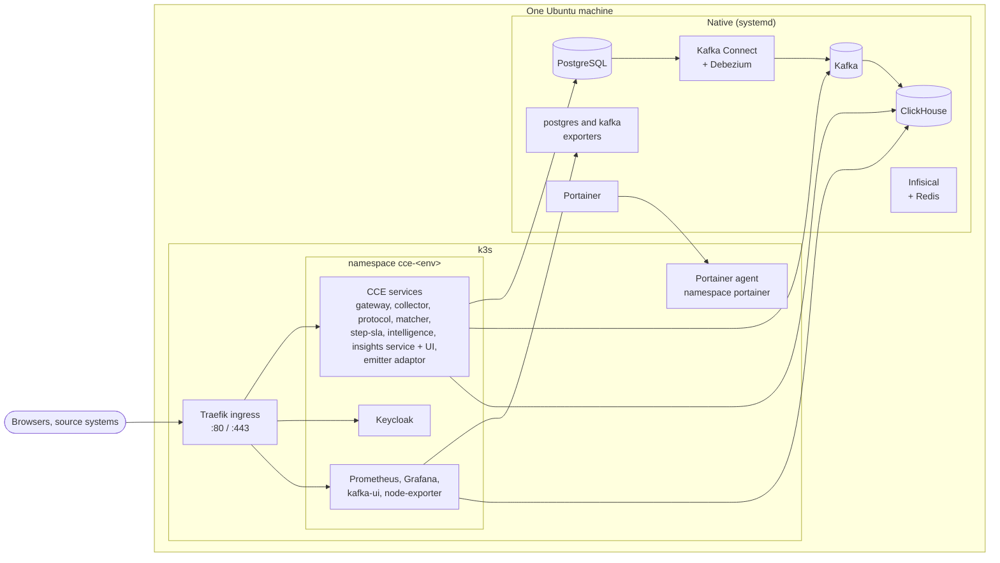
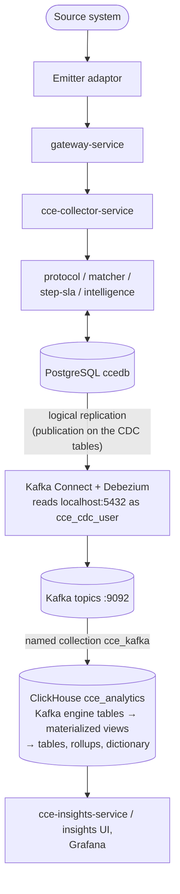
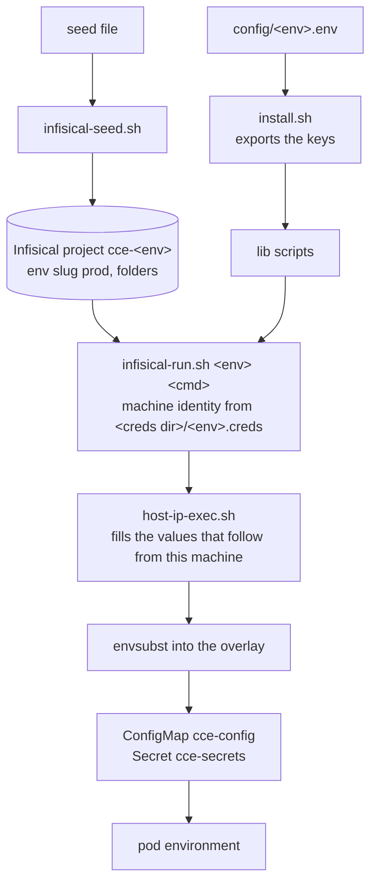
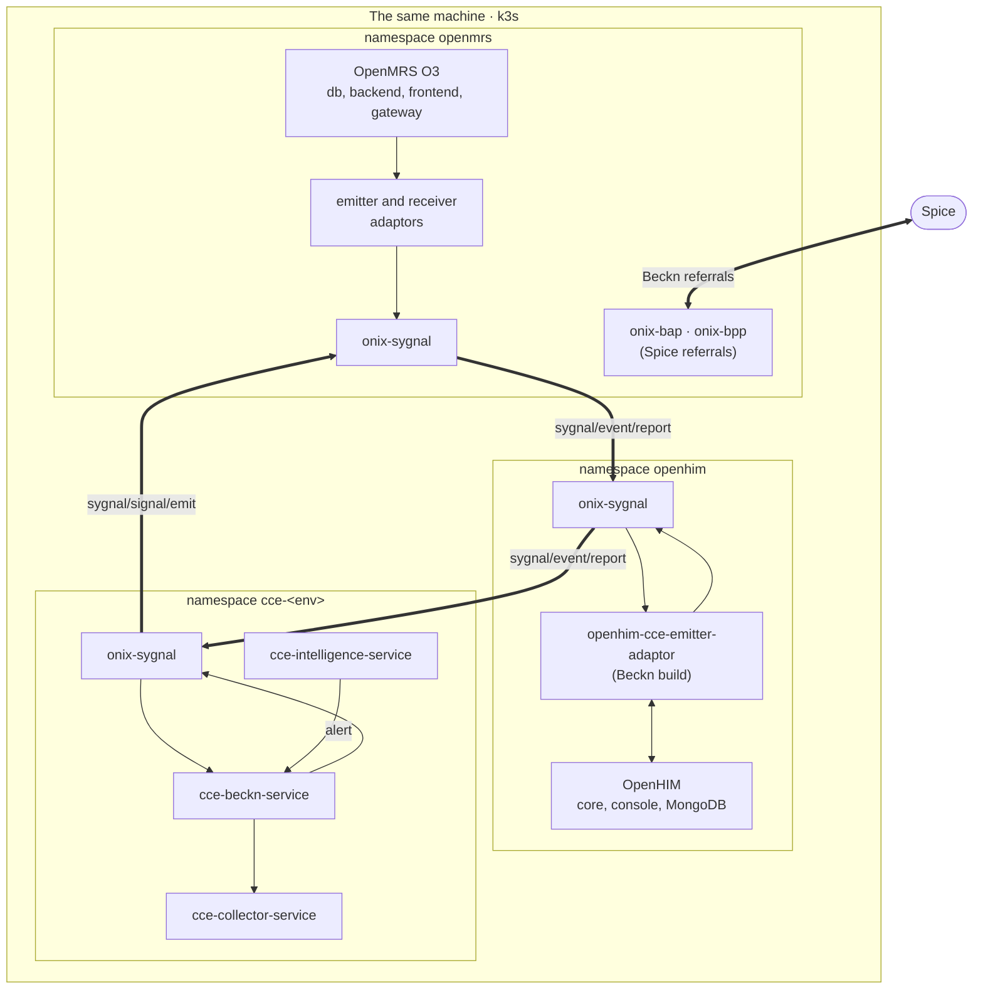

# What ends up on the machine

A short picture of a finished install with the default config. For the phase list see the
[top-level README](../README.md#phases); for each script see [docs/README.md](README.md).

- [Two halves](#two-halves)
- [Data flow](#data-flow)
- [Configuration and secrets flow](#configuration-and-secrets-flow)
- [With the Beckn add-on](#with-the-beckn-add-on)
- [Network exposure](#network-exposure)
- [Files and directories worth knowing](#files-and-directories-worth-knowing)

## Two halves



Pods reach the native services on the machine's IP; everything else stays on the machine.

| Native service (systemd) | Listens on |
|---|---|
| `postgresql` | :5432 |
| `kafka` (KRaft) | :9092, :9094 (controller) |
| `clickhouse-server` | :8123, :9000, :9009, :9363 (metrics) |
| `kafka-connect` | 127.0.0.1:8083 |
| `cce-postgres-exporter` | :9187 |
| `cce-kafka-exporter` | :9308 |
| `infisical-core` | 127.0.0.1:8080 |
| `redis-server` | 127.0.0.1:6379 |
| `cce-portainer` | :9443 (kernel-limited) |

| In k3s | What |
|---|---|
| namespace `cce-<env>` | `gateway-service`, `cce-collector-service`, `cce-protocol-service`, `cce-matcher-service`, `cce-step-sla-service`, `cce-intelligence-service`, `cce-insights-service`, `cce-insights-ui`, the emitter adaptor of `EMITTER_ADAPTOR` (for example `openhim-emitter-adaptor`), `keycloak`, `grafana`, `prometheus`, `kafka-ui`, `node-exporter` (:9100) |
| namespace `kube-system` | k3s itself: API :6443, Traefik ingress on :80 / :443 |
| namespace `portainer` | the Portainer agent (ClusterIP :9001) |

- **Native:** the data stores and anything that must reach them on `localhost`. Installed by
  [lib/native/01–03, 07](native.md), [infisical-native.sh](lib-infisical.md#infisical-nativesh) and
  [portainer.sh](lib-install.md#portainersh).
- **k3s:** the CCE application services, Keycloak and the monitoring UI. Defined by the overlay
  `k8s/overlays/<OVERLAY_NAME>` (a copy of the reference production overlay), deployed by
  [05-k8s-deploy.sh](native.md#05-k8s-deploysh).
- With the defaults, **docker is not installed** and nothing runs in a container outside k3s.

Pods reach the native services on the machine's IP (`VM_HOST_IP`, detected at deploy time). The NetworkPolicy
allows pod egress to that address only on the data and metrics ports.

## Data flow



- The CCE services also use Kafka directly (`KAFKA_BOOTSTRAP_SERVERS` in `cce-config`): the collector publishes the
  inbound events, the matcher reads them, and the step SLA service publishes the triggers the intelligence service acts on.
- The ClickHouse schema and the CDC setup come from `data-pipeline/` ([04-data-pipeline.sh](native.md#04-data-pipelinesh)).
- Prometheus (in k3s) scrapes the services, node-exporter, ClickHouse `:9363`, and the two host exporters.

## Configuration and secrets flow



`host-ip-exec.sh` fills `VM_HOST_IP`, `VM_HOST_CIDR`, `POSTGRES_HOST`, `KAFKA_BOOTSTRAP_SERVERS`, `CLICKHOUSE_HOST`
and `CCE_PUBLIC_URL` (`https://<INGRESS_HOST>`, or `http://<this machine's IP>` without one), each only when Infisical
holds no value for it.

Infisical is the source of truth for runtime values. Changing a value means: change it in Infisical, then
[redeploy.sh](lib-day2.md#redeploysh). The machine's IP is never stored; it is detected each time.

## With the Beckn add-on

`install-beckn.sh` is optional and runs after `install.sh`. It makes CCE, and if you host them here OpenHIM and
OpenMRS, participants of a network: clinical events reach CCE as signed `sygnal/event/report` messages, and CCE's care
alerts leave as `sygnal/signal/emit`. It changes none of the above; it adds to it. The reference is
[beckn.md](beckn.md); the demo setup is explained in [beckn-demo-setup.md](beckn-demo-setup.md).



Thick arrows cross a public HTTPS address (Traefik) and are signed by the sender's adapter and checked by the
receiver's. Thin arrows are plain HTTP inside one namespace.

| Where | What the add-on adds |
|---|---|
| namespace `cce-<env>` | `cce-beckn-service`, `onix-sygnal`, `onix-redis`. The CCE services are not changed |
| namespace `openhim` (`BECKN_OPENHIM_NAMESPACE`) | `openhim-core`, `openhim-console`, `openhim-mongo`, the Beckn build of `openhim-cce-emitter-adaptor`, `onix-sygnal`, `onix-redis` |
| namespace `openmrs` (`BECKN_OPENMRS_NAMESPACE`) | `openmrs-db` (MariaDB), `openmrs-backend`, `openmrs-frontend`, `openmrs-gateway`, `openmrs-cce-emitter-adaptor`, `openmrs-cce-receiver-adaptor`, `onix-sygnal`, `onix-redis`, and `onix-bap` / `onix-bpp` for the referrals with Spice |
| Infisical | folder `/beckn`: the adapters' private keys, the OpenHIM and OpenMRS logins, database passwords, the alert webhook secret |
| Native services | nothing. OpenHIM's MongoDB and OpenMRS's MariaDB run as pods with their own volumes |

Two things differ from the data flow above:

- **A second way in.** An event that arrives over the network goes `onix-sygnal` → `cce-beckn-service` →
  `cce-collector-service`, inside the CCE namespace: no gateway and no token. The adapter has already checked the
  sender's signature and network membership. From the collector on, the flow is the one above.
- **A way out.** The intelligence service posts a care alert to `cce-beckn-service` (`/v1/alerts`), which sends it
  through `onix-sygnal` to the HMIS.

The emitter adaptor of `EMITTER_ADAPTOR` in the CCE namespace is a different deployment from the Beckn build in the
`openhim` namespace. The first posts to the gateway with a token; the second has no access to the collector and reaches
CCE only through the adapters.

## Network exposure

Layers, outermost first:

1. **Cloud firewall / security group** (when `IS_CLOUD_DEPLOYMENT=true`) — yours to configure: allow only 22, 80, 443.
2. **UFW** (when `IS_CLOUD_DEPLOYMENT=false`) — [ufw-baseline.sh](lib-install.md#ufw-baselinesh): default deny inbound;
   22/80/443 public; everything from the pod, service and docker networks allowed.
3. **DOCKER-USER block** — [cce-docker-fw.sh](lib-install.md#cce-docker-fwsh-and-cce-docker-fwservice), only when docker
   is installed: the public interface cannot open new connections into docker bridges.
4. **Per-service binding** — Infisical, Redis and the Kafka Connect REST API listen on 127.0.0.1 only; ClickHouse's
   password-less `default` user is restricted to loopback; Portainer is limited by systemd `IPAddressAllow` to
   localhost and the k3s networks; the Portainer agent is a ClusterIP.
5. **Kubernetes NetworkPolicy** — limits pod egress to the host's data and metrics ports. The add-on's `openhim` and
   `openmrs` namespaces have their own policy: own namespace, `kube-system` and public addresses only, so participants
   reach each other through their public addresses even on one machine.

What listens on **all interfaces** and therefore depends on layer 1 or 2: PostgreSQL 5432 (password auth, pg_hba
allows the k3s networks), Kafka 9092/9094 (no authentication), ClickHouse 8123/9000/9009/9363 (pipeline user with a
password), postgres_exporter 9187, kafka_exporter 9308, node-exporter 9100, k3s API 6443. With
`IS_CLOUD_DEPLOYMENT=true`, install.sh prints this list in phase 7 as a reminder. After every install, check from
**outside** the network:

```bash
nmap -Pn <public-ip>      # only 22, 80, 443 should be open
```

What Traefik publishes on 80/443:

| Host | Paths | Goes to |
|---|---|---|
| `INGRESS_HOST` | `/insights`, `/v1`, `/auth`, `/grafana`, `/kafka-ui` | insights UI, gateway, Keycloak, Grafana, kafka-ui |
| every `BECKN_<P>_HOST` (add-on) | `/sygnal/receiver` | that participant's `onix-sygnal` |
| `BECKN_OPENMRS_HOST` (add-on) | `/bap/receiver`, `/bpp/receiver`; `/` | OpenMRS's `onix-bap` / `onix-bpp`; the OpenMRS app and its REST and FHIR APIs |
| `BECKN_OPENHIM_HOST` (add-on) | `/`, `/openhim-api` | the OpenHIM console and the Core API it calls |

The adapters' `/sygnal/caller`, `cce-beckn-service`, the adaptors' own endpoints and OpenHIM's channel ports are not
published: they carry no token of their own, and only pods of the same namespace reach them.

## Files and directories worth knowing

| Path | What |
|---|---|
| `k8s/overlays/<OVERLAY_NAME>/` | the environment's overlay (git-tracked; commit it) |
| `data-pipeline/.deployed-ref` | which data-pipeline ref was synced, if any |
| `BECKN_SCHEMA_DIR` (add-on) | folder with the CCE Sygnal profile (`sygnal-profile/`: `cce-sygnal-apis.yaml` and `cce-fhir-extension.yaml`) and the referral box's schema (`CoordinationEvent/`), when they are not fetched from `BECKN_SCHEMA_REPO` |
| `BECKN_OPENMRS_HOST_DIR`, default `/opt/openmrs` (add-on) | OpenMRS's frontend site files, mounted into the frontend pod |
| `<home>/.cce-infisical/<env>.creds`, `.meta` | machine-identity login and project id (root, 0600) |
| `/opt/cce-local-infisical/.env`, `admin.env` | local Infisical keys and org-admin login (0600) — **back up** |
| `/etc/infisical/infisical.rb` | native Infisical config (contains keys, 0600) |
| `/opt/kafka/`, `/var/lib/kafka/data` | Kafka install and data |
| `/opt/kafka/config/kraft/server.properties`, `connect-<env>.properties` | Kafka broker and Connect config |
| `/etc/clickhouse-server/config.d/cce-<env>.xml`, `users.d/cce-<env>-users.xml` | ClickHouse config and pipeline user |
| `/etc/cce-exporters/` | exporter environment files (DB password) |
| `/opt/portainer-<version>/`, `/var/lib/portainer` | Portainer binary and data |
| systemd units | `postgresql`, `kafka`, `kafka-connect`, `clickhouse-server`, `redis-server`, `infisical-core` (via `infisical-ctl`), `cce-postgres-exporter`, `cce-kafka-exporter`, `cce-portainer`, `k3s`; `cce-docker-fw` only with docker |
