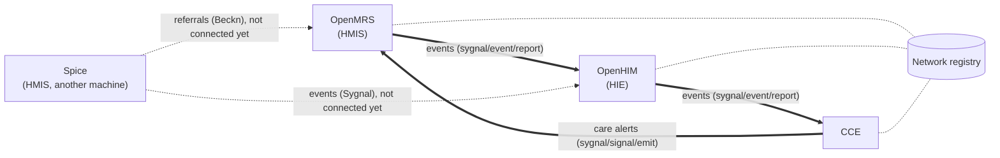
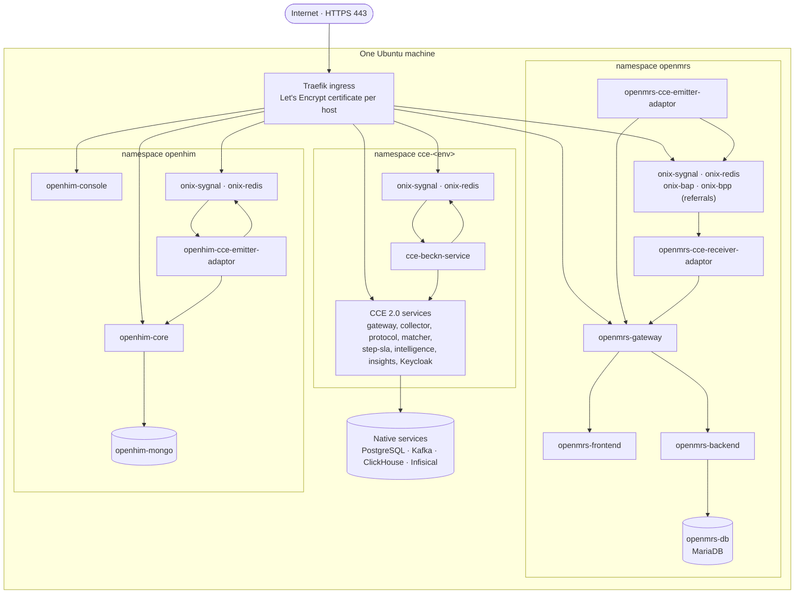
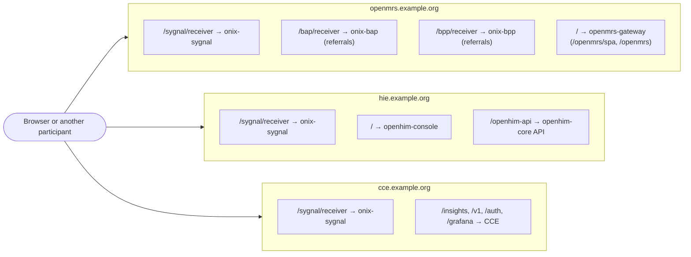
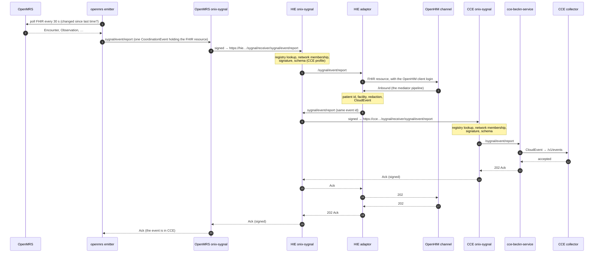
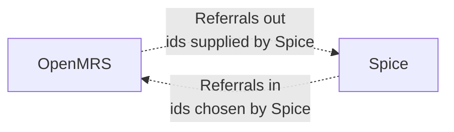
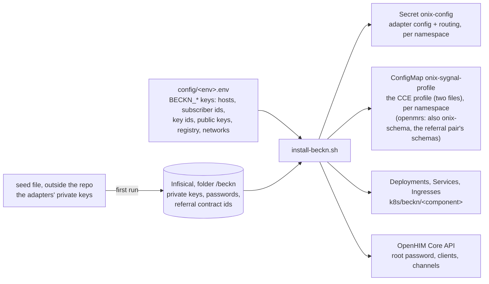
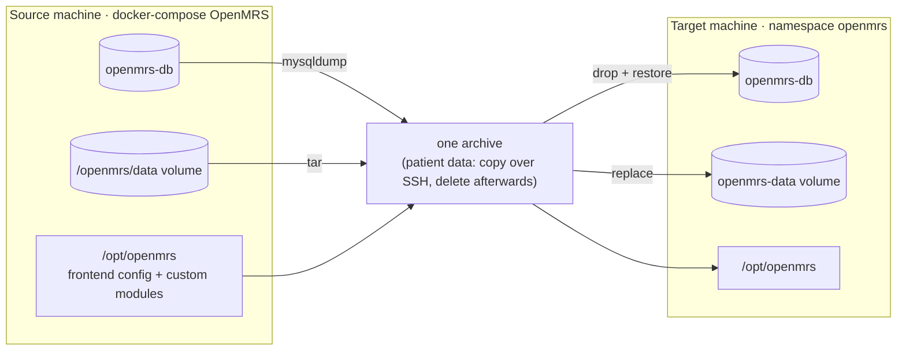

# Beckn demo setup: deployment architecture

This page explains how the CCE Beckn demo (CCE flows on Sygnal, Spice referrals on Beckn) is put together: who the participants are, what runs where, how one clinical
event travels from OpenMRS to CCE, and how to run and check the demo. It is the place to start if you need to understand
or present the setup.

- To install or change it, use the reference: [beckn.md](beckn.md) (every config key, secret, script and error).
- Host names here are examples (`cce.example.org`, `hie.example.org`, `openmrs.example.org`). The real hosts and ids of
  an environment are in its config file, which is not in git. [Values of an environment](#values-of-an-environment)
  shows how to print them.

Contents

- [What the demo shows](#what-the-demo-shows)
- [The participants](#the-participants)
- [Deployment architecture](#deployment-architecture)
- [Network: what is public, what is not](#network-what-is-public-what-is-not)
- [How one event travels](#how-one-event-travels)
- [Trust: registry, network, keys, schemas](#trust-registry-network-keys-schemas)
- [Contracts (referrals only)](#contracts-referrals-only)
- [Configuration and secrets](#configuration-and-secrets)
- [The data in each system](#the-data-in-each-system)
- [Running the demo](#running-the-demo)
- [Differences from the dev environment](#differences-from-the-dev-environment)
- [Status and open points](#status-and-open-points)
- [Values of an environment](#values-of-an-environment)

## What the demo shows

A clinician saves something in **OpenMRS** (the HMIS). The change reaches **CCE** as a clinical event, and CCE confirms
it — without OpenMRS, the HIE or CCE calling each other's private APIs. When a care step needs attention, CCE sends a
**care alert** back to OpenMRS the same way. Each of the three is a participant of a network: they exchange signed
**Sygnal** messages (the CCE profile: `sygnal/event/report` and `sygnal/signal/emit`) through their own ONIX adapters and
find each other's keys in the network registry.

The **health referrals between Spice and OpenMRS** are a separate flow on standard **Beckn** (`select` / `init` /
`confirm` / `status` / `update`), through OpenMRS's Beckn adapter pair. The actions did not change. The clinical event
in `update`, `on_update` and `on_status` is a `sygnal:CoordinationEvent`, the same object as in `sygnal/event/report`
(it was a `cce:CceClinicalEvent` box; Spice changes at the same time:
[beckn.md → Change 2026-11-23: the profile in two files, and the referral box](beckn.md#change-2026-11-23-the-profile-in-two-files-and-the-referral-box)). The pair runs
onix 1.9.4 (1.6.1 before), and Spice's referral adapter must too
([beckn.md → Change 2026-11-23: the referral adapters on onix 1.9.4](beckn.md#change-2026-11-23-the-referral-adapters-on-onix-194)).

| In the demo | Not in the demo yet |
|---|---|
| OpenMRS → HIE → CCE events, end to end; the `Ack` comes back in the same call | Spice: events to the HIE, alerts from CCE, referrals with OpenMRS ([status](#status-and-open-points)) |
| Care alerts CCE → OpenMRS, raised as OpenMRS notifications | |
| Signature and schema checks at every hop | |
| OpenHIM still authenticates and logs every event | |

## The participants

For the CCE flows each participant has **one Sygnal identity** (one subscriber record) and one Sygnal adapter. OpenMRS
also keeps its BAP and BPP records and its Beckn adapter pair for the Spice referrals.

| Participant | Sygnal: sends / receives | Own services | Source repository · branch | Image tag |
|---|---|---|---|---|
| **OpenMRS** | sends `sygnal/event/report` to the HIE; receives `sygnal/signal/emit` (alerts). Beckn referrals with Spice (BAP + BPP) | OpenMRS O3 3.6.0 (MariaDB, backend, frontend, gateway), `openmrs-cce-emitter-adaptor`, `openmrs-cce-receiver-adaptor` | [openmrs-cce-emitter-adaptor](https://github.com/openphc/openmrs-cce-emitter-adaptor/tree/demo-beckn) · `demo-beckn`, [openmrs-cce-receiver-adaptor](https://github.com/openphc/openmrs-cce-receiver-adaptor/tree/demo-beckn) · `demo-beckn` | `demo-beckn-latest` |
| **HIE** (OpenHIM) | receives `sygnal/event/report` from each HMIS; sends it on to CCE | OpenHIM Core 8.5.1 + console + MongoDB, `openhim-cce-emitter-adaptor` (its Beckn build is also the OpenHIM mediator) | [openhim-cce-emitter-adaptor](https://github.com/openphc/openhim-cce-emitter-adaptor/tree/demo-beckn) · `demo-beckn` | `demo-beckn-latest` |
| **CCE** | receives `sygnal/event/report`; sends `sygnal/signal/emit` | `cce-beckn-service`, in front of the CCE 2.0 services that `install.sh` deploys | [cce-beckn-service](https://github.com/openphc/cce-beckn-service/tree/demo) · `demo` | `latest` / `v<N>` |
| all three | — | Sygnal adapter `onix-sygnal` + Redis; OpenMRS also `onix-bap`, `onix-bpp` | [DHP-Specs](https://github.com/openphc/DHP-Specs) · `openmrs-onix`, `openhim-onix`, `cce-onix` (the reference configs, registered ids and keys) | `fidedocker/onix-adapter:1.9.4` (the Sygnal adapters and OpenMRS's referral pair) |

The message content is defined in [cce-beckn-service/schema](https://github.com/openphc/cce-beckn-service/tree/demo/schema):
the CCE profile of Sygnal, `sygnal-profile/v3.0/`. It is CCE's copy of the Sygnal schema: the two actions, their
context and answers, and Sygnal's two payload types opened and extended for CCE (Sygnal's published schema is not
changed). It is two files: `cce-sygnal-apis.yaml` (Sygnal's own fields) and `cce-fhir-extension.yaml` (the fields CCE
adds for FHIR), which the first refers to; a message must match both. The one entry of `message.events` in
`sygnal/event/report` is a `sygnal:CoordinationEvent` with the fields of a clinical event added to it: the patient
id, the FHIR version and one FHIR resource, next to Sygnal's own event id and time. The `message` of `sygnal/signal/emit` is a `sygnal:Signal` with the fields of a care alert added
to it: the patient id, the care step and SLA status, and the FHIR `CommunicationRequest` or `Task`. There is no bag and
no `cce:` type in these messages. The Spice ↔ OpenMRS referral legs (standard Beckn) carry the same
`sygnal:CoordinationEvent` in `performanceAttributes`, with an `@context` first; its schema is `CoordinationEvent/v3.0`
in that folder. `CceClinicalEvent` and `CceCareAlert` are deleted from it. Until that repository's pull
request #7 is merged, `demo` shows only profile v1.0, and the v3.0 files and `CoordinationEvent/v3.0` are on its branch
`cce-payload-types`
([beckn.md → Change 2026-11-23: the Sygnal payloads](beckn.md#change-2026-11-23-the-sygnal-payloads),
[beckn.md → Change 2026-11-23: the profile in two files, and the referral box](beckn.md#change-2026-11-23-the-profile-in-two-files-and-the-referral-box)).

## Deployment architecture

All three participants run on **one machine**, the one `install.sh` set up, in three Kubernetes namespaces of its k3s.
They are still isolated from each other: a NetworkPolicy per namespace lets pods talk only to their own namespace, to
`kube-system` and to public addresses. So a message from one participant to another always leaves through the sender's
adapter and enters through the receiver's public address, exactly as it would between three machines.

| Namespace | Deployments | Storage |
|---|---|---|
| `openmrs` | `openmrs-db`, `openmrs-backend`, `openmrs-frontend`, `openmrs-gateway`, `openmrs-cce-emitter-adaptor`, `openmrs-cce-receiver-adaptor`, `onix-sygnal`, `onix-redis`, and for the Spice referrals `onix-bap`, `onix-bpp` | volumes: database, `/openmrs/data`, the emitter's checkpoint. Node folder `/opt/openmrs`: frontend config and custom frontend modules |
| `openhim` | `openhim-mongo`, `openhim-core`, `openhim-console`, `openhim-cce-emitter-adaptor`, `onix-sygnal`, `onix-redis` | volume: MongoDB |
| `cce-<env>` | added by the Beckn add-on: `cce-beckn-service`, `onix-sygnal`, `onix-redis`. Already there: the CCE 2.0 services | none added. CCE's data is in the native PostgreSQL, Kafka and ClickHouse |

The manifests are in [`k8s/beckn/`](../../k8s/beckn): `onix/` (the Sygnal adapter, shared by all three), `onix-beckn/`
(OpenMRS's Beckn referral pair), `cce/`, `openhim/`, `openmrs/`, `netpol/`. Sizing is small on purpose (about 0.75 vCPU of requests for everything the add-on adds): the
machine already carries a production-sized CCE.

## Network: what is public, what is not

Each participant has one public host. Traefik terminates TLS and routes by host and path.

| Public | Reachable only inside its namespace |
|---|---|
| `/sygnal/receiver` of every participant — its Sygnal address, the `context.receiverUri` its peers send to; OpenMRS also `/bap/receiver`, `/bpp/receiver` for the referrals. The adapter checks the signature of everything that arrives | `/sygnal/caller` of every Sygnal adapter, `/bap/caller` and `/bpp/caller` of OpenMRS's referral pair (a participant's own services send through them) |
| The OpenMRS app and API | The adaptors' `/sygnal/**` and `/beckn/**` endpoints and `cce-beckn-service` (they carry no token: the adapter in front has already checked the signature) |
| The OpenHIM console and its Core API | OpenHIM's channel ports (5000 HTTPS, 5001 HTTP) |
| CCE: Insights, API gateway, Keycloak, Grafana | Databases, Redis, MongoDB |

One detail of a single-machine setup: a pod cannot reach the machine's own public address. So each adapter pod has host
aliases that point the three public hosts at Traefik's in-cluster address. The request still goes through Traefik with
the host's real certificate, so nothing else changes.

## How one event travels

About nine hops, **one synchronous HTTP call**: every hop waits for the hop behind it, and the `Ack` (or `Nack`) travels
back the same way. There is no queue and there are no callbacks.

| Step | Who | What happens |
|---|---|---|
| 1–2 | OpenMRS emitter | Polls OpenMRS FHIR for `Patient`, `RelatedPerson`, `Encounter`, `Observation`, `Condition`, `ServiceRequest`, `MedicationRequest`, `MedicationDispense`. A new emitter starts from "now": history is not sent. A patient without a national id is skipped |
| 3 | OpenMRS emitter | Puts the resource, unchanged, in one `sygnal:CoordinationEvent` (event id, time, patient id, the resource), the only entry of `message.events`, and posts `sygnal/event/report` to its adapter, with the HIE's id and address as `receiverId` / `receiverUri` |
| 4 | the two adapters | The sender's adapter signs. The receiver's adapter looks the sender up in the registry, checks network membership, the signature and the schema |
| 5–7 | HIE adaptor + OpenHIM | The adaptor checks that the sender is in its subscriber list, takes the FHIR resource out and posts it to the OpenHIM channel `CCE Beckn feed`. OpenHIM authenticates the client, logs the transaction and routes to the adaptor's `/inbound` |
| 7 | HIE adaptor (mediator pipeline) | The existing pipeline: source, patient id, facility, redaction (off by default), CloudEvent |
| 8–9 | HIE adaptor, adapters | Sends the event on to CCE as `sygnal/event/report`, with the same event id. Signed and checked as in step 4 |
| 10–12 | CCE | `cce-beckn-service` builds CCE's own CloudEvent (`source` = the HIE's id, `subject` = the patient id) and posts it to the collector. No gateway, no token: both are inside the CCE namespace |
| 13–20 | everyone | The collector's answer becomes the `Ack` and returns hop by hop. The emitter's `Ack` therefore means: CCE has the event. A resend carries the same event id and is recognised |

A **care alert** takes the short way: the intelligence service posts it to `cce-beckn-service` (`/v1/alerts`), which sends
`sygnal/signal/emit` — its `message` is the alert itself, a `sygnal:Signal` with the alert's fields and FHIR resource
on it — through CCE's adapter straight to OpenMRS's `https://openmrs…/sygnal/receiver`; OpenMRS's adapter passes it to
the receiver adaptor, which raises an OpenMRS notification and answers `Ack` in the same call. A repeated alert has the
same `id` (it is also `context.messageId`).

Because every hop waits, each wait is set longer than the one inside it: from 15 s at the collector to 50 s at the
emitter (alerts: 5 s → 7 s). The values are in [beckn.md → The timeout chain](beckn.md#the-timeout-chain).

## Trust: registry, network, keys, schemas

| Thing | What it is | Where it is configured |
|---|---|---|
| Network registry | The public directory of subscribers. An adapter looks a sender up by subscriber id and key id and gets its public key and network memberships. Delivery does not use the record's URL: the sender puts the receiver's address in the message | `BECKN_REGISTRY_URL` |
| Sygnal network | `sygnal.nextsteps.mdtlabs.org/sygnal_demo_network_registry`. Sent as `context.networkId` of every Sygnal message; the registry refuses a sender that is not a member, and each Sygnal adapter accepts only members. Every id that sends or receives Sygnal must be a member | `BECKN_SYGNAL_NETWORK_ID` |
| Referral network | The network of the Spice ↔ OpenMRS referrals, as before | `BECKN_NETWORK_ID` |
| Subscriber ids, key ids | One Sygnal identity per participant: CCE's former BPP record, the HIE's and OpenMRS's former BAP records. OpenMRS keeps its BAP and BPP records for the referrals | `BECKN_
_ID`, `BECKN_
_KEY_ID` (default: those records); `BECKN_OPENMRS_BAP_*`, `BECKN_OPENMRS_BPP_*` |
| Keys | Each adapter signs with a private key. The matching public key is in the registry record | public: `BECKN_SIGNING_PUBLIC_KEY`, `BECKN_ENCR_PUBLIC_KEY`. private: Infisical `/beckn`, never in git |
| Schemas | The CCE profile of Sygnal v3.0: CCE's copy of the Sygnal schema, two files. `cce-sygnal-apis.yaml` is the Sygnal adapters' only spec; `cce-fhir-extension.yaml`, the fields CCE adds for FHIR, is the file it refers to. Every Sygnal adapter holds a local copy of both (ConfigMap `onix-sygnal-profile`) and no other schema: the two describe the whole message. A validator with Sygnal's published schema would refuse these messages, so every participant loads CCE's copy. OpenMRS's referral pair holds a schema set of its own (ConfigMap `onix-schema`): `CoordinationEvent` v3.0 (the box of a clinical event in a referral message) and the Health* pack. The `@context` address in a referral message only has to be the same for everyone | `BECKN_SCHEMA_DIR` or `BECKN_SCHEMA_REPO` / `BECKN_SCHEMA_REF`; `BECKN_SYGNAL_PROFILE`; `BECKN_REFERRAL_SCHEMAS`; `BECKN_SCHEMA_BASE_URL` |
| Health referral schemas | The Health* pack (`HealthReferral`, `HealthParticipant`, ...) that Spice's health-referral flow uses. `schema.beckn.io` no longer serves it, so OpenMRS's adapters hold the copy in `k8s/beckn/onix-beckn/health-schema/` | Shipped with deploy-scripts; nothing to set |
| Health id types | The OpenMRS identifier type for each patient health id system in a health referral, as `SYSTEM=type` pairs separated by `;`. Default `NID=national-id` | `BECKN_HEALTH_ID_TYPES` |

The registry records list `https://<host>/bap/receiver` or `/bpp/receiver` today. Changing the URL of a record to
`https://<host>/sygnal/receiver` is optional, and only for ids used by Sygnal alone (CCE, the HIE). The OpenMRS and Spice
records stay as they are: their ids also carry the Spice referrals.

The services in front of and behind the adapters do not sign or verify anything themselves. That is why their endpoints
must stay unreachable from outside their namespace.

## Contracts (referrals only)

The CCE flows (Sygnal) have no contracts: every message gets a new `transactionId` and `messageId`, and a receiver checks
who sent it. Only the Spice ↔ OpenMRS referrals (standard Beckn) use contract ids: each sender puts a contract
id and a `transactionId` of its own in every message; the installer generates OpenMRS's once and keeps them in Infisical.

Dotted: prepared, waiting for Spice. For the referral outcomes OpenMRS sends back to Spice on "Referrals in", the two
agree a pair of ids. The keys and which service reads each id are in
[beckn.md → Referral contract ids](beckn.md#referral-contract-ids).

## Configuration and secrets

Nothing environment-specific is in git. A config file names the hosts and ids; Infisical holds the secrets and the
generated ids; the installer renders both into the cluster.

| What | Where |
|---|---|
| Hosts, subscriber ids, key ids, public keys, registry, network ids, image tags | `one-click-installer/config/<env>.env` on the machine (not in git) |
| Private keys, OpenHIM and OpenMRS logins, database passwords, the alert webhook secret, referral contract ids | Infisical project of the environment, folder `/beckn` |
| OpenHIM clients and channels (no passwords) | [`k8s/beckn/openhim/openhim-metadata.json`](../../k8s/beckn/openhim/openhim-metadata.json) |
| Every login, on demand | `sudo bash one-click-installer/tools/show-credentials.sh <env> [--reveal]` |

## The data in each system

| System | What it holds in the demo | How it got there |
|---|---|---|
| OpenMRS | A copy of the dev environment's OpenMRS: patients, encounters, orders, the referral metadata, user accounts, configuration, and the two custom frontend modules (referral fulfilment, notifications) | exported from dev and imported, see below |
| OpenHIM | The dev environment's four FHIR channels and clients, plus the channel `CCE Beckn feed` and its client. New passwords. No transaction history | created through the Core API by `openhim-setup.sh` |
| CCE | Events arrive in `inbound_event_log`. What happens after that (matching, compliance, Insights) needs a clinical protocol to be loaded | events: by the flow above. Protocol: `PROTOCOL_FILE` of `install.sh`, or the protocol service API |

`openmrs-export.sh` runs on the source and is read-only there. `openmrs-import.sh` stops the backend and the two
adaptors, replaces the three parts, rewrites the database login to the target's own, and starts everything again. The
user accounts come with the database, so the adaptors' login must be an account of the source. Details:
[beckn.md → Copying an OpenMRS](beckn.md#copying-an-openmrs).

## Running the demo

Open these four before you start (replace the hosts with the environment's own):

| Window | Address | Login |
|---|---|---|
| OpenMRS | `https://openmrs.example.org/openmrs/spa` | an OpenMRS user |
| OpenHIM console | `https://hie.example.org/` → Transaction Log | `OPENHIM_ROOT_USER` |
| CCE Insights | `https://cce.example.org/insights/` | the Insights user |
| A terminal on the machine | the three log commands below | — |

1. **Show the three participants.** `sudo bash one-click-installer/lib/beckn/run.sh --config <config> beckn-status.sh`:
   pods, the three Sygnal subscribers as live members of the Sygnal network, the public addresses answering.
2. **Create an event.** In OpenMRS, open a patient that has a national id, start a visit and save an encounter (or
   record vitals).
3. **Watch it leave OpenMRS** (within 30 seconds, the poll interval):
   `kubectl -n openmrs logs -f deploy/openmrs-cce-emitter-adaptor` → `sygnal/event/report` … `ACK`.
4. **Watch it cross the HIE:** `kubectl -n openhim logs -f deploy/openhim-cce-emitter-adaptor` → the event received,
   `OpenHIM channel answered: HTTP 202`, CCE's `ACK`. In the OpenHIM console, the Transaction Log shows one
   `Successful` transaction on `/cce-beckn`.
5. **Watch it arrive in CCE:** `kubectl -n cce-<env> logs -f deploy/cce-beckn-service` →
   `dir=IN action=sygnal/event/report … result=OK`. In the database:
   `select source, status, received_at from inbound_event_log order by received_at desc limit 5;`
6. **Optional: a care alert.** When a care step of the loaded protocol becomes due, CCE sends `sygnal/signal/emit` to
   OpenMRS; `kubectl -n openmrs logs -f deploy/openmrs-cce-receiver-adaptor` shows it and OpenMRS shows a notification.
7. **Optional: show what a participant outside the network gets.**
   `curl -X POST https://cce.example.org/sygnal/receiver/sygnal/event/report -d '{}'` is refused by the adapter.

A resend is harmless by design: if the same event is sent again (for example after a timeout on the route), it carries
the same event id, CCE answers `Ack`, and nothing is counted twice.

## Differences from the dev environment

| | Dev environment | Beckn demo |
|---|---|---|
| Runtime | docker-compose, one network | k3s, three namespaces with network policies |
| OpenMRS → HIE | the emitter posts FHIR to an OpenHIM channel, with a client login | the emitter sends a signed `sygnal/event/report` through the adapters; OpenHIM still sees and logs the event, one hop later |
| HIE → CCE | the adaptor posts a CloudEvent to the CCE gateway / collector, with a token | the adaptor sends a signed `sygnal/event/report`; no shared token between the HIE and CCE |
| How CCE knows the sender | the token | the registry record of the HIE's subscriber |
| Reverse proxy | Caddy, one host per service | Traefik, one host per participant, paths per service |
| OpenHIM Core API for the console | its own host | `/openhim-api` on the HIE's host |
| OpenHIM channels | published | not published |
| Secrets | `.env` file | Infisical |
| CCE's own emitter adaptor (`k8s/emitters/openhim`) | the entry point | still deployed by `install.sh`, not used by the Beckn flow |

## Status and open points

| Point | State |
|---|---|
| OpenMRS → HIE → CCE events over Sygnal | deployed by this add-on; needs the Sygnal builds of the four images |
| Care alerts CCE → OpenMRS (`sygnal/signal/emit`) | wired: `hmis.yml` and the intelligence service's `OPENMRS` destination are set by `beckn-deploy.sh cce` |
| Network membership check (`allowedNetworkIDs`) and `context.networkId` | on, Sygnal network `sygnal.nextsteps.mdtlabs.org/sygnal_demo_network_registry` |
| Registry record URLs | still `/bap/receiver` / `/bpp/receiver`; not used for delivery. Optional update to `/sygnal/receiver` for CCE and the HIE only |
| Spice | not connected. Sygnal (events to the HIE, alerts from CCE): set `BECKN_SPICE_ID` and `BECKN_SPICE_URI`. Referrals with OpenMRS (Beckn, the same actions; Spice's referral adapter must be on onix 1.9.4, as OpenMRS's is, hold `CoordinationEvent/v3.0` and send the `sygnal:CoordinationEvent` box, at the same time as OpenMRS): its referral legs are off and its receiver runs with placeholder Spice ids. See [beckn.md → Connecting Spice](beckn.md#connecting-spice) |
| Clinical protocol in CCE | must be loaded for events to be matched and to appear in Insights |
| `cce-beckn-service` image | its GHCR package needs a login, so the image is built from source and imported into k3s by hand |
| Prometheus | does not scrape the Beckn services |
| Capacity | the machine's CPU requests are almost fully used by the production-sized CCE overlay; a rolling restart that needs a spare pod can stay `Pending` |
| OpenMRS accounts | they are the source's. Change the admin password before the host is widely known, and set the same value in Infisical |

## Values of an environment

The real hosts, ids and logins are deliberately not in this repository. On the machine:

| To see | Run |
|---|---|
| Hosts, subscriber ids, registry state, network ids, referral contract ids | `sudo bash one-click-installer/lib/beckn/run.sh --config one-click-installer/config/<env>.env beckn-status.sh` |
| Every login | `sudo bash one-click-installer/tools/show-credentials.sh <env> [--reveal]` |
| Every `BECKN_*` setting | `grep '^BECKN_\|^IMAGE_' one-click-installer/config/<env>.env` |
| What is running | `kubectl get pods -n openmrs`, `-n openhim`, `-n cce-<env>` |
