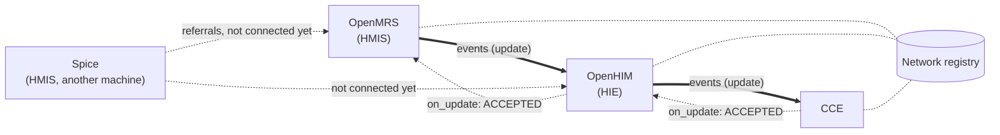
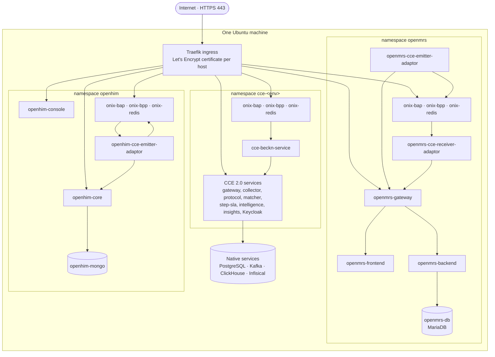
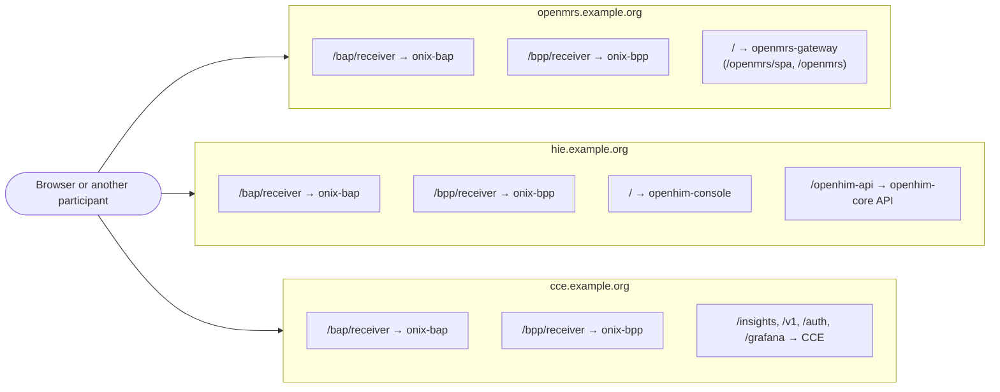
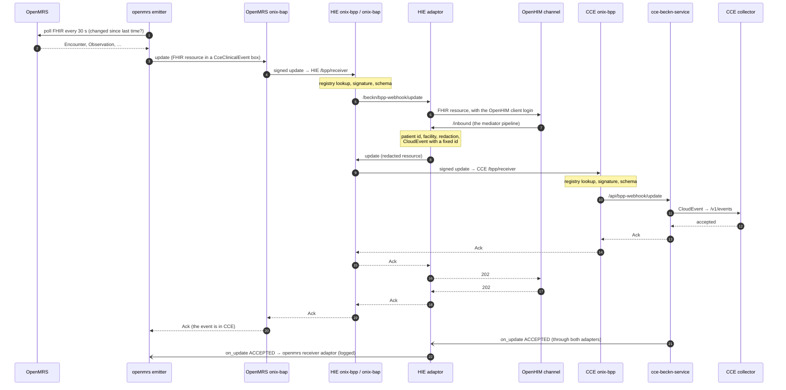
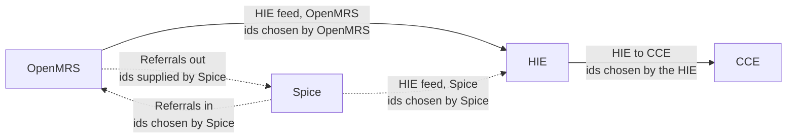
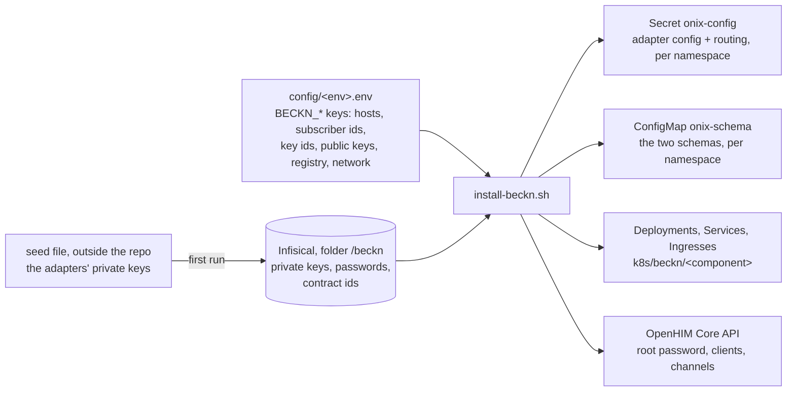
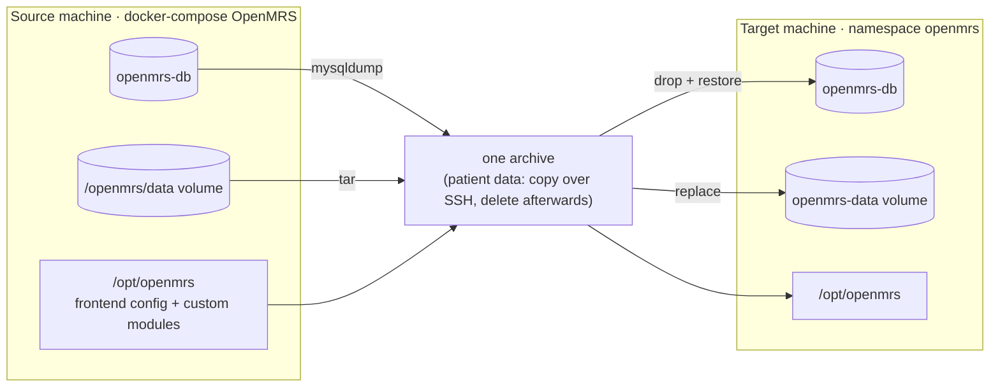

# Beckn demo setup: deployment architecture

This page explains how the CCE Beckn demo is put together: who the participants are, what runs where, how one clinical
event travels from OpenMRS to CCE, and how to run and check the demo. It is the place to start if you need to understand
or present the setup.

- To install or change it, use the reference: [beckn.md](beckn.md) (every config key, secret, script and error).
- Host names here are examples (`cce.example.org`, `hie.example.org`, `openmrs.example.org`). The real hosts and ids of
  an environment are in its config file, which is not in git. [Values of an environment](#values-of-an-environment)
  shows how to print them.

Contents

- [What the demo shows](#what-the-demo-shows)
- [The participants](#the-participants)
- [Deployment architecture](#deployment-architecture)
- [Network: what is public, what is not](#network-what-is-public-what-is-not)
- [How one event travels](#how-one-event-travels)
- [Trust: registry, network, keys, schemas](#trust-registry-network-keys-schemas)
- [Contracts](#contracts)
- [Configuration and secrets](#configuration-and-secrets)
- [The data in each system](#the-data-in-each-system)
- [Running the demo](#running-the-demo)
- [Differences from the dev environment](#differences-from-the-dev-environment)
- [Status and open points](#status-and-open-points)
- [Values of an environment](#values-of-an-environment)

## What the demo shows

A clinician saves something in **OpenMRS** (the HMIS). The change reaches **CCE** as a clinical event, and CCE confirms
it — without OpenMRS, the HIE or CCE calling each other's private APIs. Each of the three is a participant of a
**Beckn network**. They exchange signed Beckn messages through their own ONIX adapters and find each other through the
network registry.

| In the demo | Not in the demo yet |
|---|---|
| OpenMRS → HIE → CCE events, end to end, with `Ack` and `on_update` | Spice: events to the HIE and referrals with OpenMRS ([status](#status-and-open-points)) |
| Signature and schema checks at every Beckn hop | Care alerts from CCE to an HMIS (`on_status`) |
| OpenHIM still authenticates and logs every event | |
| Clinical data minimised in the HIE before it reaches CCE | |

## The participants

Each participant is a pair of subscribers in the network registry: a **BAP** (consumer: sends requests, receives
callbacks) and a **BPP** (provider: receives requests, sends callbacks).

| Participant | Plays | Own services | Source repository · branch | Image tag |
|---|---|---|---|---|
| **OpenMRS** | consumer of the HIE feed (BAP). Provider for referrals from Spice (BPP) | OpenMRS O3 3.6.0 (MariaDB, backend, frontend, gateway), `openmrs-cce-emitter-adaptor`, `openmrs-cce-receiver-adaptor` | [openmrs-cce-emitter-adaptor](https://github.com/openphc/openmrs-cce-emitter-adaptor/tree/demo-beckn) · `demo-beckn`, [openmrs-cce-receiver-adaptor](https://github.com/openphc/openmrs-cce-receiver-adaptor/tree/demo-beckn) · `demo-beckn` | `demo-beckn-latest` |
| **HIE** (OpenHIM) | provider towards each HMIS (BPP). Consumer towards CCE (BAP) | OpenHIM Core 8.5.1 + console + MongoDB, `openhim-cce-emitter-adaptor` (its Beckn build is also the OpenHIM mediator) | [openhim-cce-emitter-adaptor](https://github.com/openphc/openhim-cce-emitter-adaptor/tree/demo-beckn) · `demo-beckn` | `demo-beckn-latest` |
| **CCE** | provider (BPP) | `cce-beckn-service`, in front of the CCE 2.0 services that `install.sh` deploys | [cce-beckn-service](https://github.com/openphc/cce-beckn-service/tree/demo) · `demo` | `latest` / `v<N>` |
| all three | — | ONIX adapter: `onix-bap`, `onix-bpp`, Redis | [DHP-Specs](https://github.com/openphc/DHP-Specs) · `openmrs-onix`, `openhim-onix`, `cce-onix` (the registered ids and keys) | `fidedocker/onix-adapter:1.6.1` |

The custom message content is defined by two schemas in
[cce-beckn-service/schema](https://github.com/openphc/cce-beckn-service/tree/demo/schema): `CceClinicalEvent` (one FHIR
resource travelling to CCE) and `CceCareAlert` (one alert travelling from CCE).

## Deployment architecture

All three participants run on **one machine**, the one `install.sh` set up, in three Kubernetes namespaces of its k3s.
They are still isolated from each other: a NetworkPolicy per namespace lets pods talk only to their own namespace, to
`kube-system` and to public addresses. So a message from one participant to another always leaves through the sender's
adapter and enters through the receiver's public address, exactly as it would between three machines.

| Namespace | Deployments | Storage |
|---|---|---|
| `openmrs` | `openmrs-db`, `openmrs-backend`, `openmrs-frontend`, `openmrs-gateway`, `openmrs-cce-emitter-adaptor`, `openmrs-cce-receiver-adaptor`, `onix-bap`, `onix-bpp`, `onix-redis` | volumes: database, `/openmrs/data`, the emitter's checkpoint. Node folder `/opt/openmrs`: frontend config and custom frontend modules |
| `openhim` | `openhim-mongo`, `openhim-core`, `openhim-console`, `openhim-cce-emitter-adaptor`, `onix-bap`, `onix-bpp`, `onix-redis` | volume: MongoDB |
| `cce-<env>` | added by the Beckn add-on: `cce-beckn-service`, `onix-bap`, `onix-bpp`, `onix-redis`. Already there: the CCE 2.0 services | none added. CCE's data is in the native PostgreSQL, Kafka and ClickHouse |

The manifests are in [`k8s/beckn/`](../../k8s/beckn): `onix/` (the adapter, shared by all three), `cce/`, `openhim/`,
`openmrs/`, `netpol/`. Sizing is small on purpose (about 0.75 vCPU of requests for everything the add-on adds): the
machine already carries a production-sized CCE.

## Network: what is public, what is not

Each participant has one public host. Traefik terminates TLS and routes by host and path.

| Public | Reachable only inside its namespace |
|---|---|
| `/bap/receiver`, `/bpp/receiver` of every participant — the two addresses registered for its subscribers. The adapter checks the Beckn signature of everything that arrives | `/bap/caller`, `/bpp/caller` of every adapter (a participant's own services send through them) |
| The OpenMRS app and API | The adaptors' `/beckn/**` endpoints and `cce-beckn-service` (they carry no token: the adapter in front has already checked the signature) |
| The OpenHIM console and its Core API | OpenHIM's channel ports (5000 HTTPS, 5001 HTTP) |
| CCE: Insights, API gateway, Keycloak, Grafana | Databases, Redis, MongoDB |

One detail of a single-machine setup: a pod cannot reach the machine's own public address. So each adapter pod has host
aliases that point the three public hosts at Traefik's in-cluster address. The request still goes through Traefik with
the host's real certificate, so nothing else changes.

## How one event travels

About nine hops, **one synchronous HTTP call**: every hop waits for the hop behind it, and the `Ack` (or `Nack`) travels
back the same way. There is no queue. CCE's `on_update` follows as a separate callback.

| Step | Who | What happens |
|---|---|---|
| 1–2 | OpenMRS emitter | Polls OpenMRS FHIR for `Patient`, `RelatedPerson`, `Encounter`, `Observation`, `Condition`, `ServiceRequest`, `MedicationRequest`, `MedicationDispense`. A new emitter starts from "now": history is not sent. A patient without a national id is skipped |
| 3 | OpenMRS emitter | Wraps the resource, unchanged, in a `CceClinicalEvent` box and posts an `update` on its "HIE feed" contract. The event id is a hash of the resource |
| 4 | the two adapters | The sender's adapter signs. The receiver's adapter looks the sender up in the registry, checks network membership, the signature and the schema |
| 5–7 | HIE adaptor + OpenHIM | The adaptor checks that the sender is in its subscriber list and that a contract id is present, takes the FHIR resource out and posts it to the OpenHIM channel `CCE Beckn feed`. OpenHIM authenticates the client, logs the transaction and routes to the adaptor's `/inbound` |
| 7 | HIE adaptor (mediator pipeline) | The existing pipeline: source, patient id, facility, **redaction of clinical values**, CloudEvent. The CloudEvent id is fixed per event (a UUID v5), so a resend is recognised |
| 8–9 | HIE adaptor, adapters | Wraps the redacted resource again and sends an `update` to CCE on the HIE's contract with CCE. Signed and checked as in step 4 |
| 10–12 | CCE | `cce-beckn-service` builds CCE's own CloudEvent (`source` = the HIE's BAP id, `subject` = the patient id) and posts it to the collector. No gateway, no token: both are inside the CCE namespace |
| 13–20 | everyone | The collector's answer becomes the `Ack` and returns hop by hop. The emitter's `Ack` therefore means: CCE has the event |
| 21–22 | CCE, HIE | `on_update` with `ACCEPTED` (or `DUPLICATE` for a resend). It is logged only; nothing depends on it |

Because every hop waits, each wait is set longer than the one inside it: from 15 s at the collector to 50 s at the
emitter. The values are in [beckn.md → The timeout budget](beckn.md#the-timeout-budget).

## Trust: registry, network, keys, schemas

| Thing | What it is | Where it is configured |
|---|---|---|
| Network registry | The public directory of subscribers. An adapter looks a sender up by subscriber id and key id and gets its address and public key | `BECKN_REGISTRY_URL`, `BECKN_REGISTRY_NAME` |
| Network id | `<namespace>/<registry>` of the network's membership registry. Sent as `context.networkId` by all four services. Each adapter accepts only subscribers that are members of it | `BECKN_NETWORK_ID` |
| Subscriber ids, key ids | Two records per participant (BAP, BPP), registered with the address `https://<host>/bap/receiver` or `/bpp/receiver` | `BECKN_
_BAP_ID`, `BECKN_
_BAP_KEY_ID`, `BECKN_
_BPP_ID`, `BECKN_
_BPP_KEY_ID` |
| Keys | Each adapter signs with a private key. The matching public key is in the registry record | public: `BECKN_SIGNING_PUBLIC_KEY`, `BECKN_ENCR_PUBLIC_KEY`. private: Infisical `/beckn`, never in git |
| Schemas | `CceClinicalEvent` and `CceCareAlert`. Every adapter holds a local copy and checks messages against it. The `@context` address inside a message only has to be the same for everyone | `BECKN_SCHEMA_DIR` or `BECKN_SCHEMA_REPO` / `BECKN_SCHEMA_REF`; `BECKN_SCHEMA_BASE_URL` |

The services in front of and behind the adapters do not sign or verify anything themselves. That is why their Beckn
endpoints must stay unreachable from outside their namespace.

## Contracts

No message opens a contract in the demo (there is no `confirm`), so nothing issues a contract id. Each sender puts a
contract id and a `transactionId` of its own in every message; the installer generates them once and keeps them in
Infisical. A receiver checks who sent the message, accepts any non-blank contract id and repeats it in its `on_update`.

Solid: in use. Dotted: prepared, waiting for Spice. The arrow points from consumer (the sender) to provider. For the
referral outcomes OpenMRS sends back to Spice on "Referrals in", the two agree a pair of ids. The keys and which service
reads each id are in [beckn.md → Contracts](beckn.md#contracts-the-ids-a-sender-uses).

## Configuration and secrets

Nothing environment-specific is in git. A config file names the hosts and ids; Infisical holds the secrets and the
generated ids; the installer renders both into the cluster.

| What | Where |
|---|---|
| Hosts, subscriber ids, key ids, public keys, registry, network id, image tags | `one-click-installer/config/<env>.env` on the machine (not in git) |
| Private keys, OpenHIM and OpenMRS logins, database passwords, the alert webhook secret, contract ids | Infisical project of the environment, folder `/beckn` |
| OpenHIM clients and channels (no passwords) | [`k8s/beckn/openhim/openhim-metadata.json`](../../k8s/beckn/openhim/openhim-metadata.json) |
| Every login, on demand | `sudo bash one-click-installer/tools/show-credentials.sh <env> [--reveal]` |

## The data in each system

| System | What it holds in the demo | How it got there |
|---|---|---|
| OpenMRS | A copy of the dev environment's OpenMRS: patients, encounters, orders, the referral metadata, user accounts, configuration, and the two custom frontend modules (referral fulfilment, notifications) | exported from dev and imported, see below |
| OpenHIM | The dev environment's four FHIR channels and clients, plus the channel `CCE Beckn feed` and its client. New passwords. No transaction history | created through the Core API by `openhim-setup.sh` |
| CCE | Events arrive in `inbound_event_log`. What happens after that (matching, compliance, Insights) needs a clinical protocol to be loaded | events: by the flow above. Protocol: `PROTOCOL_FILE` of `install.sh`, or the protocol service API |

`openmrs-export.sh` runs on the source and is read-only there. `openmrs-import.sh` stops the backend and the two
adaptors, replaces the three parts, rewrites the database login to the target's own, and starts everything again. The
user accounts come with the database, so the adaptors' login must be an account of the source. Details:
[beckn.md → Copying an OpenMRS](beckn.md#copying-an-openmrs).

## Running the demo

Open these four before you start (replace the hosts with the environment's own):

| Window | Address | Login |
|---|---|---|
| OpenMRS | `https://openmrs.example.org/openmrs/spa` | an OpenMRS user |
| OpenHIM console | `https://hie.example.org/` → Transaction Log | `OPENHIM_ROOT_USER` |
| CCE Insights | `https://cce.example.org/insights/` | the Insights user |
| A terminal on the machine | the three log commands below | — |

1. **Show the three participants.** `sudo bash one-click-installer/lib/beckn/run.sh --config <config> beckn-status.sh`:
   pods, the six subscribers as live members of the network, the public Beckn addresses answering.
2. **Create an event.** In OpenMRS, open a patient that has a national id, start a visit and save an encounter (or
   record vitals).
3. **Watch it leave OpenMRS** (within 30 seconds, the poll interval):
   `kubectl -n openmrs logs -f deploy/openmrs-cce-emitter-adaptor` → `beckn action=update leg=cce-events … result=ACK`.
4. **Watch it cross the HIE:** `kubectl -n openhim logs -f deploy/openhim-cce-emitter-adaptor` →
   `Beckn update received`, `OpenHIM channel answered: HTTP 202`, `CCE ACK for CloudEvent id=…`. In the OpenHIM
   console, the Transaction Log shows one `Successful` transaction on `/cce-beckn`.
5. **Watch it arrive in CCE:** `kubectl -n cce-<env> logs -f deploy/cce-beckn-service` →
   `dir=IN action=update … result=OK`, then `dir=OUT action=on_update … ACCEPTED`. In the database:
   `select source, status, received_at from inbound_event_log order by received_at desc limit 5;`
6. **Show the callback** back in the HIE log: `Beckn callback on_update … status=ACCEPTED`.
7. **Optional: show what a participant outside the network gets.** `curl -X POST https://cce.example.org/bpp/receiver/update -d '{}'`
   is refused by the adapter.

A resend is harmless by design: if the same event is sent again (for example after a timeout on the route), CCE answers
`Ack` and then `on_update` with `DUPLICATE`, and nothing is counted twice.

## Differences from the dev environment

| | Dev environment | Beckn demo |
|---|---|---|
| Runtime | docker-compose, one network | k3s, three namespaces with network policies |
| OpenMRS → HIE | the emitter posts FHIR to an OpenHIM channel, with a client login | the emitter posts a signed Beckn `update` through the adapters; OpenHIM still sees and logs the event, one hop later |
| HIE → CCE | the adaptor posts a CloudEvent to the CCE gateway / collector, with a token | the adaptor posts a signed Beckn `update`; no shared token between the HIE and CCE |
| How CCE knows the sender | the token | the registry record of the HIE's subscriber |
| Reverse proxy | Caddy, one host per service | Traefik, one host per participant, paths per service |
| OpenHIM Core API for the console | its own host | `/openhim-api` on the HIE's host |
| OpenHIM channels | published | not published |
| Secrets | `.env` file | Infisical |
| CCE's own emitter adaptor (`k8s/emitters/openhim`) | the entry point | still deployed by `install.sh`, not used by the Beckn flow |

## Status and open points

| Point | State |
|---|---|
| OpenMRS → HIE → CCE events over Beckn | working end to end, including `Ack`, `on_update` and the OpenHIM transaction log |
| Network membership check (`allowedNetworkIDs`) and `context.networkId` | on |
| Spice | not connected. OpenMRS's referral legs are off; its receiver runs with placeholder Spice ids. The ids to exchange are listed in [beckn.md → Connecting Spice](beckn.md#connecting-spice) |
| Care alerts from CCE (`on_status`) | not wired: no receiver-adaptor record in the intelligence service, and the HIE adaptor answers `on_status` with `NOT_SUPPORTED` |
| Clinical protocol in CCE | must be loaded for events to be matched and to appear in Insights |
| `cce-beckn-service` image | its GHCR package needs a login, so the image is built from source and imported into k3s by hand |
| Prometheus | does not scrape the Beckn services |
| Capacity | the machine's CPU requests are almost fully used by the production-sized CCE overlay; a rolling restart that needs a spare pod can stay `Pending` |
| OpenMRS accounts | they are the source's. Change the admin password before the host is widely known, and set the same value in Infisical |

## Values of an environment

The real hosts, ids and logins are deliberately not in this repository. On the machine:

| To see | Run |
|---|---|
| Hosts, subscriber ids, registry state, contract ids, network id | `sudo bash one-click-installer/lib/beckn/run.sh --config one-click-installer/config/<env>.env beckn-status.sh` |
| Every login | `sudo bash one-click-installer/tools/show-credentials.sh <env> [--reveal]` |
| Every `BECKN_*` setting | `grep '^BECKN_\|^IMAGE_' one-click-installer/config/<env>.env` |
| What is running | `kubectl get pods -n openmrs`, `-n openhim`, `-n cce-<env>` |
