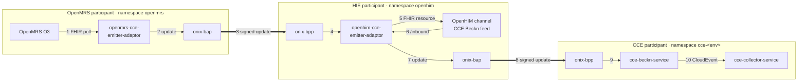

# Beckn add-on

`install-beckn.sh` adds Beckn network participants to a machine that `install.sh` has already set up. With it, clinical
events reach CCE over a Beckn network instead of a direct HTTP call:



| Arrow | Meaning |
|---|---|
| thick (3, 8) | a Beckn hop over the participant's public HTTPS address: signed by the sender's adapter, checked by the receiver's (registry lookup) |
| thin | plain HTTP inside one namespace |

Every answer travels back along the same route in the same HTTP call, and CCE's `on_update` (`ACCEPTED` / `DUPLICATE`)
follows as a callback. Each participant is described in its own repository:
[cce-beckn-service](https://github.com/openphc/cce-beckn-service/tree/demo/docs),
[openhim-cce-emitter-adaptor](https://github.com/openphc/openhim-cce-emitter-adaptor/blob/demo-beckn/docs/beckn-integration.md),
[openmrs-cce-emitter-adaptor](https://github.com/openphc/openmrs-cce-emitter-adaptor/blob/demo-beckn/docs/beckn-integration.md),
[openmrs-cce-receiver-adaptor](https://github.com/openphc/openmrs-cce-receiver-adaptor/blob/demo-beckn/docs/beckn-integration.md).

- [What it deploys](#what-it-deploys)
- [Before you run it](#before-you-run-it)
- [Run it](#run-it)
- [Check it](#check-it)
- [Configuration keys](#configuration-keys)
- [Secrets: Infisical `/beckn`](#secrets-infisical-beckn)
- [Contracts: the ids a sender uses](#contracts-the-ids-a-sender-uses)
- [The timeout budget](#the-timeout-budget)
- [Copying an OpenMRS](#copying-an-openmrs)
- [Day 2](#day-2)
- [Connecting Spice](#connecting-spice)
- [Troubleshooting](#troubleshooting)
- [Known limits](#known-limits)
- [Scripts](#scripts)

## What it deploys

`BECKN_COMPONENTS` lists the participants this machine hosts. Each has its own ONIX adapter and its own public host.

| Component | Namespace | Manifests | What runs |
|---|---|---|---|
| `cce` | `cce-<ENVCODE>` (exists) | [`k8s/beckn/cce`](../../k8s/beckn/cce) | `cce-beckn-service`, `onix-bap`, `onix-bpp`, `onix-redis` |
| `openhim` | `BECKN_OPENHIM_NAMESPACE` (`openhim`) | [`k8s/beckn/openhim`](../../k8s/beckn/openhim) | OpenHIM: `openhim-mongo`, `openhim-core`, `openhim-console`; `openhim-cce-emitter-adaptor` (Beckn build); the adapter trio |
| `openmrs` | `BECKN_OPENMRS_NAMESPACE` (`openmrs`) | [`k8s/beckn/openmrs`](../../k8s/beckn/openmrs) | OpenMRS O3 3.6.0: `openmrs-db` (MariaDB), `openmrs-backend`, `openmrs-frontend`, `openmrs-gateway`; `openmrs-cce-emitter-adaptor`, `openmrs-cce-receiver-adaptor` (Beckn builds); the adapter trio |

The adapter trio — [`k8s/beckn/onix`](../../k8s/beckn/onix) — is the same for every participant: `onix-bap` (consumer
side, port 8081), `onix-bpp` (provider side, port 8082) and their Redis. Its config templates are in
[`k8s/beckn/onix/config`](../../k8s/beckn/onix/config).

Public addresses (Traefik, Let's Encrypt), one host per component:

| Host | Path | Goes to |
|---|---|---|
| every `BECKN_<P>_HOST` | `/bap/receiver`, `/bpp/receiver` | that participant's `onix-bap` / `onix-bpp` — the two addresses registered for its subscribers |
| `BECKN_OPENHIM_HOST` | `/` | the OpenHIM console |
| `BECKN_OPENHIM_HOST` | `/openhim-api` | the OpenHIM Core API the console calls (prefix stripped) |
| `BECKN_OPENMRS_HOST` | `/` | the O3 gateway: `/openmrs/spa` (the app), `/openmrs` (REST, FHIR) |

Not published: every `/bap/caller` and `/bpp/caller`, `cce-beckn-service`, the adaptors' `/beckn/**` endpoints, and
OpenHIM's channel ports. They carry no token of their own; only pods of the same namespace reach them.

`openhim` and `openmrs` get a NetworkPolicy ([`k8s/beckn/netpol`](../../k8s/beckn/netpol)) like the CCE namespace's:
own namespace, `kube-system`, public addresses. So the three participants on one machine still talk to each other only
through their public Beckn addresses, as they would on three machines.

This is separate from `EMITTER_ADAPTOR`. `k8s/emitters/openhim` is the adaptor inside a CCE environment that posts to
the collector with a token. The Beckn build in `k8s/beckn/openhim` runs beside OpenHIM, has no access to the collector,
and reaches CCE only through the adapters.

## Before you run it

1. `install.sh` has been run for this `ENVCODE` **with `INGRESS_HOST` and `ACME_EMAIL`**. Beckn addresses are HTTPS; the
   add-on uses the Let's Encrypt resolver that install.sh sets up, and stops if it is missing.
2. A DNS name per hosted component points at this machine, and ports 80/443 are reachable from the internet.
3. Each participant has a BAP and a BPP subscriber in the network registry, registered with the address
   `https://<host>/bap/receiver` and `https://<host>/bpp/receiver`. You need each record's subscriber id and key id, and
   the key pair it was registered with.
4. The schema folders `CceClinicalEvent/` and `CceCareAlert/` are available: either the machine can clone
   `BECKN_SCHEMA_REPO`, or you copied the `schema/` folder of `cce-beckn-service` to it (`BECKN_SCHEMA_DIR`).
5. Every image can be pulled. Today the `cce-beckn-service` package on GHCR needs a login, so its image is built and
   imported by hand — see [Troubleshooting](#troubleshooting).
6. Capacity: the three components add about 0.75 vCPU of requests and, in use, about 2.5 GiB of memory. OpenMRS's backend
   alone holds over 1 GiB.

## Run it

Add the `BECKN_*` keys to the config file of the environment ([`config/example.env`](../config/example.env), "Beckn
add-on"), put the adapters' private keys in a seed file outside the repository, then:

```bash
sudo bash one-click-installer/install-beckn.sh --config one-click-installer/config/<env>.env
```

| Option | Effect |
|---|---|
| `--yes` | skips the confirmation |
| `--only cce,openhim` | limits this run to some components of `BECKN_COMPONENTS` |
| `DRY_RUN=1` (environment) | seeds Infisical, renders and checks everything, prints the resources, applies nothing |

| Phase | Script | What it does |
|---|---|---|
| 1 Secrets | [`beckn-seed.sh`](../lib/beckn/beckn-seed.sh) | fills Infisical `/beckn`: seed-file values, generated passwords and contract ids. Stops if a private key is missing |
| 2 Schemas | (in `install-beckn.sh`) | `BECKN_SCHEMA_DIR`, or a clone of `BECKN_SCHEMA_REPO` at `BECKN_SCHEMA_REF` |
| 3 Deploy | [`beckn-deploy.sh`](../lib/beckn/beckn-deploy.sh) per component | Secret `onix-config`, ConfigMap `onix-schema`, `kubectl apply` of the rendered component, host aliases on the adapter pods |
| 4 Configure and wait | [`openhim-setup.sh`](../lib/beckn/openhim-setup.sh) | OpenHIM root password, clients, channels; then waits for every deployment (reports, never aborts) |

Safe to re-run. A pod restarts only when a value it reads changed. A first OpenMRS start on an empty database installs
the reference application and takes 10–20 minutes.

## Check it

```bash
sudo bash one-click-installer/lib/beckn/run.sh --config one-click-installer/config/<env>.env beckn-status.sh
```

Per component it shows: pods ready; the adapter's `Preloaded 2 schemas`; each subscriber in the registry (live, same
address and signing key as configured, member of `BECKN_NETWORK_ID`); and the public address (an empty, unsigned request
must be refused by the adapter with 400 or 401). It ends with the contract ids. It changes nothing.

To see one event travel: change something in OpenMRS (for example save an encounter), wait for the next poll (30 s) and
read the logs, in this order.

| # | Where | A good line |
|---|---|---|
| 1 | `kubectl -n openmrs logs deploy/openmrs-cce-emitter-adaptor` | `beckn action=update leg=cce-events … result=ACK httpStatus=200` |
| 2 | `kubectl -n openhim logs deploy/openhim-cce-emitter-adaptor` | `Beckn update received …`, `OpenHIM channel answered …: HTTP 202`, `CCE ACK for CloudEvent id=…`, then `Beckn callback on_update … status=ACCEPTED` |
| 3 | `kubectl -n cce-<env> logs deploy/cce-beckn-service` | `dir=IN action=update … result=OK`, `dir=OUT action=on_update … error=ACCEPTED` |
| 4 | CCE database | `select source, status, received_at from inbound_event_log order by received_at desc limit 5;` — `source` is the HIE's BAP id |
| 5 | OpenHIM console → Transaction Log | one `Successful` transaction on `/cce-beckn`, status 202 |

A patient needs a national id for the emitter to send its resources (`PATIENT_NATIONAL_ID_ON_MISSING=skip`).

## Configuration keys

All in the environment's config file. `lib/load-config.sh` accepts any key that starts with `BECKN_`;
[`beckn-lib.sh`](../lib/beckn/beckn-lib.sh) fills the defaults (`beckn_defaults`) and validates (`beckn_validate`).
`P` is `CCE`, `OPENHIM` or `OPENMRS`.

| Key | Default | Meaning |
|---|---|---|
| `BECKN_COMPONENTS` | `cce openhim openmrs` | the participants this machine hosts (spaces or commas) |
| `BECKN_REGISTRY_URL`, `BECKN_REGISTRY_NAME` | required | the registry lookup the adapters use: `<url>/lookup/<subscriber id>/<name>/<key id>` |
| `BECKN_NETWORK_ID` | empty | `<namespace>/<registry>` of the network's membership registry. Sent as `context.networkId` by all four services; the adapters accept only its members (`allowedNetworkIDs`). Empty: no `networkId`, no membership check |
| `BECKN_ALLOWED_NETWORK_IDS` | `BECKN_NETWORK_ID` | comma-separated list for the adapters, to accept more than one network |
| `BECKN_<P>_HOST` | required when hosted | the participant's public host |
| `BECKN_<P>_BAP_ID`, `BECKN_<P>_BPP_ID` | required | subscriber ids. Needed for a participant hosted elsewhere too: its neighbours name it in every message |
| `BECKN_<P>_BAP_KEY_ID`, `BECKN_<P>_BPP_KEY_ID` | required when hosted | the registry record (key) ids |
| `BECKN_<P>_BAP_URI`, `BECKN_<P>_BPP_URI` | `https://<host>/bap/receiver`, `…/bpp/receiver` | the registered addresses. Set them for a participant hosted elsewhere when you give no `BECKN_<P>_HOST` |
| `BECKN_SIGNING_PUBLIC_KEY`, `BECKN_ENCR_PUBLIC_KEY` | required | the adapters' public keys. Per participant: `BECKN_<P>_…`; per role: `BECKN_<P>_BAP_…` / `BECKN_<P>_BPP_…`. The most specific one wins |
| `BECKN_SEED_ENV_FILE` | empty | seed file for Infisical `/beckn` (below) |
| `BECKN_SCHEMA_DIR` | empty | folder holding `CceClinicalEvent/` and `CceCareAlert/`. Empty: clone `BECKN_SCHEMA_REPO` (`https://github.com/openphc/cce-beckn-service.git`) at `BECKN_SCHEMA_REF` (`demo`) and use its `schema/` |
| `BECKN_SCHEMA_BASE_URL` | `https://raw.githubusercontent.com/openphc/cce-beckn-service/main/schema` | the start of the `@context` address in every message. Must be the same for all participants; it need not be downloadable, because each adapter has a local copy |
| `IMAGE_CCE_BECKN_SERVICE` | `latest` | tag or `sha256:` digest of `cce-beckn-service` |
| `IMAGE_OPENHIM_BECKN_EMITTER_ADAPTOR`, `IMAGE_OPENMRS_CCE_EMITTER_ADAPTOR`, `IMAGE_OPENMRS_CCE_RECEIVER_ADAPTOR` | `demo-beckn-latest` | the three adaptors |
| `BECKN_CCE_IMAGE_PULL_POLICY` | `IfNotPresent` | `Always` once the `cce-beckn-service` image can be pulled without a login |
| `BECKN_SPICE_BAP_ID`, `BECKN_SPICE_BAP_URI`, `BECKN_SPICE_BPP_ID`, `BECKN_SPICE_BPP_URI`, `BECKN_SPICE_FACILITY_CODES` | empty | Spice, see [Connecting Spice](#connecting-spice) |
| `BECKN_REFERRALS_ENABLED` | `false` | the two referral legs of the OpenMRS emitter |
| `BECKN_OPENHIM_NAMESPACE`, `BECKN_OPENMRS_NAMESPACE` | `openhim`, `openmrs` | namespaces |
| `BECKN_OPENMRS_HOST_DIR` | `/opt/openmrs` | node folder with OpenMRS's frontend site files |
| `BECKN_ONIX_LOG_LEVEL` | `info` | `debug` prints message bodies, which hold patient data |
| `BECKN_OPENHIM_FACILITY_FILTER_IDS` | empty | the HIE adaptor's facility filter; empty = every facility |
| `BECKN_OPENHIM_REDACTION_ENABLED` | `false` | the HIE adaptor's clinical-data redaction (`REDACTION_ENABLED`). Off by default: full payloads, patient data included, go to CCE, because protocol triggers read free text redaction removes, e.g. the RMNCH referral steps (`ServiceRequest.patientInstruction` / `orderDetail`, the Encounter `source-referral-order` extension). `true` redacts, where no trigger needs that content |

`IMAGE_REGISTRY` applies to the four images above as it does to the CCE services. The ONIX image
(`fidedocker/onix-adapter:1.6.1`), OpenHIM, MongoDB, MariaDB and OpenMRS versions are fixed in the manifests.

## Secrets: Infisical `/beckn`

Stored in the environment's Infisical project, folder `/beckn`. `beckn-seed.sh` never overwrites a value that exists,
except with a value from the seed file.

| Key | How it gets its value | Used by |
|---|---|---|
| `BECKN_SIGNING_PRIVATE_KEY`, `BECKN_ENCR_PRIVATE_KEY` (or `BECKN_<P>_…`, `BECKN_<P>_BAP_…`, `BECKN_<P>_BPP_…`) | **seed file, required once** | the adapters (Secret `onix-config`) |
| `BECKN_HIE_CCE_*`, `BECKN_HIE_FEED_OPENMRS_*`, `BECKN_REFERRALS_IN_*` (`_CONTRACT_ID`, `_TRANSACTION_ID`) | generated UUID | [contracts](#contracts-the-ids-a-sender-uses) |
| `BECKN_REFERRALS_OUT_CONTRACT_ID`, `_TRANSACTION_ID` | blank until supplied (Spice supplies them) | OpenMRS emitter |
| `CCE_BECKN_ALERTS_WEBHOOK_SECRET` | generated | `cce-beckn-service`; must equal `config.webhookSecret` of its receiver-adaptor records in the intelligence service |
| `OPENHIM_ROOT_USER`, `OPENHIM_ROOT_PASSWORD` | `root@openhim.org`, generated | OpenHIM console login; the HIE adaptor's mediator login |
| `OPENHIM_CLIENT_PASSWORD_<CLIENTID>` | generated, one per client in [`openhim-metadata.json`](../../k8s/beckn/openhim/openhim-metadata.json) | Basic auth on the OpenHIM channels |
| `OPENMRS_DB_PASSWORD`, `OPENMRS_DB_ROOT_PASSWORD` | generated | MariaDB |
| `OPENMRS_ADMIN_USER`, `OPENMRS_ADMIN_PASSWORD` | `admin`, `Admin123` | the OpenMRS account the two adaptors sign in with |
| `OPENHIM_PUBLIC_URL`, `OPENMRS_PUBLIC_URL` | from the config, every run | `tools/show-credentials.sh` |

`OPENMRS_ADMIN_*` is not created by the installer. It must **match an account in the OpenMRS database**. `admin` /
`Admin123` is what the O3 reference application installs and is publicly documented: on a host reachable from the
internet, change the password in OpenMRS, set the same value here, and run `install-beckn.sh --only openmrs`.

The seed file (`BECKN_SEED_ENV_FILE`) has the format of the installer's seed file ([config.md](config.md#format)). Keys
that are not `BECKN_*`, `OPENHIM_*`, `OPENMRS_*` or `CCE_BECKN_*` are ignored. Once the private keys are in Infisical the
file is no longer needed: delete it and empty the key.

`sudo bash one-click-installer/tools/show-credentials.sh <env> [--reveal]` lists the OpenHIM and OpenMRS logins, the
channel client passwords and the webhook secret. Private keys are never printed.

## Contracts: the ids a sender uses

No Beckn message opens a contract in this setup (there is no `confirm`), so nothing issues a contract id. Each sender
puts a contract id and a `transactionId` of its own in every message. They are generated once and must then stay the
same. `beckn-status.sh` prints them.

A receiver does not compare the contract id with its settings. It checks who sent the message, accepts any non-blank
contract id, and repeats that id and the `transactionId` in its `on_update`:

| Receiver | Accepts an `update` from |
|---|---|
| `cce-beckn-service` | any subscriber its adapter verified (no list of its own) |
| HIE adaptor | a `context.bapId` in its subscriber list: OpenMRS, and Spice once configured |
| OpenMRS receiver | `context.bapId` = Spice's BAP id (`BECKN_SPICE_BAP_ID`) |

| Contract | Consumer → provider | Keys | Read by |
|---|---|---|---|
| HIE to CCE | HIE → CCE | `BECKN_HIE_CCE_*` | HIE adaptor, for every `update` to CCE (`OPENHIM_EMITTER_BECKN_CCE_*`). `cce-beckn-service` holds the same pair in `hmis.yml`, for the alerts it sends to the HIE |
| HIE feed, OpenMRS | OpenMRS → HIE | `BECKN_HIE_FEED_OPENMRS_*` | OpenMRS emitter, for every `update` to the HIE (`OPENMRS_EMITTER_BECKN_OPENHIM_*`) |
| HIE feed, Spice | Spice → HIE | none | nothing here. Spice chooses its own ids |
| Referrals in | Spice → OpenMRS | `BECKN_REFERRALS_IN_*` | OpenMRS emitter, for the `on_status` (a referral's outcome) it sends to Spice. Agree the pair with Spice. Spice's own `update` may carry any id |
| Referrals out | OpenMRS → Spice | `BECKN_REFERRALS_OUT_*` | OpenMRS emitter, for the `update` (a new referral) it sends to Spice. Spice supplies the pair |

To use ids agreed with another participant instead of generated ones, put them in `BECKN_SEED_ENV_FILE` before the run.

This is the behaviour of the adaptor images built from `demo-beckn` on or after 2026-11-18
(`openhim-cce-emitter-adaptor` PR 43, `openmrs-cce-receiver-adaptor` PR 16). Earlier builds compared the contract id with
their settings and do not start with this add-on's configuration.

## The timeout budget

There is no queue on the route: each hop waits for the hop behind it, so **each wait must be longer than the one inside
it**. The adapter's default (`responseHeaderTimeout: 5s`) is too short everywhere. `beckn-deploy.sh` sets the adapter
values; the manifests set the rest.

| Hop | Waits |
|---|---|
| `cce-beckn-service` → collector | 15 s |
| CCE `onix-bpp` → `cce-beckn-service` | 18 s |
| HIE `onix-bap` → CCE | 20 s |
| HIE adaptor → HIE `onix-bap` | 25 s |
| OpenHIM channel `CCE Beckn feed` | 30 s |
| HIE adaptor's Beckn endpoint → OpenHIM channel | 35 s |
| HIE `onix-bpp` → HIE adaptor | 40 s |
| OpenMRS `onix-bap` → HIE | 45 s |
| OpenMRS emitter → OpenMRS `onix-bap` | 50 s |

Callbacks (`on_update`, `on_status`) are logged and answered at once: 5 s into the local service, 10 s to the remote
adapter (6 s from CCE, whose service allows its callbacks 7 s). The adapters' own HTTP server timeout is 60 s. If a hop
gives up before the one inside it, the sender sees `UNAVAILABLE` for an event that got through; its resend is then
answered `Ack` and `DUPLICATE`, so nothing is counted twice.

## Copying an OpenMRS

To make the k3s OpenMRS a copy of a docker-compose OpenMRS (the dev layout: containers `openmrs-db` and
`openmrs-backend`, site files under `/opt/openmrs`):

```bash
# on the SOURCE machine — needs docker and this one file; read-only, the source keeps running
sudo bash openmrs-export.sh /root/openmrs-export.tgz

# copy the archive to the target over SSH, then on the TARGET machine, after install-beckn.sh:
sudo bash one-click-installer/lib/beckn/run.sh --config one-click-installer/config/<env>.env \
     openmrs-import.sh /root/openmrs-export.tgz
```

| Part | What the import does |
|---|---|
| Database | drops `openmrs`, recreates it, restores the dump |
| `/openmrs/data` | empties the backend's volume and fills it: configuration, modules, images, search index, runtime properties (rewritten to this installation's database login). Logs, the library cache and the message broker's journal are not copied; OpenMRS rebuilds them |
| Frontend | `config-core_demo.json` and `frontend/custom-esms/` under `BECKN_OPENMRS_HOST_DIR`; restarts the frontend |
| Adaptors | stopped for the import, started after. The emitter's checkpoint is left alone; a new emitter starts from "now" and does not send history |

It asks before replacing anything (`--yes` to skip) and prints the patient counts on both sides first. **The archive holds
patient data**: move it over SSH and delete it on both machines after the import.

The OpenMRS accounts come with the database. The last step tries the adaptors' login (`OPENMRS_ADMIN_*`) against the
imported OpenMRS and tells you when it is not accepted.

Without a copy, OpenMRS starts as a stock O3 reference application: `beckn-deploy.sh` writes an empty
`config-core_demo.json` and creates an empty `frontend/custom-esms/`.

## Day 2

| Task | Command |
|---|---|
| Change a `BECKN_*` key, an image tag, or a value in Infisical `/beckn` | change it, then `install-beckn.sh --config … [--only <component>]` |
| Roll a new build of a mutable tag (`demo-beckn-latest`) | `kubectl -n <ns> rollout restart deploy/<name>` (the adaptors pull on every start) |
| Add or change an OpenHIM client or channel | edit `k8s/beckn/openhim/openhim-metadata.json`, then `run.sh --config … openhim-setup.sh` (creates or updates; never deletes) |
| Run one script by hand | `sudo bash one-click-installer/lib/beckn/run.sh --config <file> <script> [args]` — config and secrets loaded, as install-beckn.sh does |
| CCE's public host changes | change `INGRESS_HOST` and `BECKN_CCE_HOST`, run `install.sh`, then `install-beckn.sh`. The registry record must name the new address |

`install.sh` and `lib/redeploy.sh` do not touch the Beckn resources, and `install-beckn.sh` does not touch the CCE
services.

## Connecting Spice

Spice is the HMIS that exchanges referrals with OpenMRS directly, and a second sender of events to the HIE. Until its
subscriber ids are known, the OpenMRS receiver runs with placeholder ids (`bap.spice.invalid`) because it does not start
without any, and the emitter sends events to the HIE only.

1. Give the Spice team: the HIE's BPP id and address, OpenMRS's BAP and BPP ids and addresses, `BECKN_NETWORK_ID`,
   `BECKN_SCHEMA_BASE_URL`, and the "Referrals in" ids from `beckn-status.sh` (OpenMRS sends referral outcomes with
   them). For the events and referrals Spice sends, it chooses its own contract id and `transactionId`.
2. Get from them: Spice's BAP and BPP subscriber ids and addresses, the facility codes Spice serves, and the "Referrals
   out" contract id and `transactionId`. Spice's subscribers must be members of the same network.
3. Set `BECKN_SPICE_BAP_ID`, `BECKN_SPICE_BAP_URI`, `BECKN_SPICE_BPP_ID`, `BECKN_SPICE_BPP_URI`,
   `BECKN_SPICE_FACILITY_CODES` in the config, and `BECKN_REFERRALS_OUT_CONTRACT_ID` / `_TRANSACTION_ID` in Infisical
   `/beckn` (or the seed file). The HIE then accepts Spice's events (source `spice`) and the OpenMRS receiver accepts
   Spice's referrals. Both check Spice's BAP id, so it must be exactly the id Spice signs with.
4. Set `BECKN_REFERRALS_ENABLED=true` to turn on the emitter's two referral legs, and run
   `install-beckn.sh --only openhim,openmrs`.

## Troubleshooting

| Symptom | Cause | Fix |
|---|---|---|
| `onix-bap` / `onix-bpp` in `CrashLoopBackOff` with exit code 0; the log ends `Loading keys from configuration`, `Application finished` | a key is not valid base64 — typically the private key lost its trailing `=` | check the length of the value in Infisical `/beckn` (an Ed25519 key is 44 characters); re-seed from the file |
| `cce-beckn-service` in `ImagePullBackOff` / `ErrImageNeverPull` | the GHCR package needs a login | build it and import it: `docker build -t ghcr.io/openphc/cce-beckn-service:<tag> .` in the `cce-beckn-service` repository (`demo`), `docker save … \| gzip \| ssh <host> 'gunzip \| sudo k3s ctr images import -'`, then `IMAGE_CCE_BECKN_SERVICE=<tag>` and `BECKN_CCE_IMAGE_PULL_POLICY=IfNotPresent` |
| HIE adaptor: `OpenHIM channel answered …: no answer (SocketTimeoutException)`; OpenHIM Core logs `Parse Error: Invalid method encountered` | an `https://` URL on OpenHIM's plain-HTTP channel port. 5001 is HTTP, 5000 is HTTPS | `OPENHIM_EMITTER_BECKN_OPENHIM_CHANNEL_URL=http://openhim-core:5001/cce-beckn` (the manifest's value) |
| `openhim-mongo` or `openmrs-db` never ready; `gosu` at 100 % CPU in the pod | started as root, the image's entrypoint switches user with `gosu`, which hangs on k3s/containerd with Ubuntu 26.04 | the manifests run both as their own user (`runAsUser: 999`); keep that |
| OpenMRS answers on `/openmrs/health/started` but REST and FHIR are 404; the backend pod stays not ready | the core started, its modules did not. After an import: the message broker's journal was copied incompletely | `kubectl -n <ns> logs deploy/openmrs-backend \| grep -E 'ERROR\|Exception' \| head`. Re-export with the current `openmrs-export.sh` and import again |
| Emitter: `result=NACK` / `UNAVAILABLE` for every event | a hop on the route is down or a wait is too short | follow the logs in the order of [Check it](#check-it); the first hop without a good line is the one |
| HIE adaptor answers `Nack EVENT_REJECTED`, text `ignored: …` | the subscriber's `source-system` is not a source key of the adaptor | sources are `openmrs`, `spice`, `ebuzima`, `spice-facility`; see `beckn-deploy.sh` (`OPENHIM_ADAPTOR_SPRING_JSON`) |
| An adapter refuses a signed message from a registered subscriber | the subscriber is not a member of `BECKN_NETWORK_ID`, or the registry record's address or key differs | `beckn-status.sh` shows each record; fix the registry or the config |
| A value ending in `=` arrives in Infisical one character short | a seed-file parser bug, fixed here in both `beckn-seed.sh` and `infisical-seed.sh` | re-run with the current scripts |
| A pod stays `Pending` with `Insufficient cpu` | the node's CPU requests are used up (the CCE overlay is sized for production) | lower replica counts or requests of the CCE services, or use a larger machine |

## Known limits

- **Prometheus** does not scrape the Beckn services: the base config has a fixed target list, and the two extra
  namespaces are closed to it. The pods carry the usual `prometheus.io/*` annotations.
- **Alerts from CCE to an HMIS** (`on_status`): `cce-beckn-service` is ready for them (`hmis.yml` lists the HIE, the
  webhook secret exists), but no receiver-adaptor record is registered in the intelligence service, and the HIE adaptor
  answers `on_status` with `NOT_SUPPORTED`. See the `cce-beckn-service` deployment guide, §6.
- **One HIE entry in `hmis.yml`**, and one HMIS peer (Spice) for OpenMRS.
- **A machine that hosts only `openhim` or `openmrs`** still needs `install.sh` to have run, for k3s, Traefik and
  Infisical.
- **OpenHIM channel ports are not published.** Systems that post FHIR to an OpenHIM channel directly, as on the dev
  environment, cannot reach it from outside.

## Scripts

| Script | Run by | Purpose |
|---|---|---|
| [`install-beckn.sh`](../install-beckn.sh) | you | the four phases above |
| [`lib/beckn/beckn-lib.sh`](../lib/beckn/beckn-lib.sh) | sourced | defaults, validation, component → namespace |
| [`lib/beckn/beckn-seed.sh`](../lib/beckn/beckn-seed.sh) | phase 1 | Infisical `/beckn` |
| [`lib/beckn/beckn-deploy.sh`](../lib/beckn/beckn-deploy.sh) | phase 3 | render and apply one component. Substitutes `${VARS}` before kustomize, in a temp copy; stops if a variable has no value |
| [`lib/beckn/openhim-setup.sh`](../lib/beckn/openhim-setup.sh) | phase 4 | OpenHIM root password, clients, channels through the Core API |
| [`lib/beckn/beckn-status.sh`](../lib/beckn/beckn-status.sh) | you (through `run.sh`) | read-only check, contract ids |
| [`lib/beckn/openmrs-export.sh`](../lib/beckn/openmrs-export.sh) | you, on the source machine | pack a docker-compose OpenMRS |
| [`lib/beckn/openmrs-import.sh`](../lib/beckn/openmrs-import.sh) | you (through `run.sh`) | restore that archive into the k3s OpenMRS |
| [`lib/beckn/run.sh`](../lib/beckn/run.sh) | you | run one of the scripts above with config and secrets loaded |
