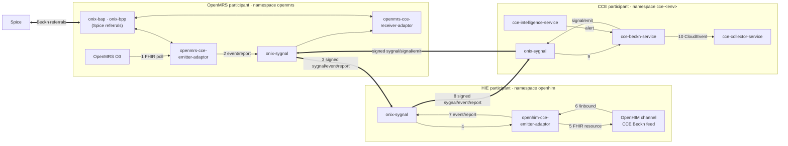

# Beckn add-on

`install-beckn.sh` adds network participants to a machine that `install.sh` has already set up. With it, clinical
events reach CCE over a network instead of a direct HTTP call, and CCE's care alerts reach the HMIS the same way.

Two protocols are in use, side by side:

| Flows | Protocol | Adapters |
|---|---|---|
| **CCE flows**: clinical events OpenMRS → HIE → CCE, care alerts CCE → OpenMRS (and Spice once configured), events Spice → HIE | **Sygnal**, the CCE profile (v2.0): two actions, `sygnal/event/report` (carries `cce:CceClinicalEvent` objects) and `sygnal/signal/emit` (its message is a `cce:CceCareAlert`), no callbacks. See [Change 2026-11-23: payload types](#change-2026-11-23-payload-types) | one Sygnal adapter per participant, `onix-sygnal` (`fidedocker/onix-adapter:1.9.4`), one identity, public address `https://<host>/sygnal/receiver` |
| **Spice ↔ OpenMRS health referrals** | standard **Beckn**, unchanged: `select` / `init` / `confirm` / `status` / `update` and their callbacks | OpenMRS's Beckn adapter pair, `onix-bap` / `onix-bpp` (`fidedocker/onix-adapter:1.6.1`), its BAP and BPP records, `https://<host>/bap/receiver` and `/bpp/receiver`, the Health* referral schemas — exactly as before the Sygnal switch |

CCE and the HIE carry no referrals and run the Sygnal adapter only.



| Arrow | Meaning |
|---|---|
| thick | a hop over the participant's public HTTPS address: signed by the sender's adapter, checked by the receiver's (registry lookup) |
| thin | plain HTTP inside one namespace |

Every Sygnal answer travels back along the same route in the same HTTP call: `202 Ack` for an event, `200 Ack` for an
alert, a `Nack` otherwise. There are no callbacks. Each participant is described in its own repository:
[cce-beckn-service](https://github.com/openphc/cce-beckn-service/tree/demo/docs),
[openhim-cce-emitter-adaptor](https://github.com/openphc/openhim-cce-emitter-adaptor/blob/demo-beckn/docs/beckn-integration.md),
[openmrs-cce-emitter-adaptor](https://github.com/openphc/openmrs-cce-emitter-adaptor/blob/demo-beckn/docs/beckn-integration.md),
[openmrs-cce-receiver-adaptor](https://github.com/openphc/openmrs-cce-receiver-adaptor/blob/demo-beckn/docs/sygnal-integration.md).

- [What it deploys](#what-it-deploys)
- [Before you run it](#before-you-run-it)
- [Run it](#run-it)
- [Check it](#check-it)
- [Configuration keys](#configuration-keys)
- [Identities, keys and the registry](#identities-keys-and-the-registry)
- [Secrets: Infisical `/beckn`](#secrets-infisical-beckn)
- [Referral contract ids](#referral-contract-ids)
- [The timeout chain](#the-timeout-chain)
- [Upgrading from the Beckn-only setup](#upgrading-from-the-beckn-only-setup)
- [Change 2026-11-23: payload types](#change-2026-11-23-payload-types)
- [Copying an OpenMRS](#copying-an-openmrs)
- [Day 2](#day-2)
- [Connecting Spice](#connecting-spice)
- [Troubleshooting](#troubleshooting)
- [Known limits](#known-limits)
- [Scripts](#scripts)

## What it deploys

`BECKN_COMPONENTS` lists the participants this machine hosts. Each has its own adapter(s) and its own public host.

| Component | Namespace | Manifests | What runs |
|---|---|---|---|
| `cce` | `cce-<ENVCODE>` (exists) | [`k8s/beckn/cce`](../../k8s/beckn/cce) | `cce-beckn-service`, `onix-sygnal`, `onix-redis` |
| `openhim` | `BECKN_OPENHIM_NAMESPACE` (`openhim`) | [`k8s/beckn/openhim`](../../k8s/beckn/openhim) | OpenHIM: `openhim-mongo`, `openhim-core`, `openhim-console`; `openhim-cce-emitter-adaptor` (Beckn build); `onix-sygnal`, `onix-redis` |
| `openmrs` | `BECKN_OPENMRS_NAMESPACE` (`openmrs`) | [`k8s/beckn/openmrs`](../../k8s/beckn/openmrs) | OpenMRS O3 3.6.0: `openmrs-db` (MariaDB), `openmrs-backend`, `openmrs-frontend`, `openmrs-gateway`; `openmrs-cce-emitter-adaptor`, `openmrs-cce-receiver-adaptor` (Beckn builds); `onix-sygnal`, `onix-redis`; and the referral pair `onix-bap`, `onix-bpp` |

The Sygnal adapter — [`k8s/beckn/onix`](../../k8s/beckn/onix) — is the same for every participant: one container
`onix-sygnal` on port 8082 with two modules, `/sygnal/receiver/` (published) and `/sygnal/caller/` (in-cluster: the
participant's services post to `http://onix-sygnal:8082/sygnal/caller/<action>`), and the Redis `onix-redis`. Its config
templates are in [`k8s/beckn/onix/config`](../../k8s/beckn/onix/config): `onix.yaml`, `routing-receiver.yaml` (the action
the participant receives → its own service), `routing-caller.yaml` (the action it sends → `context.receiverUri`). It checks
messages against the CCE profile of Sygnal only (`schemaValidator` type `file`, ConfigMap `onix-sygnal-profile`) plus the
schemas of CCE's two payload types (ConfigMap `onix-sygnal-schema`, its own): `CceClinicalEvent` v2.0, the object in
`message.events` of `sygnal/event/report`, and `CceCareAlert` v1.0, the `message` of `sygnal/signal/emit`. It keeps no
copy of the messages (no payload store: they hold patient data).

| Participant | Receives (→ its service) | Sends |
|---|---|---|
| CCE | `sygnal/event/report` → `http://cce-beckn-service:8075/sygnal/event/report` | `sygnal/signal/emit` |
| HIE | `sygnal/event/report` → `http://openhim-cce-emitter-adaptor:8082/sygnal/event/report` | `sygnal/event/report` |
| OpenMRS | `sygnal/signal/emit` → `http://openmrs-cce-receiver-adaptor:8080/sygnal/signal/emit` | `sygnal/event/report` |

OpenMRS's Beckn referral pair — [`k8s/beckn/onix-beckn`](../../k8s/beckn/onix-beckn) — is the adapter pair of the setup
before Sygnal, unchanged: `onix-bap` (port 8081), `onix-bpp` (port 8082), their config templates in
[`k8s/beckn/onix-beckn/config`](../../k8s/beckn/onix-beckn/config) and the Health* referral schemas in
[`k8s/beckn/onix-beckn/health-schema`](../../k8s/beckn/onix-beckn/health-schema). It uses the same Redis. Its schemas
are in the ConfigMap `onix-schema`, as before: `CceClinicalEvent` **v1.0** (the box the referral legs still carry),
`CceCareAlert` v1.0 and the Health* pack. The Sygnal adapter does not read that ConfigMap: an adapter finds a schema by
its type name, so the two versions of `CceClinicalEvent` cannot be in one folder.

Public addresses (Traefik, Let's Encrypt), one host per component:

| Host | Path | Goes to |
|---|---|---|
| every `BECKN_<P>_HOST` | `/sygnal/receiver` | that participant's `onix-sygnal` — its Sygnal address, the `context.receiverUri` its peers send to |
| `BECKN_OPENMRS_HOST` | `/bap/receiver`, `/bpp/receiver` | OpenMRS's `onix-bap` / `onix-bpp` — the two addresses of its referral records |
| `BECKN_OPENHIM_HOST` | `/` | the OpenHIM console |
| `BECKN_OPENHIM_HOST` | `/openhim-api` | the OpenHIM Core API the console calls (prefix stripped) |
| `BECKN_OPENMRS_HOST` | `/` | the O3 gateway: `/openmrs/spa` (the app), `/openmrs` (REST, FHIR) |

Not published: every `/sygnal/caller`, `/bap/caller` and `/bpp/caller`, `cce-beckn-service`, the adaptors' `/sygnal/**`
and `/beckn/**` endpoints, and OpenHIM's channel ports. They carry no token of their own; only pods of the same namespace
reach them.

`openhim` and `openmrs` get a NetworkPolicy ([`k8s/beckn/netpol`](../../k8s/beckn/netpol)) like the CCE namespace's:
own namespace, `kube-system`, public addresses. So the three participants on one machine still talk to each other only
through their public addresses, as they would on three machines.

This is separate from `EMITTER_ADAPTOR`. `k8s/emitters/openhim` is the adaptor inside a CCE environment that posts to
the collector with a token. The Beckn build in `k8s/beckn/openhim` runs beside OpenHIM, has no access to the collector,
and reaches CCE only through the adapters.

## Before you run it

1. `install.sh` has been run for this `ENVCODE` **with `INGRESS_HOST` and `ACME_EMAIL`**. The addresses are HTTPS; the
   add-on uses the Let's Encrypt resolver that install.sh sets up, and stops if it is missing.
2. A DNS name per hosted component points at this machine, and ports 80/443 are reachable from the internet.
3. Each participant has a subscriber record in the network registry for its Sygnal identity, and that subscriber is a
   **member of the Sygnal network** (`BECKN_SYGNAL_NETWORK_ID`, default
   `sygnal.nextsteps.mdtlabs.org/sygnal_demo_network_registry`). You need its subscriber id and key id, and the key pair
   it was registered with. OpenMRS also needs its BAP and BPP records for the referrals, as before. See
   [Identities, keys and the registry](#identities-keys-and-the-registry).
4. The schemas are available: either the machine can clone `BECKN_SCHEMA_REPO` at a `BECKN_SCHEMA_REF` whose `schema/`
   has `sygnal-profile/v2.0/cce-sygnal-apis.yaml`, `CceClinicalEvent/v2.0` and `CceCareAlert/v1.0` (and, with `openmrs`,
   `CceClinicalEvent/v1.0` for the referral pair), or you copied that `schema/` folder to it (`BECKN_SCHEMA_DIR`).
   Without the profile or one of these folders the install stops: the Sygnal adapters cannot start without the profile.
   **Until the cce-beckn-service pull request for the payload types is merged into `demo`, `demo` (the
   default ref) has only v1.0: set `BECKN_SCHEMA_REF=cce-payload-types`, or `BECKN_SCHEMA_DIR` to a checkout of that
   branch** ([Change 2026-11-23](#change-2026-11-23-payload-types)).
5. Every image can be pulled, and they are Sygnal builds for the payload types (`cce-beckn-service` with
   `POST /sygnal/event/report`, the adaptors with `sygnal/event/report` / `sygnal/signal/emit`; all four send and
   expect `cce:CceClinicalEvent` / `cce:CceCareAlert`). Today the `cce-beckn-service` package on GHCR needs a
   login, so its image is built and imported by hand — see [Troubleshooting](#troubleshooting).
6. Capacity: the three components add about 0.75 vCPU of requests and, in use, about 2.5 GiB of memory. OpenMRS's backend
   alone holds over 1 GiB.

## Run it

Add the `BECKN_*` keys to the config file of the environment ([`config/example.env`](../config/example.env), "Beckn
add-on"), put the adapters' private keys in a seed file outside the repository, then:

```bash
sudo bash one-click-installer/install-beckn.sh --config one-click-installer/config/<env>.env
```

| Option | Effect |
|---|---|
| `--yes` | skips the confirmation |
| `--only cce,openhim` | limits this run to some components of `BECKN_COMPONENTS` |
| `DRY_RUN=1` (environment) | seeds Infisical, renders and checks everything, prints the resources, applies nothing |

| Phase | Script | What it does |
|---|---|---|
| 1 Secrets | [`beckn-seed.sh`](../lib/beckn/beckn-seed.sh) | fills Infisical `/beckn`: seed-file values, generated passwords, the referral contract ids. Stops if a private key is missing |
| 2 Schemas | (in `install-beckn.sh`) | `BECKN_SCHEMA_DIR`, or a clone of `BECKN_SCHEMA_REPO` at `BECKN_SCHEMA_REF`; the CCE profile (`BECKN_SYGNAL_PROFILE`, by default `sygnal-profile/v2.0/cce-sygnal-apis.yaml` in it) and the version folders of `BECKN_SYGNAL_SCHEMAS` (with `openmrs`: of `BECKN_REFERRAL_SCHEMAS` too) must be there |
| 3 Deploy | [`beckn-deploy.sh`](../lib/beckn/beckn-deploy.sh) per component | Secret `onix-config`, ConfigMaps `onix-sygnal-profile` and `onix-sygnal-schema` (the Sygnal adapter's schemas), openmrs: also `onix-schema` (the referral pair's), `kubectl apply` of the rendered component, host aliases on the adapter pods; cce / openhim: removes the old `onix-bap` / `onix-bpp` and the ConfigMap `onix-schema`; cce: the intelligence service's alert routes |
| 4 Configure and wait | [`openhim-setup.sh`](../lib/beckn/openhim-setup.sh) | OpenHIM root password, clients, channels; then waits for every deployment (reports, never aborts) |

Safe to re-run. A pod restarts only when a value it reads changed. A first OpenMRS start on an empty database installs
the reference application and takes 10–20 minutes.

## Check it

```bash
sudo bash one-click-installer/lib/beckn/run.sh --config one-click-installer/config/<env>.env beckn-status.sh
```

Per component it shows: pods ready; each adapter's `Preloaded N schemas`; the Sygnal subscriber in the registry (live,
same signing key as configured, member of `BECKN_SYGNAL_NETWORK_ID`; the record's url is shown when it differs, for
information); and the public address `https://<host>/sygnal/receiver/<action>` (an empty, unsigned request must be refused
by the adapter with 400 or 401). For OpenMRS the same for its referral pair (`/bap/receiver`, `/bpp/receiver`). It ends
with the ids and addresses to give the other participants and the referral contract ids. It changes nothing.

To see one event travel: change something in OpenMRS (for example save an encounter), wait for the next poll (30 s) and
read the logs, in this order.

| # | Where | A good line |
|---|---|---|
| 1 | `kubectl -n openmrs logs deploy/openmrs-cce-emitter-adaptor` | `sygnal/event/report` … `ACK` |
| 2 | `kubectl -n openhim logs deploy/openhim-cce-emitter-adaptor` | the event received, `OpenHIM channel answered …: HTTP 202`, CCE's `ACK` |
| 3 | `kubectl -n cce-<env> logs deploy/cce-beckn-service` | `dir=IN action=sygnal/event/report … result=OK` |
| 4 | CCE database | `select source, status, received_at from inbound_event_log order by received_at desc limit 5;` — `source` is the HIE's id |
| 5 | OpenHIM console → Transaction Log | one `Successful` transaction on `/cce-beckn`, status 202 |

A patient needs a national id for the emitter to send its resources (`PATIENT_NATIONAL_ID_ON_MISSING=skip`).

## Configuration keys

All in the environment's config file. `lib/load-config.sh` accepts any key that starts with `BECKN_`;
[`beckn-lib.sh`](../lib/beckn/beckn-lib.sh) fills the defaults (`beckn_defaults`) and validates (`beckn_validate`).
`P` is `CCE`, `OPENHIM` or `OPENMRS`.

| Key | Default | Meaning |
|---|---|---|
| `BECKN_COMPONENTS` | `cce openhim openmrs` | the participants this machine hosts (spaces or commas) |
| `BECKN_REGISTRY_URL` | `https://fabric.nfh.global/registry/dedi` | the DeDi registry every adapter looks senders up in |
| `BECKN_REGISTRY_NAME` | required with `openmrs` | the registry name OpenMRS's referral pair (onix 1.6.1) puts in its lookups. The Sygnal adapters search every registry and do not use it |
| `BECKN_SYGNAL_NETWORK_ID` | `sygnal.nextsteps.mdtlabs.org/sygnal_demo_network_registry` | the Sygnal network: `context.networkId` of every Sygnal message (the registry refuses a sender that is not a member), and the only network the Sygnal adapters accept senders from |
| `BECKN_SYGNAL_ALLOWED_NETWORK_IDS` | `BECKN_SYGNAL_NETWORK_ID` | comma-separated list for the Sygnal adapters, to accept more than one network |
| `BECKN_NETWORK_ID`, `BECKN_ALLOWED_NETWORK_IDS` | empty | the network of the Spice ↔ OpenMRS **referrals** (unchanged meaning): their `context.networkId` and the `allowedNetworkIDs` of OpenMRS's `onix-bap` / `onix-bpp`. Empty: no `networkId`, no membership check |
| `BECKN_<P>_HOST` | required when hosted | the participant's public host |
| `BECKN_<P>_ID`, `BECKN_<P>_KEY_ID` | see [Identities](#identities-keys-and-the-registry) | the participant's Sygnal identity: subscriber id and registry record (key) id. The id is needed for a participant hosted elsewhere too: its neighbours name it in every message |
| `BECKN_<P>_URI` | `https://<host>/sygnal/receiver` | the participant's Sygnal address. Set it for a participant hosted elsewhere when you give no `BECKN_<P>_HOST` |
| `BECKN_OPENMRS_BAP_ID`, `_BAP_KEY_ID`, `_BPP_ID`, `_BPP_KEY_ID` | required with `openmrs` | OpenMRS's referral records |
| `BECKN_OPENMRS_BAP_URI`, `_BPP_URI` | `https://<host>/bap/receiver`, `…/bpp/receiver` | their addresses |
| `BECKN_SIGNING_PUBLIC_KEY`, `BECKN_ENCR_PUBLIC_KEY` | required | the adapters' public keys. Per participant: `BECKN_<P>_…`; per record: `BECKN_<P>_BAP_…` / `BECKN_<P>_BPP_…`. The most specific one wins |
| `BECKN_SEED_ENV_FILE` | empty | seed file for Infisical `/beckn` (below) |
| `BECKN_SCHEMA_DIR` | empty | folder holding `sygnal-profile/`, `CceClinicalEvent/` and `CceCareAlert/` (cce-beckn-service's `schema/`). Empty: clone `BECKN_SCHEMA_REPO` (`https://github.com/openphc/cce-beckn-service.git`) at `BECKN_SCHEMA_REF` and use its `schema/` |
| `BECKN_SCHEMA_REF` | `demo` | the branch or tag of `BECKN_SCHEMA_REPO` to take the schemas from. It must have `sygnal-profile/v2.0`. Until the payload types are merged into `demo`: `cce-payload-types` ([Change 2026-11-23](#change-2026-11-23-payload-types)) |
| `BECKN_SYGNAL_PROFILE` | `<schema>/sygnal-profile/v2.0/cce-sygnal-apis.yaml` | the CCE profile of Sygnal, the Sygnal adapters' only spec |
| `BECKN_SYGNAL_SCHEMAS` | `CceClinicalEvent/v2.0 CceCareAlert/v1.0` | the `<Type>/<version>` folders of the schema folder every Sygnal adapter holds (ConfigMap `onix-sygnal-schema`). One version per type |
| `BECKN_REFERRAL_SCHEMAS` | `CceClinicalEvent/v1.0 CceCareAlert/v1.0` | the same for OpenMRS's referral pair (ConfigMap `onix-schema`, with the Health* pack): what it held before, unchanged |
| `BECKN_SCHEMA_BASE_URL` | `https://raw.githubusercontent.com/openphc/cce-beckn-service/main/schema` | the start of the `@context` address in every message. Must be the same for all participants; it need not be downloadable, because each adapter has a local copy |
| `BECKN_SCHEMA_ALLOWED_DOMAINS` | `beckn.org,raw.githubusercontent.com,schema.beckn.io` | the domains an adapter may fetch an unknown schema from |
| `BECKN_CORE_SCHEMA_URL` | the Beckn core v2.0.0 spec | what OpenMRS's referral pair checks messages against (the Sygnal adapters use the CCE profile) |
| `IMAGE_CCE_BECKN_SERVICE` | `latest` | tag or `sha256:` digest of `cce-beckn-service` |
| `IMAGE_OPENHIM_BECKN_EMITTER_ADAPTOR`, `IMAGE_OPENMRS_CCE_EMITTER_ADAPTOR`, `IMAGE_OPENMRS_CCE_RECEIVER_ADAPTOR` | `demo-beckn-latest` | the three adaptors |
| `BECKN_CCE_IMAGE_PULL_POLICY` | `IfNotPresent` | `Always` once the `cce-beckn-service` image can be pulled without a login |
| `BECKN_SPICE_ID`, `BECKN_SPICE_URI` | empty (`BECKN_SPICE_ID`: `BECKN_SPICE_BAP_ID`) | Spice on Sygnal, see [Connecting Spice](#connecting-spice) |
| `BECKN_SPICE_BAP_ID`, `_BAP_URI`, `_BPP_ID`, `_BPP_URI`, `_FACILITY_CODES` | empty | Spice for the referrals (unchanged) |
| `BECKN_REFERRALS_ENABLED` | `false` | the two referral legs of the OpenMRS emitter |
| `BECKN_HEALTH_ID_TYPES` | `NID=national-id` | health referrals from Spice: the OpenMRS identifier type for each patient health id system (`SYSTEM=type`, `;`-separated). The default stores Spice's national id (system `NID`) as `national-id`, the id the OpenMRS emitter sends to CCE |
| `BECKN_OPENHIM_NAMESPACE`, `BECKN_OPENMRS_NAMESPACE` | `openhim`, `openmrs` | namespaces |
| `BECKN_OPENMRS_HOST_DIR` | `/opt/openmrs` | node folder with OpenMRS's frontend site files |
| `BECKN_ONIX_LOG_LEVEL` | `info` | `debug` prints message bodies, which hold patient data |
| `BECKN_OPENHIM_FACILITY_FILTER_IDS` | empty | the HIE adaptor's facility filter; empty = every facility |
| `BECKN_OPENHIM_REDACTION_ENABLED` | `false` | the HIE adaptor's clinical-data redaction (`REDACTION_ENABLED`). Off by default: full payloads, patient data included, go to CCE, because protocol triggers read free text redaction removes, e.g. the RMNCH referral steps (`ServiceRequest.patientInstruction` / `orderDetail`, the Encounter `source-referral-order` extension). `true` redacts, where no trigger needs that content |

No longer read: `BECKN_CCE_BAP_*`, `BECKN_OPENHIM_BPP_*`, `BECKN_CCE_BPP_URI` / `BECKN_OPENHIM_BAP_URI` (the Sygnal
address replaces them), and the contract ids of the CCE flows (`BECKN_HIE_CCE_*`, `BECKN_HIE_FEED_OPENMRS_*`).

`IMAGE_REGISTRY` applies to the four images above as it does to the CCE services. The ONIX images
(`fidedocker/onix-adapter:1.9.4` for Sygnal, `:1.6.1` for OpenMRS's referral pair), OpenHIM, MongoDB, MariaDB and OpenMRS
versions are fixed in the manifests.

## Identities, keys and the registry

Each participant has **one Sygnal identity**: `BECKN_<P>_ID` and `BECKN_<P>_KEY_ID`. When they are unset, the record the
participant used before the switch is taken, so an existing config keeps working:

| Participant | Sygnal id when `BECKN_<P>_ID` is unset | Also |
|---|---|---|
| CCE | `BECKN_CCE_BPP_ID` / `BECKN_CCE_BPP_KEY_ID` | — |
| HIE | `BECKN_OPENHIM_BAP_ID` / `BECKN_OPENHIM_BAP_KEY_ID` | — |
| OpenMRS | `BECKN_OPENMRS_BAP_ID` / `BECKN_OPENMRS_BAP_KEY_ID` | its BAP **and** BPP records for the referral pair, as before |

Keys follow the same rule: for the Sygnal adapter the record's own key (`BECKN_CCE_BPP_…`, `BECKN_OPENHIM_BAP_…`,
`BECKN_OPENMRS_BAP_…`) wins, then the participant's (`BECKN_<P>_…`), then the shared pair (`BECKN_…`). OpenMRS's referral
pair reads `BECKN_OPENMRS_BAP_…` / `BECKN_OPENMRS_BPP_…`, then the same two fallbacks, as before.

**The registry.** Delivery never uses the URL in a registry record: a Sygnal sender puts the receiver's address in
`context.receiverUri` (these come from `BECKN_<P>_URI`), a Beckn sender puts it in `bapUri` / `bppUri`. What matters is:

- every id that sends or receives Sygnal — CCE, the HIE, OpenMRS, and Spice once connected — is a **member of
  `sygnal.nextsteps.mdtlabs.org/sygnal_demo_network_registry`** (`BECKN_SYGNAL_NETWORK_ID`): the registry refuses a
  sender that is not, and every Sygnal adapter accepts only members. `beckn-status.sh` checks it;
- the signing key in the record is the one configured here.

Changing a record's URL to `https://<host>/sygnal/receiver` is optional, and only for ids used by Sygnal alone (CCE, the
HIE). **Do not change the OpenMRS or Spice records**: their ids also carry the Spice referrals.

## Secrets: Infisical `/beckn`

Stored in the environment's Infisical project, folder `/beckn`. `beckn-seed.sh` never overwrites a value that exists,
except with a value from the seed file.

| Key | How it gets its value | Used by |
|---|---|---|
| `BECKN_SIGNING_PRIVATE_KEY`, `BECKN_ENCR_PRIVATE_KEY` (or `BECKN_<P>_…`, `BECKN_<P>_BAP_…`, `BECKN_<P>_BPP_…`) | **seed file, required once** | the adapters (Secret `onix-config`) |
| `BECKN_REFERRALS_IN_CONTRACT_ID`, `_TRANSACTION_ID` | generated UUID (with `openmrs`) | [referral contract ids](#referral-contract-ids) |
| `BECKN_REFERRALS_OUT_CONTRACT_ID`, `_TRANSACTION_ID` | blank until supplied (Spice supplies them) | OpenMRS emitter |
| `CCE_BECKN_ALERTS_WEBHOOK_SECRET` | generated | `cce-beckn-service`; must equal `config.webhookSecret` of its receiver-adaptor records in the intelligence service |
| `OPENHIM_ROOT_USER`, `OPENHIM_ROOT_PASSWORD` | `root@openhim.org`, generated | OpenHIM console login; the HIE adaptor's mediator login |
| `OPENHIM_CLIENT_PASSWORD_<CLIENTID>` | generated, one per client in [`openhim-metadata.json`](../../k8s/beckn/openhim/openhim-metadata.json) | Basic auth on the OpenHIM channels |
| `OPENMRS_DB_PASSWORD`, `OPENMRS_DB_ROOT_PASSWORD` | generated | MariaDB |
| `OPENMRS_ADMIN_USER`, `OPENMRS_ADMIN_PASSWORD` | `admin`, `Admin123` | the OpenMRS account the two adaptors sign in with |
| `OPENHIM_PUBLIC_URL`, `OPENMRS_PUBLIC_URL` | from the config, every run | `tools/show-credentials.sh` |

The contract ids an earlier install generated for the CCE flows (`BECKN_HIE_CCE_*`, `BECKN_HIE_FEED_OPENMRS_*`) are no
longer read: Sygnal messages carry none, and every `transactionId` and `messageId` is a new UUID. They may be deleted.

`OPENMRS_ADMIN_*` is not created by the installer. It must **match an account in the OpenMRS database**. `admin` /
`Admin123` is what the O3 reference application installs and is publicly documented: on a host reachable from the
internet, change the password in OpenMRS, set the same value here, and run `install-beckn.sh --only openmrs`.

The seed file (`BECKN_SEED_ENV_FILE`) has the format of the installer's seed file ([config.md](config.md#format)). Keys
that are not `BECKN_*`, `OPENHIM_*`, `OPENMRS_*` or `CCE_BECKN_*` are ignored. Once the private keys are in Infisical the
file is no longer needed: delete it and empty the key.

`sudo bash one-click-installer/tools/show-credentials.sh <env> [--reveal]` lists the OpenHIM and OpenMRS logins, the
channel client passwords and the webhook secret. Private keys are never printed.

## Referral contract ids

Only the Spice ↔ OpenMRS referrals (standard Beckn) use contract ids; nothing about them changed. No message opens a
contract (there is no `confirm` from OpenMRS's side), so each sender puts a contract id and a `transactionId` of its own
in its messages; a receiver accepts any non-blank contract id from the sender it knows and echoes it.
`beckn-status.sh` prints them.

| Contract | Consumer → provider | Keys | Read by |
|---|---|---|---|
| Referrals in | Spice → OpenMRS | `BECKN_REFERRALS_IN_*` | OpenMRS emitter, for the `on_status` (a referral's outcome) it sends to Spice. Agree the pair with Spice. Spice's own `update` may carry any id |
| Referrals out | OpenMRS → Spice | `BECKN_REFERRALS_OUT_*` | OpenMRS emitter, for the `update` (a new referral) it sends to Spice. Spice supplies the pair |

To use ids agreed with Spice instead of generated ones, put them in `BECKN_SEED_ENV_FILE` before the run.

The CCE flows have no contract ids. The receivers check who sent a message instead: `cce-beckn-service` accepts an event
from any sender its adapter verified; the HIE adaptor accepts `context.senderId` from its subscriber list (OpenMRS, and
Spice once configured); the OpenMRS receiver accepts an alert whose `context.senderId` is CCE's id.

## The timeout chain

There is no queue on the routes: each hop waits for the hop behind it in the same HTTP call, so **each wait must be
longer than the one inside it**. The adapters' default (`responseHeaderTimeout: 5s`) is too short. `beckn-deploy.sh` sets
the adapter values (and explains them); the manifests and `openhim-metadata.json` set the rest.

`sygnal/event/report`, OpenMRS → HIE → CCE:

| Hop | Waits |
|---|---|
| `cce-beckn-service` → collector | 15 s |
| CCE `onix-sygnal` receiver → `cce-beckn-service` | 18 s |
| HIE `onix-sygnal` caller → CCE; HIE adaptor → its `onix-sygnal` | 20 s |
| OpenHIM channel `CCE Beckn feed` → the adaptor's `/inbound` | 22.5 s |
| HIE adaptor → OpenHIM channel | 25 s |
| HIE `onix-sygnal` receiver → HIE adaptor | 30 s |
| OpenMRS `onix-sygnal` caller → HIE | 40 s |
| OpenMRS emitter → its adapters | 50 s (one setting for every leg; the referral pair's `onix-bap` waits 45 s) |

`sygnal/signal/emit`, CCE → OpenMRS:

| Hop | Waits |
|---|---|
| OpenMRS `onix-sygnal` receiver → receiver adaptor | 5 s |
| CCE `onix-sygnal` caller → OpenMRS | 6 s |
| `cce-beckn-service` → its `onix-sygnal` | 7 s (the intelligence service gives `cce-beckn-service` 10 s) |

OpenMRS's referral pair keeps its values: `onix-bpp` → receiver 45 s, `onix-bap` → Spice 45 s, callbacks 5 s in and 10 s
out. Every adapter's own HTTP server write timeout is 60 s. If a hop gives up before the one inside it, the sender sees a
failure for an event that got through; a resend carries the same event id, which CCE's collector recognises, so nothing is
counted twice.

## Upgrading from the Beckn-only setup

`install-beckn.sh` on a machine that ran the earlier (Beckn `update` / `on_update`) version:

- removes `onix-bap` / `onix-bpp` from the CCE and HIE namespaces (the Sygnal adapter replaces them); OpenMRS keeps
  them for the referrals. The Ingress `onix-ingress` now serves `/sygnal/receiver`; OpenMRS's `/bap/receiver` and
  `/bpp/receiver` move to `onix-beckn-ingress`;
- changes the OpenHIM channel `CCE Beckn feed` timeout from 30 s to 22.5 s (`openhim-setup.sh` updates it);
- needs Sygnal builds of all four images and a `BECKN_SCHEMA_REF` / `BECKN_SCHEMA_DIR` with the CCE profile (v2.0, see
  [Change 2026-11-23: payload types](#change-2026-11-23-payload-types)).

Config changes: `BECKN_NETWORK_ID` keeps its meaning for the referrals; the Sygnal network is the new
`BECKN_SYGNAL_NETWORK_ID` (defaulted). `BECKN_<P>_ID` / `_KEY_ID` default to the old records (above). Add
`BECKN_SPICE_URI` when Spice is to receive alerts.

## Change 2026-11-23: payload types

The payloads of the two Sygnal actions are now CCE's own types. The CCE profile of Sygnal is `sygnal-profile/v2.0`
(v1.0 is gone) and the Sygnal messages use `CceClinicalEvent` v2.0 and `CceCareAlert` v1.0. `CceClinicalEvent` v1.0
stays in cce-beckn-service's `schema/`, because the Spice ↔ OpenMRS referral legs (standard Beckn, unchanged) still
carry it.

| Action | Before (profile v1.0) | Now (profile v2.0) |
|---|---|---|
| `sygnal/event/report` | each entry of `message.events` was a `sygnal:CoordinationEvent`; the CCE data sat in its `eventAttributes` bag (`CceClinicalEvent` v1.0) | each entry of `message.events` **is** a `cce:CceClinicalEvent` (v2.0): `@context`, `@type`, `id` (the event id, the same on every hop and every retry), `occurredAt`, `patientId`, `fhirVersion`, `resource` (the FHIR R4 resource), and optionally `facilityId`, `facilityName`, `sourceEventId`. Exactly one event; the object is closed (no other field). The optional `policyId` next to `events` stays |
| `sygnal/signal/emit` | `message` was a `sygnal:Signal`; the alert sat in its `signalAttributes` bag (`CceCareAlert` v1.0) | `message` **is** the `cce:CceCareAlert` (v1.0, the schema did not change): `@context`, `@type`, `patientId`, `severity` (`LOW`, `MEDIUM`, `HIGH`, `CRITICAL`), `stepStatus`, optionally `slaStatus`, `fhirVersion`, `resource` (a FHIR `CommunicationRequest` or `Task`). The delivery id is `context.messageId`: a repeated alert has the same one, and a receiver de-duplicates on it |

No longer in a Sygnal message: the `sygnal:CoordinationEvent` wrapper with `revision`, `eventType`, `granularity`, `from`
and `eventAttributes` (the kind of clinical event is `resource.resourceType`); the `sygnal:Signal` wrapper with `id`,
`signalType`, `target`, the Sygnal severity (`INFO` / `WARNING` / `CRITICAL`), `basis`, `issuedAt` and
`signalAttributes`.

Why:

1. `sygnal:CoordinationEvent` has no place for a FHIR resource.
2. It is closed (`additionalProperties: false`), so a FHIR resource cannot be added as an extra field.
3. `cce:CceClinicalEvent` cannot extend it without a change to `sygnal:CoordinationEvent` itself: a closed base type
   refuses the fields of a type that extends it.

`sygnal:Signal` is replaced the same way, to keep the two messages alike.

Unchanged: the two action names and paths, the Sygnal context (`senderId`, `receiverId`, `receiverUri`, `networkId`), the
`Ack` / `Nack` answers and their status codes, no callbacks, the retry rules, the Sygnal adapters' config and routing,
the identities and the [timeout chain](#the-timeout-chain). **No application setting changed.** The Spice ↔ OpenMRS
referrals are untouched: `onix-bap` / `onix-bpp`, their config, their routing and the schemas they hold are what they
were, and the referral legs still carry the `CceClinicalEvent` **v1.0** box in `performanceAttributes` (with `eventType`,
without `id` / `occurredAt`).

**Two schema sets.** An adapter finds a local schema by its **type name** and ignores the version folder, so it can hold
only one version of a type, and two versions of `CceClinicalEvent` are in use. Each kind of adapter therefore has its
own ConfigMap, and its version folders are named explicitly: nothing is shipped because it happens to be in the schema
folder, and there is no "newest wins".

| Adapters | ConfigMap | Version folders | Setting (default) |
|---|---|---|---|
| `onix-sygnal`, every participant | `onix-sygnal-schema` (new) | `CceClinicalEvent/v2.0`, `CceCareAlert/v1.0` | `BECKN_SYGNAL_SCHEMAS` (`CceClinicalEvent/v2.0 CceCareAlert/v1.0`) |
| `onix-bap` / `onix-bpp`, OpenMRS only | `onix-schema` (as before) | `CceClinicalEvent/v1.0`, `CceCareAlert/v1.0`, and the Health* pack of this repository | `BECKN_REFERRAL_SCHEMAS` (`CceClinicalEvent/v1.0 CceCareAlert/v1.0`) |

What it means for an install:

- The installer ships the profile `sygnal-profile/v2.0/cce-sygnal-apis.yaml` (the version is named once, in
  [`beckn-lib.sh`](../lib/beckn/beckn-lib.sh): `BECKN_SYGNAL_PROFILE_REL`) and stops when the schema folder does not
  have it, naming the versions it found instead. It also stops when a version folder of one of the two sets is missing,
  or when a set would hold a type twice. Each run prints what each set holds.
- `onix-sygnal` no longer mounts `onix-schema`. In the CCE and HIE namespaces, which have no referral pair,
  `install-beckn.sh` removes that ConfigMap.
- **The schema source must have v2.0.** The default `BECKN_SCHEMA_REF` is `demo`, and `demo` of cce-beckn-service has
  only v1.0 until its pull request for this change is merged. Until then set `BECKN_SCHEMA_REF=cce-payload-types` (the
  branch of that change), or `BECKN_SCHEMA_DIR` to the `schema/` folder of a checkout of it. Once it is merged, remove
  the setting.
- All four images (`cce-beckn-service`, the HIE adaptor, the two OpenMRS adaptors) must be builds for the payload types,
  on every participant at the same time: a receiving Sygnal adapter refuses a message in the former shape (schema
  check, a `Nack`).
- Then re-run `install-beckn.sh`. It replaces the ConfigMap `onix-sygnal-profile`, creates `onix-sygnal-schema`, and
  restarts, once, the adapters and the pods that read their settings at start (`cce-beckn-service`; the HIE adaptor and
  the OpenHIM console; the two OpenMRS adaptors and the OpenMRS frontend): the Deployment `onix-sygnal` changed, and the
  hashes that roll those pods cover the rendered manifests, the profile and the schemas. Databases, OpenHIM Core and the
  OpenMRS backend are not restarted. The referral pair restarts with the config and schemas it had.

## Copying an OpenMRS

To make the k3s OpenMRS a copy of a docker-compose OpenMRS (the dev layout: containers `openmrs-db` and
`openmrs-backend`, site files under `/opt/openmrs`):

```bash
# on the SOURCE machine — needs docker and this one file; read-only, the source keeps running
sudo bash openmrs-export.sh /root/openmrs-export.tgz

# copy the archive to the target over SSH, then on the TARGET machine, after install-beckn.sh:
sudo bash one-click-installer/lib/beckn/run.sh --config one-click-installer/config/<env>.env \
     openmrs-import.sh /root/openmrs-export.tgz
```

| Part | What the import does |
|---|---|
| Database | drops `openmrs`, recreates it, restores the dump |
| `/openmrs/data` | empties the backend's volume and fills it: configuration, modules, images, search index, runtime properties (rewritten to this installation's database login). Logs, the library cache and the message broker's journal are not copied; OpenMRS rebuilds them |
| Frontend | `config-core_demo.json` and `frontend/custom-esms/` under `BECKN_OPENMRS_HOST_DIR`; restarts the frontend |
| Adaptors | stopped for the import, started after. The emitter's checkpoint is left alone; a new emitter starts from "now" and does not send history |

It asks before replacing anything (`--yes` to skip) and prints the patient counts on both sides first. **The archive holds
patient data**: move it over SSH and delete it on both machines after the import.

The OpenMRS accounts come with the database. The last step tries the adaptors' login (`OPENMRS_ADMIN_*`) against the
imported OpenMRS and tells you when it is not accepted.

Without a copy, OpenMRS starts as a stock O3 reference application: `beckn-deploy.sh` writes an empty
`config-core_demo.json` and creates an empty `frontend/custom-esms/`.

## Day 2

| Task | Command |
|---|---|
| Change a `BECKN_*` key, an image tag, or a value in Infisical `/beckn` | change it, then `install-beckn.sh --config … [--only <component>]` |
| Roll a new build of a mutable tag (`demo-beckn-latest`) | `kubectl -n <ns> rollout restart deploy/<name>` (the adaptors pull on every start) |
| Add or change an OpenHIM client or channel | edit `k8s/beckn/openhim/openhim-metadata.json`, then `run.sh --config … openhim-setup.sh` (creates or updates; never deletes) |
| Run one script by hand | `sudo bash one-click-installer/lib/beckn/run.sh --config <file> <script> [args]` — config and secrets loaded, as install-beckn.sh does |
| CCE's public host changes | change `INGRESS_HOST` and `BECKN_CCE_HOST`, run `install.sh`, then `install-beckn.sh`, then give the peers the new Sygnal address (`BECKN_CCE_URI`: the HIE's `OPENHIM_EMITTER_BECKN_CCE_URI` follows from it when the HIE is on this machine) |

`install.sh` and `lib/redeploy.sh` do not touch the Beckn resources, and `install-beckn.sh` does not touch the CCE
services.

## Connecting Spice

Spice has two roles, on two protocols.

**Sygnal (CCE flows).** Spice sends `sygnal/event/report` to the HIE, and receives CCE's care alerts as
`sygnal/signal/emit`.

1. Give the Spice team: the HIE's id and address (`BECKN_OPENHIM_ID`, `https://<HIE host>/sygnal/receiver`), CCE's id,
   `BECKN_SYGNAL_NETWORK_ID`, `BECKN_SCHEMA_BASE_URL`, and the CCE profile (v2.0) with the `CceClinicalEvent` v2.0 and
   `CceCareAlert` v1.0 schemas: Spice sends `cce:CceClinicalEvent` objects and receives a `cce:CceCareAlert` as the
   message ([Change 2026-11-23](#change-2026-11-23-payload-types)).
2. Get from them: Spice's Sygnal subscriber id and its Sygnal address. Spice's id must be a member of the Sygnal network.
3. Set `BECKN_SPICE_ID` (default: `BECKN_SPICE_BAP_ID`) and `BECKN_SPICE_URI`, and run `install-beckn.sh --only cce,openhim`.
   The HIE then accepts Spice's events (source `spice`), and CCE lists Spice in its `hmis.yml` and gets an intelligence
   destination `SPICE`. Without `BECKN_SPICE_URI` CCE sends Spice no alerts (a warning says so).

**Beckn referrals with OpenMRS (unchanged).** Until Spice's BAP id is known, the OpenMRS receiver runs with placeholder
ids (`bap.spice.invalid`) because it does not start without any.

1. Give the Spice team: OpenMRS's BAP and BPP ids and addresses, `BECKN_NETWORK_ID`, and the "Referrals in" ids from
   `beckn-status.sh` (OpenMRS sends referral outcomes with them).
2. Get from them: Spice's BAP and BPP subscriber ids and addresses, the facility codes Spice serves, and the "Referrals
   out" contract id and `transactionId`.
3. Set `BECKN_SPICE_BAP_ID`, `BECKN_SPICE_BAP_URI`, `BECKN_SPICE_BPP_ID`, `BECKN_SPICE_BPP_URI`,
   `BECKN_SPICE_FACILITY_CODES` in the config, and `BECKN_REFERRALS_OUT_CONTRACT_ID` / `_TRANSACTION_ID` in Infisical
   `/beckn` (or the seed file). The OpenMRS receiver then accepts Spice's referrals.
4. Set `BECKN_REFERRALS_ENABLED=true` to turn on the emitter's two referral legs, and run
   `install-beckn.sh --only openmrs`.

## Troubleshooting

| Symptom | Cause | Fix |
|---|---|---|
| An adapter in `CrashLoopBackOff` with exit code 0; the log ends `Loading keys from configuration`, `Application finished` | a key is not valid base64 — typically the private key lost its trailing `=` | check the length of the value in Infisical `/beckn` (an Ed25519 key is 44 characters); re-seed from the file |
| `install-beckn.sh` stops: `no CCE Sygnal profile at …/sygnal-profile/v2.0/cce-sygnal-apis.yaml`, and it names `sygnal-profile/v1.0/…` as what it found | the schema source is from before the payload types (`demo` of cce-beckn-service until that change is merged) | `BECKN_SCHEMA_REF=cce-payload-types`, or `BECKN_SCHEMA_DIR` to a checkout of that branch |
| `onix-sygnal` does not start: cannot read `./config/sygnal/cce-sygnal-apis.yaml` | the ConfigMap `onix-sygnal-profile` is missing | re-run `install-beckn.sh` with a schema folder that has `sygnal-profile/v2.0/` |
| `install-beckn.sh` stops: `BECKN_SYGNAL_SCHEMAS: no CceClinicalEvent/v2.0/attributes.yaml in …` (or `BECKN_REFERRAL_SCHEMAS: no CceClinicalEvent/v1.0/…`) | the schema source lacks a version folder one of the two schema sets names | as above for v2.0; for v1.0 use a cce-beckn-service ref that still has `CceClinicalEvent/v1.0` (the referral legs use it) |
| A Sygnal adapter answers a `Nack` about the schema for every event or alert, right after this change | one side still runs an image from before the payload types (it sends `sygnal:CoordinationEvent` / `sygnal:Signal`), or an adapter still holds the v1.0 profile | deploy the payload-types builds of all four images, and re-run `install-beckn.sh` on every participant |
| `onix-sygnal` logs a WARN `running non-canonical value (canonical="url" actual="file")` | expected: the CCE profile, not the Beckn core spec, is its spec | nothing |
| A sender gets a Nack from the registry / the receiving adapter refuses a signed message | the sender's id is not a member of `BECKN_SYGNAL_NETWORK_ID` (or `context.networkId` is another network), or the record's key differs | `beckn-status.sh` shows each record; fix the registry membership or the config |
| `cce-beckn-service` in `ImagePullBackOff` / `ErrImageNeverPull` | the GHCR package needs a login | build it and import it: `docker build -t ghcr.io/openphc/cce-beckn-service:<tag> .` in the `cce-beckn-service` repository (`demo`), `docker save … \| gzip \| ssh <host> 'gunzip \| sudo k3s ctr images import -'`, then `IMAGE_CCE_BECKN_SERVICE=<tag>` and `BECKN_CCE_IMAGE_PULL_POLICY=IfNotPresent` |
| HIE adaptor: `OpenHIM channel answered …: no answer (SocketTimeoutException)`; OpenHIM Core logs `Parse Error: Invalid method encountered` | an `https://` URL on OpenHIM's plain-HTTP channel port. 5001 is HTTP, 5000 is HTTPS | `OPENHIM_EMITTER_BECKN_OPENHIM_CHANNEL_URL=http://openhim-core:5001/cce-beckn` (the manifest's value) |
| `openhim-mongo` or `openmrs-db` never ready; `gosu` at 100 % CPU in the pod | started as root, the image's entrypoint switches user with `gosu`, which hangs on k3s/containerd with Ubuntu 26.04 | the manifests run both as their own user (`runAsUser: 999`); keep that |
| OpenMRS answers on `/openmrs/health/started` but REST and FHIR are 404; the backend pod stays not ready | the core started, its modules did not. After an import: the message broker's journal was copied incompletely | `kubectl -n <ns> logs deploy/openmrs-backend \| grep -E 'ERROR\|Exception' \| head`. Re-export with the current `openmrs-export.sh` and import again |
| Emitter: a Nack or a timeout for every event | a hop on the route is down or a wait is too short | follow the logs in the order of [Check it](#check-it); the first hop without a good line is the one |
| HIE adaptor answers a Nack, text `ignored: …` | the subscriber's `source-system` is not a source key of the adaptor | sources are `openmrs`, `spice`, `ebuzima`, `spice-facility`; see `beckn-deploy.sh` (`OPENHIM_ADAPTOR_SPRING_JSON`) |
| A value ending in `=` arrives in Infisical one character short | a seed-file parser bug, fixed here in both `beckn-seed.sh` and `infisical-seed.sh` | re-run with the current scripts |
| A pod stays `Pending` with `Insufficient cpu` | the node's CPU requests are used up (the CCE overlay is sized for production) | lower replica counts or requests of the CCE services, or use a larger machine |

## Known limits

- **Prometheus** does not scrape the Beckn services: the base config has a fixed target list, and the two extra
  namespaces are closed to it. The pods carry the usual `prometheus.io/*` annotations.
- **Alerts from CCE to an HMIS** (`sygnal/signal/emit`) go straight to that HMIS, not through the HIE (the HIE adaptor
  has no `sygnal/signal/emit` endpoint, so the HIE is not in CCE's alert list). `beckn-deploy.sh cce` builds
  `cce-beckn-service`'s `hmis.yml` (`subscriber-id` + `subscriber-uri`: OpenMRS when its id and address are known, Spice
  once configured with `BECKN_SPICE_URI`) and registers, in the intelligence service, one receiver adaptor and one
  destination mapping per alert destination: `OPENMRS`, and `SPICE` once configured, each pointing at
  `cce-beckn-service`'s `/v1/alerts`. A protocol action reaches them with `intelligence-destination` `OPENMRS` or
  `SPICE`.
- **One HMIS peer (Spice) for OpenMRS's referrals.**
- **A machine that hosts only `openhim` or `openmrs`** still needs `install.sh` to have run, for k3s, Traefik and
  Infisical.
- **OpenHIM channel ports are not published.** Systems that post FHIR to an OpenHIM channel directly, as on the dev
  environment, cannot reach it from outside.

## Scripts

| Script | Run by | Purpose |
|---|---|---|
| [`install-beckn.sh`](../install-beckn.sh) | you | the four phases above |
| [`lib/beckn/beckn-lib.sh`](../lib/beckn/beckn-lib.sh) | sourced | defaults, identity fallback, validation, component → namespace |
| [`lib/beckn/beckn-seed.sh`](../lib/beckn/beckn-seed.sh) | phase 1 | Infisical `/beckn` |
| [`lib/beckn/beckn-deploy.sh`](../lib/beckn/beckn-deploy.sh) | phase 3 | render and apply one component; holds the timeout chain. Substitutes `${VARS}` before kustomize, in a temp copy; stops if a variable has no value |
| [`lib/beckn/openhim-setup.sh`](../lib/beckn/openhim-setup.sh) | phase 4 | OpenHIM root password, clients, channels through the Core API |
| [`lib/beckn/beckn-status.sh`](../lib/beckn/beckn-status.sh) | you (through `run.sh`) | read-only check, ids, referral contract ids |
| [`lib/beckn/openmrs-export.sh`](../lib/beckn/openmrs-export.sh) | you, on the source machine | pack a docker-compose OpenMRS |
| [`lib/beckn/openmrs-import.sh`](../lib/beckn/openmrs-import.sh) | you (through `run.sh`) | restore that archive into the k3s OpenMRS |
| [`lib/beckn/run.sh`](../lib/beckn/run.sh) | you | run one of the scripts above with config and secrets loaded |
