# Care Coordination Engine — Architecture, Data & Security

**A C4-model description of the CCE product, the data it holds, how it is secured, and how it is deployed for the Rwanda Ministry of Health.**

| | |
|---|---|
| **Document version** | 1.1 |
| **Prepared** | 2026-09-08; §8 rewritten for the one-click deployment on 2026-11-17 |
| **Audience** | Customer technical stakeholders, security reviewers, MoH technical support |
| **Product** | OpenPHC Care Coordination Engine (CCE) |
| **Software release described** | **2.0.0** |
| **Deployment described** | Rwanda MoH one-click deployment: UAT `cceuat.moh.gov.rw` (102.215.10.21), PROD `cce.moh.gov.rw` (102.215.10.20) |

---

## How to read this document

The description follows the **C4 model** — four nested levels of abstraction, each one zooming into the previous:

| Level | Question it answers | Section |
|---|---|---|
| **1 — System Context** | Who uses CCE, and what does it talk to? | [§2](#2-c4-level-1--system-context) |
| **2 — Containers** | What separately deployable/runnable things make up CCE? | [§3](#3-c4-level-2--containers) |
| **3 — Components** | What are the major parts inside each container? | [§4](#4-c4-level-3--components) |
| **4 — Code** | How is a component implemented? | [§5](#5-c4-level-4--code) |

Two cross-cutting views follow the C4 levels, because they are what most reviewers actually need:

- **[§6 — Data: what is stored, where, and how](#6-data--what-is-stored-where-and-how)**
- **[§7 — Security](#7-security)**

The final section, **[§8 — Rwanda deployment](#8-rwanda-deployment)**, describes the physical deployment: one machine per environment, installed by the one-click installer.

### Which release this describes

**This document describes CCE release 2.0.0 throughout** — the architecture, data model and services described in §2–§7 are the ones being deployed to Rwanda. There is no second architecture to hold in mind while reading.

Release 2.0.0 organises the compliance logic as three services split along the axis of what drives each one — definitions, events, and time. [§3.2](#32-why-the-compliance-logic-is-split-into-three-planes) explains why that boundary falls where it does.

**[§8](#8-rwanda-deployment) describes the Rwanda deployment** — the machines, the services and their deployment order, how the software is built and deployed, how the platform is operated, and a verification checklist to work through once it is live.

> **Where this document sits.** It is the architecture reference for the `rw/` folder of `deploy-scripts` (branch `deploy-scripts-rw`). Procedures are in the operations runbook and the other documents listed in [§8.8](#88-routine-operations); where they disagree with this document on an operational detail, the runbook is the one checked against the machine.

---

## 1. What CCE is

The Care Coordination Engine is an **event observer and care coordinator** for health systems. It sits *alongside* existing systems rather than replacing them: it watches clinical events, checks them against expected care pathways, and raises intelligence when something is missed.

The problem it addresses is not a shortage of data but a shortage of coordination. Care events sit siloed in CHW apps, facility EMRs, labs and registries; missed steps go unnoticed; handoffs break down silently between systems.

### The three things it does

| Capability | What it means |
|---|---|
| **TRACK** — Journey | Every step of a patient's care across all connected systems — visits, referrals, labs, immunizations. |
| **COMPARE** — Protocol | Automatically compares what happened against what *should* have happened, per the defined care protocol. |
| **ACT** — Intelligence | Alerts for missed visits, reminders before deadlines, supervisor escalations, cross-system task routing. *(Detection is live in Rwanda; outbound delivery is a later phase — see the scope note below.)* |

**A worked example.** A high-risk pregnancy is enrolled on Day 0 and a referral raised on Day 1. If no appointment event arrives by Day 5, CCE raises a `referral_pending_alert`; by Day 8 it escalates to a supervisor. When the appointment completes on Day 10 the referral loop is closed and logged as three days late. Without CCE, that referral expires silently and nobody knows.

> **Scope note — what is live in Rwanda today.** TRACK and COMPARE are fully live: events are ingested, matched against protocols, and every deviation is detected, recorded and surfaced in the analytics dashboard. **ACT is partially live.** CCE *detects* the conditions that warrant an alert and records them, but **it does not yet deliver anything to an external system** — no SMS, no EMR task, no supervisor notification. In the example above, CCE would record the pending referral and the escalation-worthy delay, and show both in the dashboard; a supervisor learns of it by looking, not by being told. Outbound delivery is planned for a later phase ([§8.9](#89-known-items)).

### Design principle — CCE acts, systems decide

CCE generates *intelligence events* — alerts, tasks, escalations. Each participating system decides whether and how to respond. CCE coordinates; it does not control.

> **Operationally this means: CCE never writes into a source EMR.** It is a read-only observer of clinical activity plus a publisher of advisory events. This is the single most important fact for a security or clinical-safety review.

### Standards it is built on

| Standard | Used for |
|---|---|
| **CloudEvents v1.0** | The event envelope every inbound event is wrapped in |
| **FHIR R4** | Clinical payloads — Encounter, Observation, ServiceRequest, Consent, MedicationRequest |
| **FHIR PlanDefinition** | Care protocols expressed as a standard resource |
| **FHIR ActivityDefinition** | Intelligence actions (what CCE does when a rule fires) |
| **OAuth 2.0 / OIDC** | Authentication and authorization, via Keycloak |

CCE is built entirely on **open-source components** — no proprietary runtime dependency, no vendor lock-in.

---

## 2. C4 Level 1 — System Context

At the highest level, CCE is one system with three classes of neighbour: the **source systems** that generate clinical events, the **people** who consume its analytics, and the **target systems** that receive its intelligence.

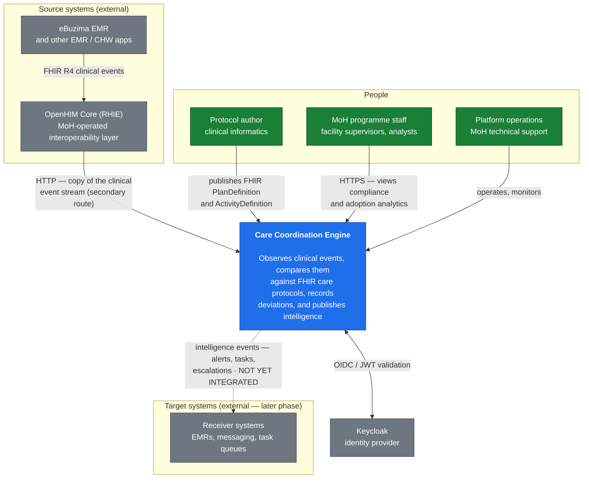

### Actors and neighbours

| Actor / system | Relationship to CCE | Direction |
|---|---|---|
| **eBuzima EMR** | The source of all live clinical events in Rwanda. CCE never writes to it. | Inbound only |
| **OpenHIM Core (RHIE)** | MoH-operated interoperability layer. CCE receives a *copy* of the clinical event stream via a **secondary route** on an existing channel, authenticating to the CCE gateway with HTTP Basic. CCE is never on the primary clinical path, so a CCE outage cannot affect clinical service delivery. | Inbound only |
| **Protocol author** | Publishes versioned FHIR PlanDefinition / ActivityDefinition resources that define what "correct care" means. | Inbound (write) |
| **MoH programme staff** | Consume compliance, adoption, deviation and referral analytics through a browser dashboard. | Outbound (read) |
| **Platform operations** | Deploy, monitor, back up and troubleshoot the platform. | Operational |
| **Receiver systems** | Would consume CCE intelligence events and decide how to act. **No integration exists today** — this is planned for a later phase. | Outbound (not yet active) |
| **Keycloak** | Issues and signs the tokens that authorize every human and machine caller. | Bidirectional |

### Phase status in Rwanda

| Phase | Scope | Status |
|---|---|---|
| **Phase 1 — Compliance** | Emitter adaptor, event ingestion, protocol matching, SLA tracking, deviation detection, analytics dashboard | **Live — this is what the deployment delivers today** |
| **Later phase — Intelligence delivery** | Receiver adaptors, automated alerts, cross-system task routing | **Not in use.** `cce-intelligence-service` is deployed but no downstream integration exists; see [§8.9](#89-known-items) |

---

## 3. C4 Level 2 — Containers

A *container* in C4 is a separately deployable or runnable thing — an application process, a database, a message broker. CCE is composed of **nine application containers**, **three data stores** and **one message broker**, arranged in four planes.

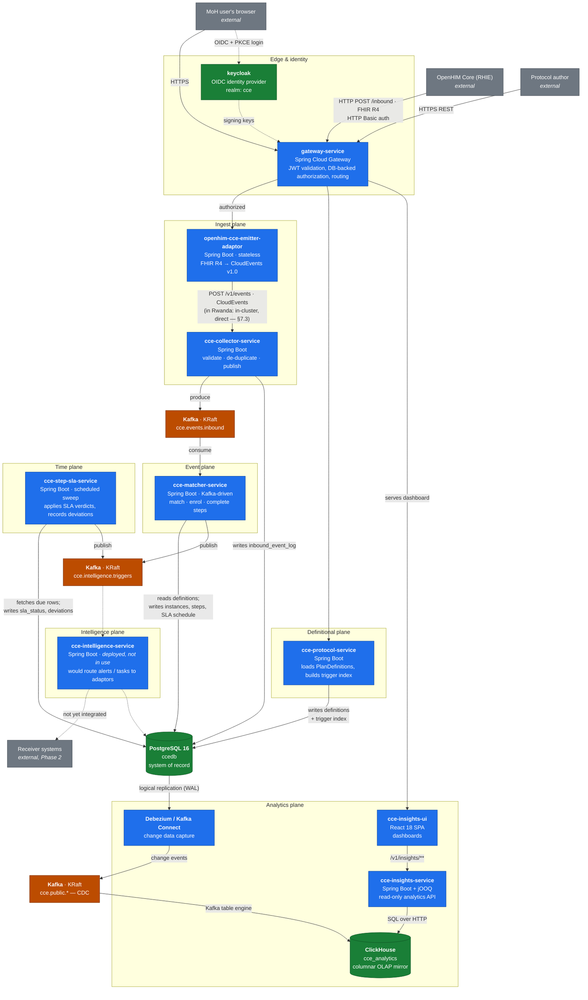

### 3.1 Container catalogue

#### Application containers

| Container | Technology | Responsibility | Persists to | Speaks |
|---|---|---|---|---|
| **openhim-cce-emitter-adaptor** | Spring Boot 3.4, Java 21, HAPI FHIR 7.4 | OpenHIM mediator. Receives FHIR R4 resources forwarded by the gateway from a secondary OpenHIM route, wraps each in a CloudEvents v1.0 envelope, forwards to the Collector. Registers itself with OpenHIM Core and heartbeats. | **Nothing — fully stateless** | HTTP in, HTTP out |
| **cce-collector-service** | Spring Boot 3.4, Java 21 | The **single point of entry** for clinical events. Validates the CloudEvents envelope and FHIR payload, de-duplicates, applies server-side defaults, publishes to Kafka. No external system publishes to Kafka directly. | `ccedb.inbound_event_log` | HTTP in, Kafka out |
| **cce-protocol-service** | Spring Boot 3.4, Java 21 | The **definitional plane**. Accepts and validates FHIR PlanDefinition / ActivityDefinition, derives the trigger index, manages definition lifecycle. Traffic measured in loads per month. | `protocol_definition`, `action_definition`, `trigger_index` | HTTP in, SQL |
| **cce-matcher-service** | Spring Boot 3.4, Java 21 | The **event plane**. Consumes clinical events, matches them against protocol triggers (two-tier), enrols patients, creates and completes steps, schedules SLA thresholds, detects order violations. **No REST API** — driven entirely by Kafka. | `protocol_instance`, `step_instance`, `step_sla_state_transition`, `deviation`, `matcher_event_log`, `facility`, history tables | Kafka in/out, SQL |
| **cce-step-sla-service** | Spring Boot 3.4, Java 21 | The **time plane**. A scheduled sweep that picks up SLA threshold rows as they fall due, writes the SLA verdict, records `OVERDUE` / `MISSED` deviations, and publishes the intelligence they trigger. Creates **no tables** and has **no REST API**. | `step_instance.sla_status`, `deviation`, `intelligence_event_log` (writes only) | Kafka out, SQL |
| **cce-intelligence-service** | Spring Boot 3.4, Java 21 | **Deployed but not in use.** Its role is to consume intelligence triggers, resolve the delivery target and routing, dispatch to receiver adaptors and record the outcome — none of which is active, because no downstream integration exists yet. | `intelligence_delivery`, `receiver_adaptor`, `destination_adaptor_mapping` — **all unused today** | Kafka in, HTTP out, SQL |
| **cce-insights-service** | Spring Boot 3.4, Java 21, jOOQ | **Read-only** analytics API — 33+ REST endpoints over compliance, adoption, deviation, referral, event-volume and ingestion metrics. Never writes. Three-tier in-memory cache. | Nothing (read-only) | HTTP in, ClickHouse SQL out |
| **cce-insights-ui** | React 18, TypeScript, Vite 6, Tailwind 4 | Browser SPA rendering the analytics dashboards. Read-only. | Browser only | HTTPS |
| **gateway-service** | Spring Boot 3.5, Spring Cloud Gateway | Single ingress for authenticated traffic. Validates JWTs against Keycloak, enforces route-level permissions loaded from a database table, routes to backends. | `api_permissions` (reads) | HTTPS |

#### Infrastructure containers

| Container | Technology | Role |
|---|---|---|
| **PostgreSQL** | PostgreSQL 16 | `ccedb` — **the system of record** for all compliance state. Also hosts the `keycloak` database. |
| **Apache Kafka** | Kafka 3.9.2, KRaft mode | Event backbone. Carries the clinical event stream, the intelligence trigger stream, and the CDC change stream. |
| **Debezium on Kafka Connect** | Debezium 3.0.0, `pgoutput` plugin | Reads the PostgreSQL WAL via logical replication and publishes one change-event topic per table. |
| **ClickHouse** | ClickHouse 26.5 | `cce_analytics` — the **derived analytics mirror**. Columnar OLAP store, populated only by CDC. |
| **Keycloak** | Keycloak 26.5.4 | OIDC identity provider. Realm `cce`. |

Versions are those deployed in Rwanda ([§8.4](#84-services-in-the-deployment)).

### 3.2 Why the compliance logic is split into three planes

The three planes have genuinely different shapes, and merging them meant every one of them got the wrong deployment:

- **Definitions change rarely and by human action.** A protocol is published, reviewed, retired. This plane wants a small, tightly-audited surface with write access to definitional tables and no clinical traffic.
- **Events arrive continuously and unpredictably.** Inbound volume tracks clinic activity, so the event plane must scale horizontally with Kafka partitions and hold no state between records. It is latency-sensitive.
- **Time passes at a constant rate.** SLA deadlines fall due whether or not any event arrives. This plane scales with the *backlog*, not with inbound traffic — and a burst of clinical events must not delay it, nor it them.

A single deployment had to be sized for the union of all three, and any one of them could stall the others.

### 3.3 What is deliberately *not* split

**The database is shared** (`ccedb`) rather than one per service. Splitting it would put a network hop and an eventual-consistency window between `step_instance` and the `deviation` rows that reference it — and the reporting queries that join them are the product. Instead the boundary is enforced by **column ownership**: exactly one service runs the DDL for a table, and exactly one service writes any given column. See [§6.3](#table-ownership--who-writes-what).

**The persistence layer is shared** through the `cce-common-util` library rather than duplicated per service, so a column added in one place cannot be missed in another.

### 3.4 How the services coordinate

There is **no synchronous call between the three compliance services, and no Kafka hop between them either.** They coordinate entirely through `ccedb`:

- The Protocol Service writes rows the Matcher Service reads.
- The Matcher Service writes `step_sla_state_transition` rows the Step SLA Service fetches.

This is deliberate: a request-response dependency between them would mean an inbound clinical event could fail because the definitional plane was restarting.

**Deployment order is therefore fixed: Protocol → Matcher → Step SLA.** Matcher's migration declares foreign keys into tables the Protocol Service creates, and the Step SLA Service validates its mapping at startup and fails fast rather than starting against a schema that cannot serve it.

---

## 4. C4 Level 3 — Components

This level opens up the containers that carry the most logic. Containers that are thin by design — the emitter adaptor, the UI, the gateway — are summarised rather than diagrammed.

### 4.1 cce-collector-service — the front door

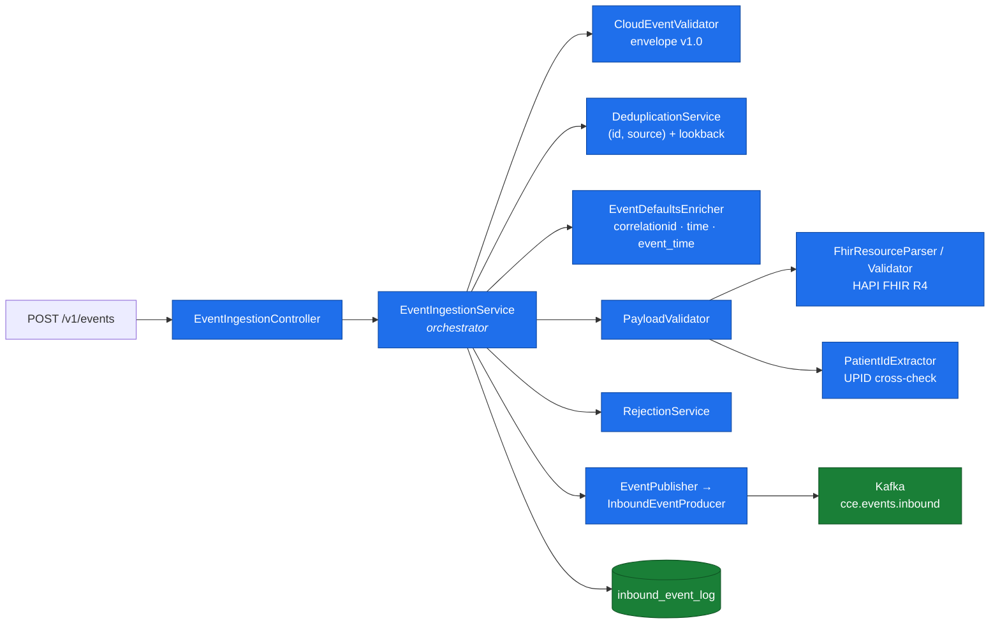

**Processing pipeline, in order:**

1. **Receive** HTTP POST, parse body.
2. **Validate the CloudEvents envelope** — `specversion` must be `1.0`; `id`, `source`, `type`, `subject`, `data`, `datacontenttype` must all be present. `subject` (the patient UPID) is mandatory: CCE cannot route an event without it.
3. **De-duplicate** on `(cloudevents_id, source)` within a configurable lookback window (default 30 days). A repeat returns **200 OK with `status: "duplicate"`** and is *not* republished — the standard idempotent-POST contract OpenHIM mediators expect.
4. **Persist the raw request as-is** to `inbound_event_log` (status `RECEIVED`) *before* any processing. This is the audit trail.
5. **Apply server-side defaults** — generate `correlationid` if absent; fill `time` from server receipt time if absent; derive `event_time` (the *clinical occurrence time*) from the FHIR payload, falling back to the envelope `time`, then to receipt time.
6. **Validate the payload.** For `application/fhir+json`: parse via HAPI FHIR, confirm a recognised R4 `resourceType`, and **cross-check the patient UPID in the resource against the envelope `subject`** — a mismatch is rejected. For `application/json`: JSON validity only. Anything else is rejected.
7. **Publish to Kafka synchronously**, keyed by `subject` so all events for one patient stay in order on one partition.
8. **Record the outcome** on `inbound_event_log` — `ACCEPTED`, `REJECTED` (with a reason code and error detail), or `DUPLICATE`.

> **No outbox, no dead-letter topic.** If the Kafka publish fails the Collector returns HTTP 500 and marks the event `REJECTED / KAFKA_PUBLISH_FAILURE`; the source system retries per its own policy. Rejections are monitored through the database and a Prometheus counter tagged by reason.

**Constraints:** max payload 1 MB; max event id 50 characters; publish timeout 30 s.

### 4.2 cce-protocol-service — the definitional plane

Everything this service does is arranged so that *runtime* is cheap. A definition is parsed, validated and indexed **once, at load**; the Matcher then matches events with an index lookup rather than by interpreting FHIR on the hot path. That makes load-time validation the only place a broken definition can be caught, so the loader **rejects rather than warns** wherever a definition could not possibly work.

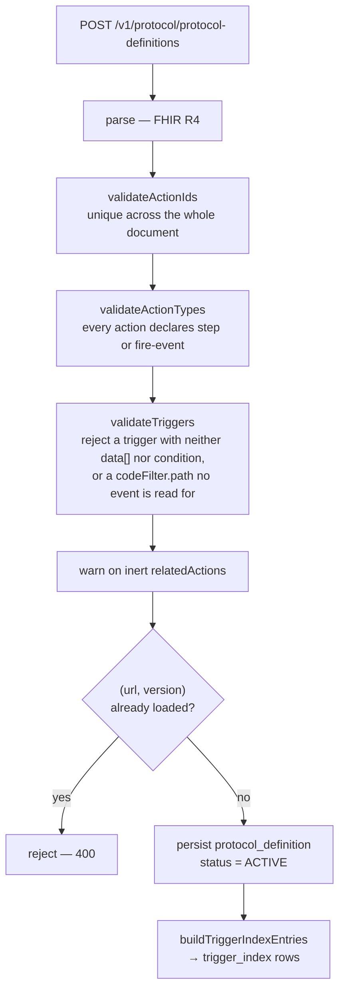

Validation happens **before** the duplicate check and before any write, so a malformed definition never leaves a partial row behind.

| Condition | Outcome | Why |
|---|---|---|
| Duplicate action id | reject | Sub-steps are flattened to peers, so ids must be unique document-wide |
| Missing / unknown action type | reject | An untyped action cannot be classified |
| Trigger with neither `data[]` nor `condition` | reject | Matches nothing — an action that can never fire |
| Unknown FHIR resource type in a trigger | reject | Would create an index row no event could match |
| `codeFilter.path` outside the nine readable paths | reject | Every codeFilter of an action must match, so one bad path silently disables the whole action |
| `concurrent-*` or dangling `relatedAction` | **warn** | Establishes no ordering; inert at runtime |

### 4.3 cce-matcher-service — the event plane

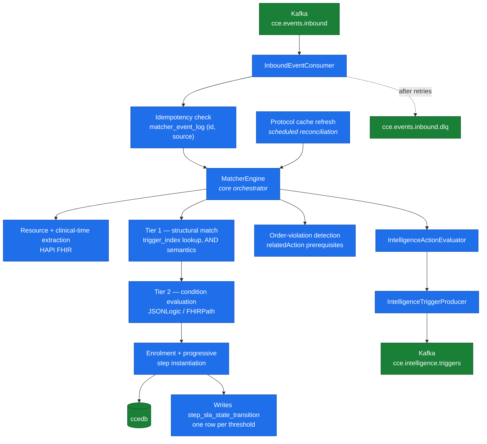

**Two-tier matching.** Tier 1 is a single indexed SQL lookup against `trigger_index`, decomposed at protocol-load time into `(resourceType, path, codeSystem, codeValue)` tuples, with `GROUP BY … HAVING` enforcing AND semantics across an action's code filters. Tier 2 evaluates optional JSONLogic/FHIRPath conditions in process. Condition-only triggers (no `data[]`) are held in memory and evaluated per event.

**Clinical time, not ingestion time.** The Matcher resolves each event's *clinical occurrence time* from the FHIR payload, falling back to the envelope, then to now. `enrolled_at` and `completed_at` are clinical times — so a backdated or batch-uploaded event lands where it clinically belongs, and ingestion lag never shifts a compliance number. Unmapped and unparseable clinical-time fields are counted as metrics rather than silently swallowed.

**Scheduling, not judging.** When the Matcher creates a step, it writes one `step_sla_state_transition` row per threshold **in the same transaction**, so a step never exists without its schedule. It never writes `sla_status`.

### 4.4 cce-step-sla-service — the time plane

This service owns everything driven by *time passing*:

1. Fetch the `step_sla_state_transition` rows the Matcher scheduled, once they come round, and reach the verdict each one stands for — a breached deadline, or a completion recorded on time.
2. Write `step_instance.sla_status` — `OVERDUE`, `MISSED` and `MET` all from (1). **It is the only writer of that column.**
3. Record the resulting `OVERDUE` / `MISSED` deviations. On-time work breached nothing and records none.
4. Evaluate and publish the intelligence those deviations trigger.

**The fetch protocol.** A row is fetched under `FOR UPDATE SKIP LOCKED`, which is what lets every replica poll the same table concurrently: a row locked by one replica is invisible to the others rather than contended. There is **no lease table, no heartbeat and no leader election** — the row lock *is* the reservation, held for the length of the transaction that applies it. A replica that dies mid-batch releases its locks on connection loss and the work becomes immediately available again. Fetch and apply happen in **one** transaction, so a crash cannot leave a row marked taken but unacted-on.

**The verdict depends on the step, not on when the sweep runs.** The applier compares `step_instance.completed_at` against the row's immutable `process_by` and never consults the wall clock. A row deferred by a failure and applied late therefore reaches exactly the verdict it would have reached on time.

| Row | Step when applied | `sla_status` | Deviation |
|---|---|---|---|
| `DUE_DATE_REACHED` | not completed | `OVERDUE` | `OVERDUE` |
| `DUE_DATE_REACHED` | `completed_at >= process_by` | `OVERDUE` | `OVERDUE` |
| `DUE_DATE_REACHED` | `completed_at < process_by` | *unchanged* | — |
| `MISSED_DATE_REACHED` | not completed | `MISSED` (`must` only) | `MISSED` (`must` only) |
| `MISSED_DATE_REACHED` | `completed_at >= process_by` | `MISSED` (`must` only) | `MISSED` (`must` only) |
| `MISSED_DATE_REACHED` | `completed_at < process_by` | *unchanged* | — |

**On-time work does not wait for its deadline.** Matcher writes a `MET_CONDITION_REACHED` row the moment a completing event lands before the step's `due_date`, with `process_by` set to that `completed_at` — so the row is already due and the Step SLA Service records `MET` on its next cycle (seconds), not when a deadline weeks away arrives. One table, one loop, every verdict.

**Writes are forward-only.** `MET` and `MISSED` are settled outcomes, and `OVERDUE` never replaces `MISSED` — which is what a retry applying two rows out of order would otherwise do. Failed rows are retried with exponential backoff (`2^attempts`, capped), never discarded.

**Optional steps.** Only mandatory steps have deadlines. Matcher schedules no transition row for an optional step and the Protocol Service rejects a protocol that gives one a `tolerance-days`, so an optional step takes neither `OVERDUE` nor `MISSED` — nothing was required of it, so there is nothing for it to breach. A row for one predates those rules and is consumed, recording nothing.

### 4.5 The two-status model — the heart of the data model

Two independent facts about a step, in two columns. This is the single most important modelling decision in CCE and it shapes every downstream analytic.

| Column | Question | Written by | Values |
|---|---|---|---|
| `step_status` | **Did the expected event arrive?** | Matcher only | `NOT_STARTED` → `COMPLETED` |
| `sla_status` | **Was the deadline met?** | Step SLA only | *null* → `OVERDUE` → `MISSED`, or *null* → `MET` |

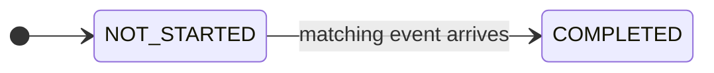

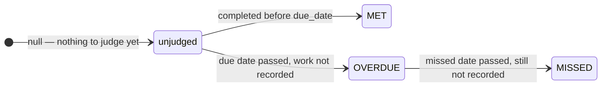

**Reading the pair:**

| `step_status` | `sla_status` | Meaning |
|---|---|---|
| `COMPLETED` | `MET` | Recorded on time |
| `COMPLETED` | `OVERDUE` | Recorded late, before being written off |
| `COMPLETED` | `MISSED` | Recorded after being written off |
| `NOT_STARTED` | *(null)* / `OVERDUE` | Still outstanding |
| `NOT_STARTED` | `MISSED` | Never recorded; deviation raised |

`sla_status` has **no initial enum value** — the column is nullable and null means *there is nothing to judge yet*. Null is also the permanent state of a step with no due date. Saying "unjudged" with an enum constant would make the absence of a judgement look like one that had been made.

### 4.6 cce-insights-service — the analytics API

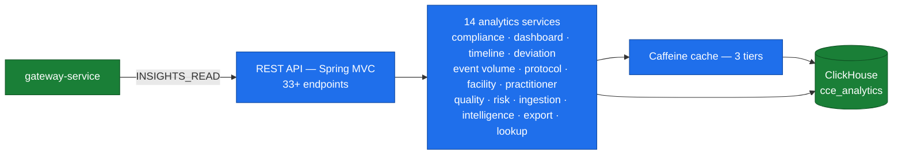

**Read-only by construction.** The service never issues `INSERT`, `UPDATE` or `DELETE`. It uses jOOQ for type-safe SQL against the live ClickHouse schema — no ORM, no entity manager, no transactions.

**Three cache tiers** (Caffeine, in-process, TTL-configurable):

| Cache | Default TTL | Max entries | Contents |
|---|---|---|---|
| `lookups` | 60 min | 50 | Dropdown filter data — protocols, facilities, practitioners, sources |
| `analytics` | 30 min | 200 | Compliance summaries, protocol analytics, deviation analytics, patient risk |
| `metrics` | 15 min | 500 | Event volume, ingestion pipeline, processing quality |

**Two clocks, chosen by metric type** — this matters when reconciling numbers:

- **Functional / clinical metrics** (adoption, compliance, deviations, event volume, referrals, patient cohorts) are measured on **clinical `event_time`** — when the act actually happened. Ingestion lag, offline sync, batch upload and replay never shift these numbers.
- **Technical / operational metrics** (the Ingestion page only) are measured on **processing time** (`received_at`).

> Rule of thumb: *"when did it happen clinically?"* → `event_time`; *"when did our system handle it?"* → `received_at`. Every page is clinical **except** Ingestion.

### 4.7 cce-insights-ui — the dashboard

A React 18 + TypeScript SPA served as static assets. Read-only; it holds no data beyond the browser session.

- **Login** is OIDC Authorization Code with **PKCE (S256)** against Keycloak, run *before* the app renders, so an unauthenticated user never sees a frame of the application.
- The access token is refreshed on a background interval and attached as `Authorization: Bearer …` to every API call.
- Authentication is a **build-time** flag (`VITE_AUTH_ENABLED`). The same image runs gateway-less for local development or fully authenticated in production. **Production builds must have it enabled.**

### 4.8 gateway-service — the policy enforcement point

The gateway is the only container exposed to end users and the only place authorization decisions are made.

| Step | What happens |
|---|---|
| 1 | Extract credentials from `Authorization`. Bearer JWT is the primary path. |
| 2 | Validate the JWT against the Keycloak realm — signature, issuer (`JWT_ISSUER`), audience (`gateway-service`), expiry. |
| 3 | Read the caller's roles from `resource_access.gateway-service.roles`. |
| 4 | Match the request's HTTP method and URI against the `api_permissions` table, which maps a permission name to a method + URI pattern (e.g. `INSIGHTS_READ` → `GET /v1/insights/**`). |
| 5 | Route to the backend, or reject with 401 / 403. |

Permissions live in a **database table rather than YAML**, so they can be changed without redeploying the gateway and are shared across gateway replicas.

**HTTP Basic path — used in production by OpenHIM.** OpenHIM channels can send only Basic credentials, so the gateway accepts them on the inbound clinical route (`BASIC_AUTH_ENABLED=true`). It exchanges those credentials for a Keycloak token via the resource-owner-password grant and then runs the **identical** validation and authorization pipeline as a bearer token — so a Basic caller gets no weaker treatment than a JWT caller. Tokens are cached per credential until shortly before expiry, so the exchange does not add a Keycloak round-trip to every event.

The capability is deliberately isolated to a **dedicated confidential client** (`openhim-basic`) with Direct Access Grants enabled, separate from the bearer-only `gateway-service` client, which therefore keeps its tighter posture. Detail in [§7.4.3](#743-the-openhim-basic-auth-path).

### 4.9 The analytics pipeline

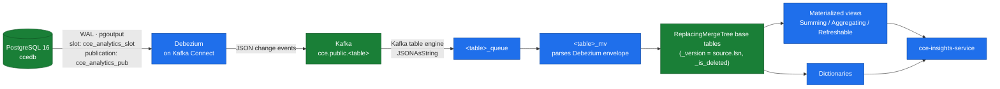

**Design principles:**

| Principle | Rationale |
|---|---|
| **Open-source only** | No vendor lock-in, no licence cost |
| **CDC-only (committed data)** | Analytics read only what PostgreSQL committed — no discrepancies from rolled-back transactions |
| **No custom stream processing** | ClickHouse MATERIALIZED columns and materialized views replace a Flink-style layer. Zero custom application code in the pipeline. |
| **Immutable append-only** | `ReplacingMergeTree` handles updates idempotently, versioned by WAL position |
| **Read-only observer** | **The pipeline never writes to CCE operational databases. Its failure cannot impact clinical services.** |

**Key invariant: PostgreSQL is authoritative; ClickHouse is derived.** If analytics look wrong, the fix is to rebuild the mirror — never to edit ClickHouse by hand.

---

## 5. C4 Level 4 — Code

The code level is not diagrammed here. In C4 practice it is generated on demand for the one component under discussion rather than maintained as documentation, and CCE's repositories carry that detail themselves.

Where to look:

| For | Repository | File |
|---|---|---|
| Shared entities, repositories, FHIR parsing, package-by-package reference | `cce-common-util` | `docs/library-reference.md` |
| Column-level schema, enums, JSONB shapes | `cce-common-util` | `docs/data-dictionary.md` |
| `relatedAction` direction, status vocabularies, trigger model | `cce-common-util` | `docs/fhir-conformance.md` |
| Matching algorithm, enrolment, step lifecycle | `cce-matcher-service` | `docs/architecture-overview.md` |
| Definition loading, trigger index construction | `cce-protocol-service` | `docs/architecture-overview.md` |
| SLA sweep internals and tuning | `cce-step-sla-service` | `docs/architecture-overview.md` |
| ClickHouse DDL, MV catalogue, dictionaries | `cce-data-pipeline` | `docs/data-flow.md`, `schema/01..09-*.sql` |

> **There are no OpenAPI / Swagger specifications anywhere in the platform.** The `api-reference.md` file in each repository is the authoritative API contract. This is a documented gap, not an oversight to work around.

---

## 6. Data — what is stored, where, and how

### 6.1 The short answer

CCE holds four kinds of data in four places:

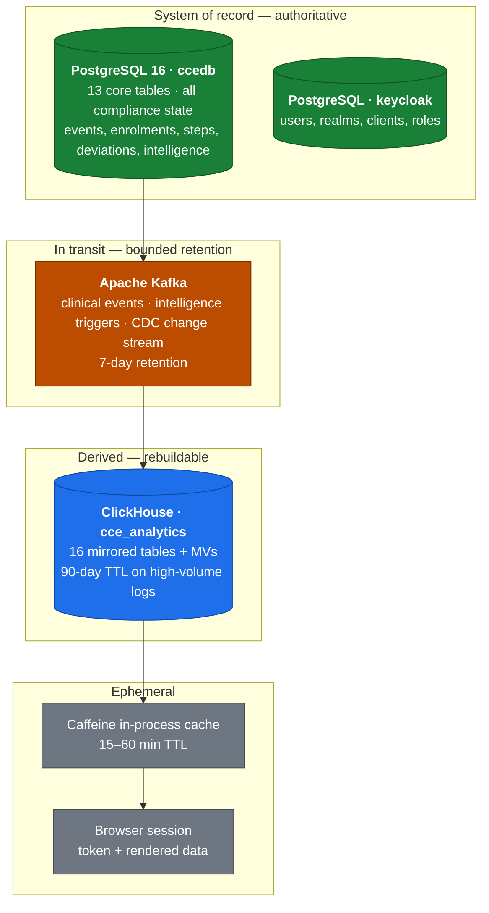

| Store | Role | Authoritative? | Rebuildable? |
|---|---|---|---|
| **PostgreSQL `ccedb`** | All compliance state | **Yes — system of record** | **No.** Irreplaceable. |
| **PostgreSQL `keycloak`** | Identity | **Yes** | **No.** Irreplaceable. |
| **Apache Kafka** | Event backbone, in flight | No — a buffer | Not needed; replayable within retention |
| **ClickHouse `cce_analytics`** | Analytics mirror | No — **derived** | **Yes**, fully, from PostgreSQL via replay |

> **The single most important operational consequence:** back up PostgreSQL. ClickHouse can be reconstructed from it in full; the ClickHouse dump exists to make recovery *faster*, not to make it *possible*.

### 6.2 What clinical data CCE actually holds

CCE is a compliance observer, so the data it keeps is deliberately narrow. Understanding what is *and is not* present matters for any privacy assessment.

| Category | Held? | Where | Notes |
|---|---|---|---|
| **Patient identifier (UPID)** | **Yes** | `protocol_instance.patient_id`, `intelligence_event_log.subject`, CloudEvent `subject`, and inside every raw payload | A **pseudonymous** programme identifier (e.g. `260115-0001-7823`), not a name |
| **Patient name, address, contact details** | **No, in Rwanda** — the emitter strips them before forwarding (see the redaction note below) | — | Elsewhere: kept in `raw_payload` only if the source sent them; CCE never *extracts*, *indexes* or *queries* these fields |
| **Raw FHIR payload** | **Yes, as received from the emitter** | `inbound_event_log.raw_payload` (JSONB), mirrored to ClickHouse `inbound_event_logs.raw_payload` | The request body as the collector received it, immutable. In Rwanda that is the **redacted** resource: codes, statuses, times, facility and UPID, without findings or values |
| **Facility identifier & name** | **Yes** | `facility` table; `facility_id` extracted from payloads | Auto-populated from inbound events; `district_name` and `expected_patients_per_day` set by programme staff |
| **Practitioner reference & display name** | **Yes** | Extracted at insert time into ClickHouse `inbound_event_logs.practitioner_ref` / `practitioner_display` | Used for practitioner-level analytics |
| **Compliance state** | **Yes** | `protocol_instance`, `step_instance`, `deviation`, history tables | The product's actual output — enrolments, steps, timing, verdicts |
| **Care protocol definitions** | **Yes** | `protocol_definition`, `action_definition` (JSONB) | Clinical logic, not patient data |
| **Clinical *notes* / free text, findings, values** | **No, in Rwanda** — removed by the emitter | — | `note`/`text`/`comment`, `value[x]`, interpretations, diagnoses and other findings are stripped before forwarding |
| **Credentials of end users** | **No** | Held only by Keycloak | CCE services never see a password |
| **Financial / payment data** | **No** | — | Not in scope |

**Two properties worth stating plainly to any reviewer:**

1. **CCE is write-only towards source systems' data and read-only towards their systems.** It never issues a write to an EMR.
2. **Patient identifiers are pseudonymous.** The UPID is a programme identifier. Re-identification requires the source registry, which CCE does not hold.

> **Clinical-data minimisation (redaction) in Rwanda.** CCE needs to know *that* a clinical step happened, when, for whom and where — not *what was found*. The `openhim-cce-emitter-adaptor` therefore strips clinical content **before** forwarding, so nothing downstream ever receives it: not `inbound_event_log`, Kafka, the ClickHouse mirror or the backups. Removed: values, notes, interpretations, body sites, dosage, reason and medication fields, per-type findings (`Condition.code`, `AllergyIntolerance.code`, `ServiceRequest.code`, …), the patient name, and Encounter's whole `extension` array (where eBuzima carries diagnosis, vitals, ANC detail, name, date of birth and address). Kept on purpose: the UPID, `Observation.code` (the trigger key), facility attribution, statuses and clinical times. Redaction is forward-only: data received before it was switched on is not changed. Rules, checks and the kill-switch: [`uat/SECURITY.md`](uat/SECURITY.md) §10.

### 6.3 PostgreSQL `ccedb` — the system of record

One database, shared by four services. Thirteen core tables, described below.

> Release 2.0.0 has since added `step_group_instance` (visit-level step groups, written by the Matcher). The Rwanda database also holds the Intelligence Service's tables (`intelligence_delivery`, `intelligence_delivery_audit_log`, `receiver_adaptor`, `destination_adaptor_mapping`), the gateway's `api_permissions` and the Flyway ledgers: 23 tables on UAT.

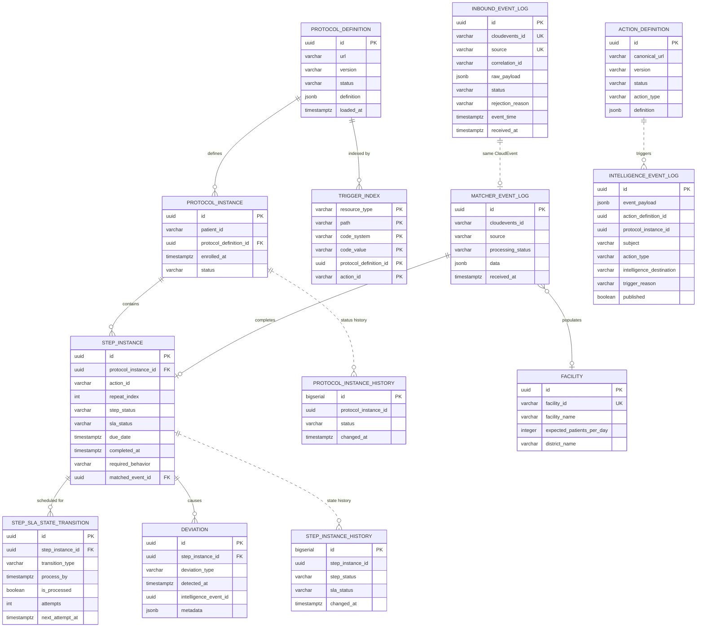

#### Table catalogue

| # | Table | What it holds | Row growth | Contains patient data? |
|---|---|---|---|---|
| 1 | `protocol_definition` | FHIR PlanDefinition resources — the protocol templates | Low (tens) | No |
| 2 | `action_definition` | FHIR ActivityDefinition resources — what an intelligence action does | Low (tens) | No |
| 3 | `trigger_index` | Inverted index for fast structural event matching | Low (per protocol load) | No |
| 4 | `protocol_instance` | A patient's enrolment in a protocol | Medium (per patient) | **UPID** |
| 5 | `step_instance` | An individual action occurrence in a patient's journey | Medium–High | Indirect (via FK) |
| 6 | `step_sla_state_transition` | Each step's SLA schedule — one row per verdict to be reached | Medium–High | Indirect |
| 7 | `deviation` | Recorded protocol deviations | Medium | Indirect |
| 8 | `intelligence_event_log` | Every intelligence action evaluated, with its context and published payload | Medium–High | **UPID + FHIR payload** |
| 9 | `protocol_instance_history` | Append-only log of every enrolment status transition | High | Indirect |
| 10 | `step_instance_history` | Append-only log of every step / SLA status transition | High | Indirect |
| 11 | `matcher_event_log` | Idempotency log of every inbound CloudEvent and its outcome | High (every event) | **FHIR `data` body** |
| 12 | `facility` | Reference registry of known facilities | Low | No |
| 13 | `inbound_event_log` | **Every** CloudEvent accepted or rejected, with its raw payload | High (every event) | **Full raw payload** |

#### Table ownership — who writes what

Two rules keep a shared database safe: **exactly one service runs the DDL for a table, and exactly one service writes any given column.**

| Table | Migration owner | Writers | Readers |
|---|---|---|---|
| `protocol_definition` | Protocol | Protocol | Matcher, Step SLA |
| `action_definition` | Protocol | Protocol | Matcher, Step SLA |
| `trigger_index` | Protocol | Protocol | Matcher |
| `protocol_instance` | Matcher | Matcher | Step SLA |
| `step_instance` | Matcher | Matcher, **Step SLA** (disjoint columns) | both |
| `step_sla_state_transition` | Matcher | Matcher (inserts), Step SLA (fetches) | both |
| `deviation` | Matcher | Matcher, Step SLA (append-only) | both |
| `intelligence_event_log` | Matcher | Matcher, Step SLA (append-only) | Step SLA |
| `protocol_instance_history` | Matcher | Matcher | — (CDC only) |
| `step_instance_history` | Matcher | Matcher, Step SLA (append-only) | — (CDC only) |
| `matcher_event_log` | Matcher | Matcher | Matcher |
| `facility` | Matcher | Matcher, **programme staff (direct SQL)** | Matcher |
| `inbound_event_log` | Collector | Collector | — (CDC only) |

**The one shared mutable table** is `step_instance`, and the split is by column:

| Column | Writer | Meaning |
|---|---|---|
| `step_status`, `completed_at` | **Matcher only** | Whether the expected event arrived, and when the act happened |
| `due_date` | **Matcher only** | Written once at step creation, never updated |
| `sla_status` | **Step SLA only** | Whether the deadline was met |

`facility` is the one table with a writer that is not a service: programme staff set `district_name` and `expected_patients_per_day` directly in the database, and no service touches those two columns.

#### How the data is stored — mechanics

| Mechanism | Where | Why |
|---|---|---|
| **UUID v7 primary keys** | `protocol_instance`, `step_instance`, `deviation`, `step_sla_state_transition`, `inbound_event_log` | Time-ordered, so rows sort by creation time and inserts get index locality |
| **JSONB for FHIR resources** | `protocol_definition.definition`, `action_definition.definition`, `inbound_event_log.raw_payload`, `matcher_event_log.data`, `deviation.metadata`, `intelligence_event_log.event_payload` / `evaluation_context` | Preserves the complete FHIR resource without a migration for every schema evolution |
| **Natural-key uniqueness for idempotency** | `inbound_event_log (cloudevents_id, source)`, `matcher_event_log (cloudevents_id, source)`, `deviation (step_instance_id, deviation_type)`, `step_sla_state_transition (step_instance_id, transition_type)` | Makes ingestion, deviation recording and SLA scheduling idempotent against retries and concurrent writers |
| **Partial indexes on the hot predicate** | `idx_sslt_due` (unprocessed rows), `idx_step_instance_not_started`, `idx_protocol_instance_status` | Keeps working sets scoped to pending work however large the retained history grows |
| **Append-only history tables** | `protocol_instance_history`, `step_instance_history` | Lifecycle columns are overwritten in place, so the prior value would otherwise be lost. Written inside the caller's transaction (`Propagation.MANDATORY`), so a transition and its record are atomic. |
| **Immutable audit columns** | `step_sla_state_transition.process_by`, `inbound_event_log.raw_payload` | `process_by` is the audit truth for when a deadline fell; `raw_payload` is the audit truth for what was received |
| **Separate Flyway ledgers** | `flyway_schema_history_protocol`, `flyway_schema_history_matcher` | So neither service's migration ledger sees the other's |

> **A caveat that matters for audit completeness.** History rows are written by the service layer inside the same transaction as the change they record. Out-of-band SQL `UPDATE`s are therefore **not** captured. Every lifecycle mutation must go through the service layer.

> **There is no `audit_log` table.** It was removed in 2.0.0: the append-only history tables carry state transitions, and actor attribution is planned to move onto the domain tables. **Consequence: a protocol load or retirement is currently traceable only through the application log, not through the database.** See [§7.7](#77-known-gaps-and-hardening-backlog).

### 6.4 Apache Kafka — data in transit

| Topic | Direction | Partitions | Key | Contents | Retention |
|---|---|---|---|---|---|
| `cce.events.inbound` | Collector → Matcher | 25 | `subject` (patient UPID) | Validated CloudEvents with full FHIR payload | **7 days** |
| `cce.events.inbound.dlq` | Matcher (failure) | 25 | `subject` | Events that failed processing after retries | 7 days |
| `cce.intelligence.triggers` | Matcher / Step SLA → Intelligence | 25 | — | `IntelligenceTriggerEvent` — patient UPID, action, severity, destination, original FHIR payload. **Produced today; no active consumer** while intelligence delivery is out of use | 7 days |
| `cce.public.<table>` (one per published table, 16) | Debezium → ClickHouse | — | table PK | Row-level change events for every mirrored table | 7 days |

**Producer guarantees on the clinical stream:** `acks=all`, `enable.idempotence=true` (exactly-once within a partition), 3–5 retries, 32 MB producer buffer. Keying by patient UPID means all events for one patient land on one partition and are therefore processed in order.

**Kafka carries clinical payloads.** This is the reason Kafka is not exposed outside the platform network and the reason topic retention is bounded at 7 days.

**Confirmed publication, not fire-and-forget.** Intelligence triggers wait for the broker acknowledgement and record the outcome on the `intelligence_event_log` row. A trigger the broker never acknowledged stays marked unpublished and is replayable — `SELECT … FROM intelligence_event_log WHERE NOT published` lists exactly those replay candidates.

### 6.5 ClickHouse `cce_analytics` — the derived mirror

**How data gets there.** PostgreSQL logical replication (`pgoutput`) feeds a Debezium connector on a replication slot; Debezium publishes JSON change events to Kafka; ClickHouse consumes those topics *directly* through Kafka-engine queue tables into `ReplacingMergeTree` targets via consumer materialized views. **There is no ClickHouse sink connector and no S3 staging.**

| Component | Identity |
|---|---|
| Replication slot | `cce_analytics_slot` |
| Publication | `cce_analytics_pub` |
| Debezium connector | `cce-ccedb-source` |
| Snapshot mode | `initial` |
| Deletes | Carried as `op='d'`, not tombstones |

#### Mirrored tables

| Category | Source table in `ccedb` | Engine |
|---|---|---|
| Event logs | `inbound_event_log`, `matcher_event_log` | ReplacingMergeTree |
| Domain entities | `protocol_instance`, `step_group_instance`, `step_instance`, `deviation` | ReplacingMergeTree |
| SLA schedule | `step_sla_state_transition` | ReplacingMergeTree |
| State history | `protocol_instance_history`, `step_instance_history` | ReplacingMergeTree (append-only) |
| Intelligence | `intelligence_event_log` · `intelligence_delivery` (unused today) | ReplacingMergeTree |
| Reference | `protocol_definition`, `action_definition`, `facility` | ReplacingMergeTree |
| Adaptor routing | `receiver_adaptor`, `destination_adaptor_mapping` (unused today) | ReplacingMergeTree |

> **The mirror tracks the operational schema.** Each ClickHouse table takes its shape from the `ccedb` table it mirrors, so any change to the operational schema must be carried through the connector's column list, the ClickHouse DDL, and every materialized view that groups or filters on a changed column — followed by a full rebuild, since **schema changes do not propagate through CDC** ([§8.5](#85-data-stores)).

#### How deduplication and deletes work

- `_version` = the Debezium `source.lsn` (monotonic WAL position). `ReplacingMergeTree(_version, _is_deleted)` keeps the highest-version row per key.
- `_is_deleted = 1` when PostgreSQL deleted the row; `clean_deleted_rows = 'Always'` physically removes it on merge.
- Queries use `FINAL` explicitly (or the pre-aggregated rollups) when exact deduplication is needed before background merges complete.
- `min_age_to_force_merge_seconds = 120` force-merges settled parts, so deduplication happens promptly and `FINAL` reads stay cheap.

#### Field extraction at insert time

`MATERIALIZED` columns extract from the stored JSON at insert with **zero query cost** — `subject`, `event_type`, `facility_id`, `event_time`, `resource_type`, `practitioner_ref`, `practitioner_display` are all derived from `inbound_event_logs.raw_payload` this way.

#### Pre-aggregation

Twelve incremental materialized views on append-only sources, plus six **refreshable daily-summary** views (`mv_daily_compliance_kpis`, `mv_daily_adoption_kpis`, `mv_daily_deviation_kpis`, `mv_daily_event_kpis`, `mv_daily_referral_kpis`, and the hourly event-volume rollup) that back the dashboard header cards. Four dictionaries replace joins for hot lookups. Seventeen bloom-filter skip indexes serve point lookups on non-sort-key columns.

#### Two columns deliberately excluded from CDC

`intelligence_event_log.event_payload` and `intelligence_delivery.fhir_payload` are dropped at the connector — large, unused in analytics, and a needless duplication of clinical payload into a second store.

> **Two important consequences of the derived model:**
> 1. **Deletes in PostgreSQL propagate**, but **schema changes and aggregate corrections do not.** When analytics diverge from the source, *rebuild* rather than patch.
> 2. **A full re-snapshot loses historical daily-summary rows** unless backfilled. The `*_history` tables exist precisely so `schema/09-historical-backfill.sql` can rebuild those days. They are not retroactive — deploy history capture *before* any planned re-snapshot.

### 6.6 Other data stores

| Store | Contents | Notes |
|---|---|---|
| **PostgreSQL `keycloak`** | Users, realms, clients, roles, SMTP configuration | Small (~12 MB on UAT) but **irreplaceable** — losing it means re-onboarding every user |
| **`api_permissions` table** | Gateway route → permission mapping | Read by the gateway at startup; changeable by SQL without a redeploy |
| **Caffeine in-process cache** | Analytics query results, 15–60 min TTL | Holds aggregated analytics, which can include facility- and practitioner-level detail. Lost on restart. |
| **Browser** | Access token, rendered dashboard data | Session-scoped |
| **Prometheus** | Metrics time series | No patient data — counters, timers, gauges only |
| **Container / application logs** | Correlation-keyed processing logs | See the log-hygiene note in [§7.6](#76-audit-and-traceability) |

### 6.7 Data retention and lifecycle

| Store | Data | Retention | Mechanism |
|---|---|---|---|
| PostgreSQL `ccedb` | All compliance state, raw payloads | **Indefinite** — nothing is deleted | No purge job exists |
| PostgreSQL `ccedb` | `step_sla_state_transition` rows | **Retained after processing**, never deleted | Partial index keeps the hot path scoped regardless of total size |
| Kafka | All topics | **7 days** | `cleanup.policy=delete`, `retention.ms=604800000` |
| ClickHouse | `inbound_event_logs`, `matcher_event_logs`, `intelligence_event_logs`, `intelligence_deliveries` | **90 days** | Table `TTL` |
| ClickHouse | `deviations`, `protocol_instances`, `step_instances` | **None** — retained indefinitely | Clinical compliance record / active data |
| Caffeine cache | Analytics results | 15–60 min | TTL, and lost on restart |
| Backups (Rwanda) | PostgreSQL + ClickHouse dumps | **10 days** | Nightly cron, pruned |

> **Retention is a decision the programme must make explicitly.** The 90-day ClickHouse TTL is a *hot-tier* policy, not a compliance retention policy. Health-data regulations commonly require multi-year retention (HIPAA, for example, typically implies seven years). PostgreSQL currently retains everything indefinitely with no archival tier and no purge path. Two gaps follow:
> - **No cold-tier archival** is configured for long-term retention.
> - **No data-subject erasure path** exists. A hard delete in PostgreSQL propagates to ClickHouse via CDC, but the raw payload also sits in Kafka for up to 7 days and in every nightly backup for 10 days.
>
> Both are tractable; neither is built. They should be scoped against Rwandan data-protection requirements before the platform scales beyond its current footprint.

### 6.8 Data lineage — following one clinical event end to end

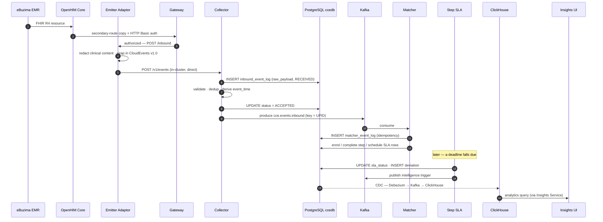

**Traceability keys.** One clinical event can be followed end to end by three keys:

| Key | Spans | Purpose |
|---|---|---|
| `(cloudevents_id, source)` | `inbound_event_log` ↔ `matcher_event_log` | The natural key, unique in both tables — traces an event from the front door to the steps it completed, without a foreign key between them |
| `correlationid` | Every log line, every service | Distributed tracing across services; put into the logging MDC for the life of the event |
| `step_instance.matched_event_id` | `step_instance` → `matcher_event_log` | Links a completed step back to the exact event that completed it |

> **There is no distributed tracing system** (no spans, no OpenTelemetry). Correlation is by MDC field only.

---

## 7. Security

### 7.1 Security posture in one page

| Property | Position |
|---|---|
| **Blast radius on a source system** | **None by design.** CCE never writes to an EMR. A total CCE compromise cannot alter a clinical record in eBuzima. |
| **Blast radius on clinical service delivery** | **None by design.** CCE sits on an OpenHIM *secondary* route, never the primary clinical path. A CCE outage is invisible to clinicians. |
| **Authentication** | OAuth 2.0 / OIDC via Keycloak, for both human users and machine clients |
| **Authorization** | Role-based, enforced at a single gateway against a database-backed permission table |
| **Internal services** | **Unauthenticated at the application layer** — they rely entirely on network isolation and the gateway. See [§7.3](#73-trust-boundaries). |
| **Transport** | HTTPS/TLS at the edge. Inside the machine, Kafka and ClickHouse run without TLS in Rwanda, behind the host firewall |
| **Secrets** | Centralised in Infisical; injected at deploy time. No `.env` files. |
| **Patient identifiers** | Pseudonymous programme UPIDs, not names |
| **Clinical content** | Stripped by the emitter before anything is stored ([§6.2](#62-what-clinical-data-cce-actually-holds)) |
| **Known gaps** | Documented honestly in [§7.7](#77-known-gaps-and-hardening-backlog) |

### 7.2 Security architecture

Traffic flows top to bottom. **Every arrow into the platform passes through the gateway** — that is the whole point of the picture.

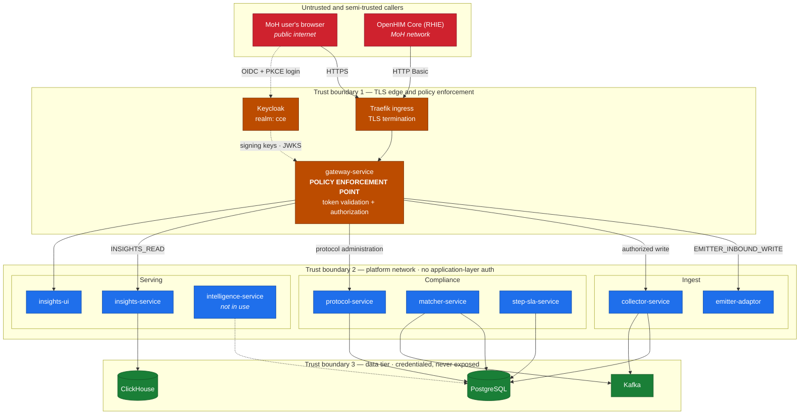

> **The emitter's onward call.** The emitter can send its call to the Collector back through the gateway with its own OAuth2 client credentials, so that one clinical event is authorized twice under two identities. **Rwanda does not use that option:** the emitter calls the Collector directly inside the cluster (`CCE_COLLECTOR_URL=http://cce-collector-service:8080`, no token). The event is authorized once, at the gateway, as OpenHIM's ([§7.4.3](#743-the-openhim-basic-auth-path)); the hop to the Collector relies on network isolation like every other internal call ([§7.3](#73-trust-boundaries)).

### 7.3 Trust boundaries

| # | Boundary | What crosses it | Control |
|---|---|---|---|
| **1** | Internet → platform | User dashboard traffic | TLS at Traefik; OIDC login at Keycloak; JWT validated and authorized at the gateway |
| **2** | MoH network → platform | Clinical event stream from OpenHIM | **OpenHIM authenticates to the gateway with HTTP Basic**, which the gateway exchanges for a Keycloak token and authorizes against `EMITTER_INBOUND_WRITE`. In Rwanda the emitter then calls the Collector directly inside the cluster, without a token (boundary 3) |
| **3** | Gateway → internal services | Authorized requests only | Network isolation. **This is the load-bearing control** — see the note below. In Rwanda: the services are reachable only inside the k3s cluster, a `deny-cross-namespace` NetworkPolicy, and UFW (only 22, 80 and 443 open) |
| **4** | Services → data tier | SQL, Kafka protocol | Database credentials from Infisical; least-privileged roles for CDC and analytics reads. In Rwanda all CCE services and Keycloak share one PostgreSQL role (`admin`, not a superuser), and Kafka has no authentication; the host firewall is the boundary |

> **The load-bearing assumption, stated plainly.** CCE's internal services enforce **no authentication at the application layer**. The Protocol Service documents this explicitly, and so do the Matcher and Step SLA services. The security of the platform therefore rests on network isolation and on the gateway being the *only* route to them.
>
> This is a common and defensible microservice posture, but it has a sharp edge worth naming: **a caller who can reach `POST /v1/protocol/protocol-definitions` directly can change what every patient in the system is measured against.** Network segmentation around the definitional plane is not a nice-to-have.

### 7.4 Authentication and authorization

#### The three things a working user token needs

Access to the dashboard requires all three to line up. Miss any one and the user sees a 401 or 403 *after logging in successfully* — this is by far the most common onboarding failure.

| Requirement | Value | How it is satisfied |
|---|---|---|
| **Issuer** | `https://cce.moh.gov.rw/auth/realms/cce` (UAT: `https://cceuat.moh.gov.rw/…`) | Gateway env `JWT_ISSUER`, derived from the environment's public name |
| **Audience** | `gateway-service` | Automatic — `gateway-audience` is a *default* client scope on `cce-insights-ui` |
| **Authorization role** | `INSIGHTS_READ` | **Manual** — a client role on `gateway-service`, granted per user |

**How authorization actually works.** The gateway reads roles from `resource_access.gateway-service.roles` and matches them against the `api_permissions` table, which maps `INSIGHTS_READ` → `GET /v1/insights/**`. A user with a perfectly valid token but no `INSIGHTS_READ` role authenticates fine and then gets **403 on every dashboard call**.

#### Machine-to-machine authentication

| Caller | Callee | Mechanism |
|---|---|---|
| eBuzima EMR | OpenHIM Core | OpenHIM channel authentication (MoH-operated, outside CCE) |
| **OpenHIM Core** | **CCE Gateway → Emitter adaptor** | **HTTP Basic.** The gateway exchanges the credentials for a Keycloak token and runs its normal validation pipeline — see [§7.4.3](#743-the-openhim-basic-auth-path) |
| Emitter adaptor | OpenHIM Core API | HTTP Basic, for mediator registration and heartbeat |
| **Emitter adaptor** | **Collector** | Supports **OAuth2 client credentials via Keycloak** through the gateway, or a static bearer token. **In Rwanda: neither** — a direct in-cluster call with no token ([§7.2](#72-security-architecture)) |
| Insights UI | Gateway | User's bearer JWT, forwarded from the browser |
| Services | PostgreSQL / ClickHouse | Per-service credentials from Infisical |


#### 7.4.3 The OpenHIM Basic auth path

The inbound clinical stream is the one route where a caller presents HTTP Basic rather than a bearer token, because OpenHIM channels cannot send anything else. It is worth setting out precisely, since "Basic auth" alone reads as a weakness and here it is not.

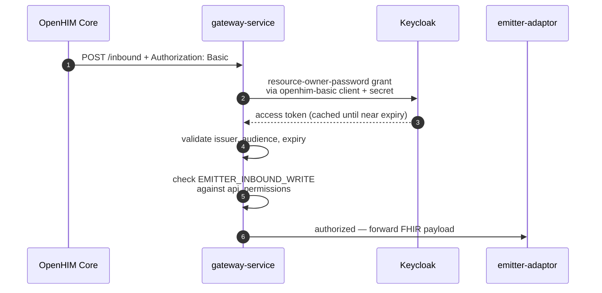

**What makes this acceptable:**

| Property | Detail |
|---|---|
| **Same authorization pipeline** | Once exchanged, the token goes through exactly the same issuer/audience/expiry validation and the same `api_permissions` role check as any bearer caller. Basic is a credential *format* here, not a weaker *path* |
| **Dedicated client** | The exchange uses a confidential client, `openhim-basic`, with Direct Access Grants enabled and Standard Flow and Service Accounts disabled. The bearer-only `gateway-service` client does not enable the password grant at all |
| **Dedicated service account** | The OpenHIM service user holds only `EMITTER_INBOUND_WRITE` — it can post clinical events and nothing else. It cannot read analytics or load protocols |
| **Scoped to one route** | The permission maps to the inbound clinical route alone |
| **Token caching** | Tokens are cached per credential until shortly before expiry, so a high event rate does not translate into a Keycloak request per event |

**What to keep an eye on:**

- The client secret and the service-account password are **real credentials on the clinical ingress path**. They belong in Infisical, in the rotation schedule, and nowhere else.
- The resource-owner-password grant is **deprecated in OAuth 2.1** and treated as legacy by Keycloak. It is the right compatibility bridge today; if OpenHIM ever gains client-credentials support, moving to it removes the last password-grant dependency in the platform.
- Because Basic credentials do not expire on their own, **rotation is the only revocation mechanism.** Confirm the rotation interval as part of [§8.10](#810-deployment-verification-checklist).

#### User onboarding

An Insights user needs an account in the `cce` realm, the `INSIGHTS_READ` client role of `gateway-service`, and a Keycloak "set your password" e-mail (**Credential Reset**), so that nobody else ever knows the password. The step-by-step guide with screenshots is [`uat/USER-ONBOARDING.md`](uat/USER-ONBOARDING.md).

### 7.5 Data protection

| Concern | Control | Status |
|---|---|---|
| **Data in transit — edge** | HTTPS/TLS terminated at Traefik; valid certificate on `cce.moh.gov.rw` | **In place** |
| **Data in transit — emitter → collector** | HTTPS configurable via `server.ssl.*` | **Plain HTTP inside the cluster in Rwanda** |
| **Data in transit — internal** | ClickHouse TLS, Kafka TLS/SASL are supported | **Not used in Rwanda:** Kafka listens `PLAINTEXT`, ClickHouse without TLS; both are closed to the outside by UFW |
| **Data at rest — PostgreSQL** | Host-level disk encryption | **Deployment responsibility — not enforced by the application** |
| **Data at rest — ClickHouse** | ClickHouse disk encryption; sensitive fields reachable only by authorised roles | Deployment responsibility |
| **Data at rest — backups** | Gzipped dumps on local disk | **Not encrypted at rest by the backup script** |
| **Payload size limit** | 1 MB per event, enforced at the Collector | In place |
| **Least privilege — analytics** | ClickHouse `cce_pipeline` is a **read-only** user; an explicit read-only profile exists | In place |
| **Least privilege — CDC** | Debezium uses a dedicated `cce_cdc_user` PostgreSQL role | In place |
| **Least privilege — insights** | The Insights Service issues no writes at all, by construction | In place |
| **Pseudonymisation** | Patient identifiers are programme UPIDs, not names | In place |
| **Clinical-data minimisation** | The emitter strips clinical content and the patient name before forwarding ([§6.2](#62-what-clinical-data-cce-actually-holds)) | **In place** in Rwanda; check the emitter logs `redaction ACTIVE` after every rebuild |
| **Container hardening** | Services run as non-root (`appuser`); multi-stage builds ship a JRE, not a JDK | In place |
| **CSRF** | Disabled on the stateless APIs — correct for token-authenticated, non-cookie services | By design |

### 7.6 Audit and traceability

**What is auditable today:**

| Question | Answer source |
|---|---|
| What did we receive, and when? | `inbound_event_log` — every request, accepted or rejected, with the raw body and both clocks |
| Why was an event rejected? | `inbound_event_log.rejection_reason` + `error_details`, and a Prometheus counter tagged by reason |
| What happened to a patient's care, and in what order? | `protocol_instance_history` + `step_instance_history` — every status transition, append-only |
| Which event completed this step? | `step_instance.matched_event_id` → `matcher_event_log` |
| When did this deadline fall, and when was it applied? | `step_sla_state_transition.process_by` (immutable) and `processed_at` / `processed_by` |
| What intelligence fired, why, and did it reach the broker? | `intelligence_event_log` — evaluated expression, runtime context, published flag, published timestamp |
| Which service instance applied this SLA verdict? | `step_sla_state_transition.processed_by` |

**Logging.** Structured JSON logs in production, with `correlationId` in the MDC for the life of an event, so every line for one event is greppable by a single key. Intelligence evaluation additionally puts `intelligenceEventId` into the MDC.

**What is *not* auditable today:**

- **No actor attribution on definitional changes.** The `audit_log` table was dropped in 2.0.0 and per-row actor columns have not yet landed. Who loaded or retired a protocol is currently recoverable only from application logs.
- **No distributed tracing.** Correlation is by MDC field, not spans.
- **Out-of-band SQL is invisible.** The history tables capture only changes made through the service layer.
- **Log retention is short and can destroy evidence.** Container logs live only as long as k3s keeps them (a few rotated files per pod, lost when the pod is replaced). A chatty service can roll its log within hours — long enough to lose evidence of an intermittent fault. Nothing ships logs off the machine.

### 7.7 Known gaps and hardening backlog

Recorded honestly. None of these is a defect in the sense of "something broke"; each is a decision that has not yet been made or a control that has not yet been added.

| # | Gap | Impact | Recommended action |
|---|---|---|---|
| 1 | **No application-layer auth on internal services** | Anything with network reach to the Protocol Service can rewrite clinical protocols | Enforce network policy around the definitional plane; consider mTLS or service-level tokens |
| 2 | **Default passwords in packaged config** | Several services' `application.yml` files carry default database credentials (`cce_user` / `cce_pass`) | Confirm every deployed service takes its credentials from Infisical; **rotate anything real before wider repository access is granted** |
| 3 | **No actor attribution on protocol changes** | A protocol change cannot be attributed to a person from the database | Add actor columns to the definitional tables |
| 4 | **Backups unencrypted and on the same disk as the data; secret store not backed up** | Losing the VM loses the data, its backups and, in Rwanda, every secret (the Infisical database is not in the backup) | Copy nightly archives and the Infisical key off-box; encrypt at rest. See [§8.7](#87-backups-and-recovery) |
| 5 | **Restores not yet rehearsed** | *A backup you have never restored is a hypothesis*. In Rwanda the Keycloak restore is tested; the `ccedb` restore procedure is not yet settled | Resolve the `ccedb` restore, then drill it on a scratch database |
| 6 | **Mutable image tags** | A `:latest` tag means you cannot tell from the tag what code is running | **Closed in Rwanda:** images are built on the machine and tagged `<branch>-<commit>` ([§8.3](#83-how-the-software-gets-there)) |
| 7 | **No data-subject erasure path** | Raw payloads persist in PostgreSQL indefinitely, in Kafka for 7 days, and in backups for 10 days | Define an erasure procedure against Rwandan data-protection requirements |
| 8 | **No cold-tier archival** | The 90-day ClickHouse TTL is a hot-tier policy, not a retention policy | Configure archival to object storage with a compliance-driven TTL |
| 9 | **Basic-auth credentials on the clinical ingress path** | OpenHIM authenticates with HTTP Basic over a deprecated OAuth grant. Credentials do not expire on their own, so **rotation is the only revocation mechanism** | Keep the `openhim-basic` client secret and service-account password in Infisical with a defined rotation interval; move to client credentials if OpenHIM ever supports it. See [§7.4.3](#743-the-openhim-basic-auth-path) |
| 10 | **No ingestion-freshness alert, and no alert delivery at all** | CCE is a passive observer, so a silent upstream stop is indistinguishable from a quiet clinical period. In Rwanda no alert reaches anyone: there is no Alertmanager or Grafana contact point | Deliver alerts; then alert on *"no new rows in `inbound_event_log` for N hours"* — see [§8.6](#86-monitoring) |
| 11 | **No internal transport TLS or Kafka authentication** | Kafka (`PLAINTEXT`, no SASL), ClickHouse and Kafka Connect's REST API rely on the host firewall alone; anyone on the machine, or past UFW, can read the event stream | Keep UFW strict; consider TLS/SASL if the services ever leave the single machine |
| 12 | **No OpenAPI specifications** | API contracts are Markdown, so they cannot be linted, mocked or contract-tested | Generate OpenAPI from the controllers |
| 13 | **One shared database role** | In Rwanda every CCE service and Keycloak connect as `admin`, so a compromised service can write any table, including another service's | Per-service roles with grants matching the table ownership in [§6.3](#63-postgresql-ccedb--the-system-of-record) |

---

## 8. Rwanda deployment

This section describes how CCE 2.0.0 is deployed for the Rwanda Ministry of Health: the machines, the services on them, how
the software gets there, and how the platform is run. It describes the **one-click deployment**: each environment on its own
machine, installed by `rw/one-click-install.sh`, with the CCE services built on that machine from the RW-MOH GitLab.

Facts marked "on UAT" were checked on 102.215.10.21 on **2026-11-17**. PROD is installed the same way from the same branches
(`rw/config/prod.env` was made from `uat.env`), so it differs only where §8.2 says so. Day-to-day procedures are in the
operations runbook, not here: [`uat/OPERATIONS-RUNBOOK.md`](uat/OPERATIONS-RUNBOOK.md).

### 8.1 Deployment diagram

One machine per environment. Arrows follow the **direction of the request**. The Kafka broker appears three times, once per
topic family it carries; it is one broker on one port.

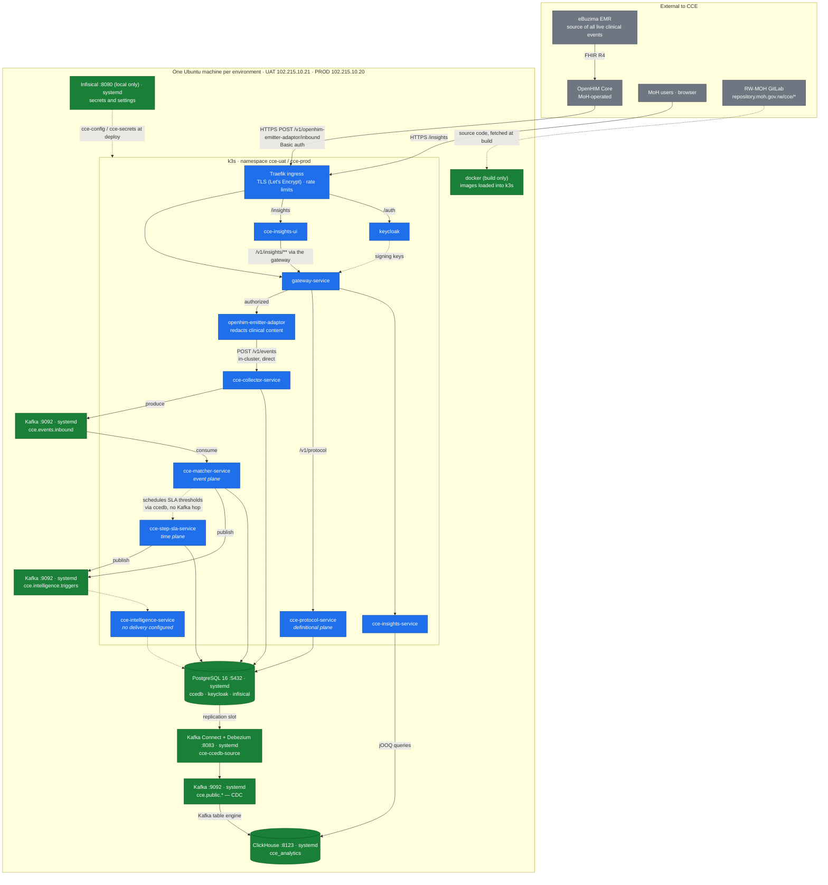

**Legend.** Blue: pod in k3s. Green: native `systemd` service on the machine, **not** in Kubernetes. Grey: outside CCE.

> **Three things this diagram makes explicit.**
>
> **Kubernetes is only half the system.** PostgreSQL, Kafka, Kafka Connect, ClickHouse and Infisical run **natively under
> systemd**. Restarting a pod never fixes a database problem, and `kubectl` does not show these services; use `systemctl`.
>
> **Two write paths, one source of truth.** PostgreSQL `ccedb` is authoritative. ClickHouse `cce_analytics` is a derived
> mirror, rebuilt from PostgreSQL by CDC. If analytics look wrong, rebuild the mirror; never edit ClickHouse by hand.
>
> **Nothing is pulled from a registry.** Every CCE image is built on the machine from the RW-MOH GitLab and loaded straight
> into k3s (§8.3).

### 8.2 Environments and machines

| | **UAT** | **PROD** |
|---|---|---|
| Machine | `102.215.10.21` | `102.215.10.20` |
| Hostname | `cce-prod` (**misleading**) | `cce-uat` (**misleading**) |
| Public name | `cceuat.moh.gov.rw` | `cce.moh.gov.rw` |
| Status (2026-11-17) | installed 2026-11-04, in use | old 1.x system removed; waiting for the install with [`prod/INSTALL-GUIDE.md`](prod/INSTALL-GUIDE.md) |
| OS · size | Ubuntu 22.04 · 8 CPU · 22 GB · 490 GB disk (18% used) | Ubuntu 26.04 · 16 CPU · 48 GB · 736 GB disk |
| Installer config | `rw/config/uat.env` | `rw/config/prod.env` |
| Namespace · overlay | `cce-uat` · `k8s/overlays/rw-uat` | `cce-prod` · `k8s/overlays/rw-prod` |
| Replicas | 1 of every service (`HPA_REPLICAS=1`) | PROD's HPAs: collector, gateway, emitter 2–3; the rest 1–3 |
| Secrets | local Infisical, project `cce-uat` | local Infisical, project `cce-prod` |
| Backups | `/var/backups/cce-uat/` | `/var/backups/cce-prod/` |

> **The hostnames are swapped.** 102.215.10.21 is called `cce-prod` and is **UAT**. Always go by IP, and confirm the
> environment by namespace (`cce-uat` / `cce-prod`).

The two environments share nothing: each machine has its own k3s, databases, Kafka, Infisical and Keycloak. All services use
their **standard ports**:

| Port | What | Reachable from outside |
|---|---|---|
| 22 | SSH | yes |
| 80, 443 | Traefik (k3s ingress) | yes |
| 5432 | PostgreSQL 16 | no (UFW) |
| 8080 | Infisical | no (127.0.0.1 only) |
| 8083 | Kafka Connect REST (no authentication) | no (UFW) |
| 8123, 9000, 9009, 9363 | ClickHouse HTTP, native, interserver, metrics | no (UFW) |
| 9092, 9094 | Kafka broker, KRaft controller | no (UFW) |
| 9100, 9187, 9308 | node, PostgreSQL and Kafka exporters | no (UFW) |
| 9443 | Portainer | no |

UFW is default-deny with only 22, 80 and 443 open, and `cce-docker-fw` blocks docker-published ports. Details:
[`uat/SECURITY.md`](uat/SECURITY.md) §4 and [`uat/CONFIG-REFERENCE.md`](uat/CONFIG-REFERENCE.md) §3.

**Reaching a machine:** `ssh cceadmin@<ip>`, then `cd /home/cceadmin/deploy-scripts`. No credentials file exists. Every login
the installer created is read live from Infisical with `sudo bash one-click-installer/tools/show-credentials.sh <uat|prod>`
(`--reveal` prints the passwords).

> **A sudo gotcha.** Environment variables must come **after** `sudo`, because sudo resets the environment.
> `FORCE_REBUILD=1 sudo bash …` silently drops the variable. Use `sudo env FORCE_REBUILD=1 bash …`.

### 8.3 How the software gets there

The installer and the day-2 script build every CCE service **on the machine**, from the RW-MOH GitLab, the way each repo's CI
does. There is no image registry.

| Repository (`repository.moh.gov.rw/cce/…`) | Branch | Deployed on UAT (commit) |
|---|---|---|
| `cce-common-util` | `release-2.0.0` | built into the four services below it |
| `cce-collector-service` | `release-2.0.0` | `bf88e5d74e` |
| `cce-protocol-service` | `release-2.0.0` | `529c0b6ddd` |
| `cce-matcher-service` | `release-2.0.0` | `7be6f2682e` |
| `cce-step-sla-service` | `release-2.0.0` | `346cf19958` |
| `cce-intelligence-service` | `demo` | `6ae6dfc83f` |
| `cce-insights-service` | `demo-rw-v2` | `3ed690767c` |
| `cce-insights-ui` | `demo-rw-v2` | `a01491ec6e` |
| `gateway-service` | `main` | `37283392e5` |
| `openhim-cce-emitter-adaptor` | `release-1.0.0` | `50e4e5605b` |
| `cce-data-pipeline` | `demo-v2` | ClickHouse schema and Debezium connector, applied by the installer |

- **Image tags are immutable.** Each image is tagged `cce.local/rw/<repo>:<branch>-<commit>`, so the tag says exactly which
  commit is running. A commit that has not changed is not rebuilt, and only services whose image changed are restarted.
- **Pinning and rollback:** set `SRC_<REPO>_BRANCH` in the env's config file to a branch, a tag or a full commit SHA. A
  previously built commit is usually still in k3s, so a rollback deploys at once.
- **Build state** is in `/var/lib/cce-rw/<env>/`: `pins.env` (deployed tags), `build-manifest.tsv` (repo, branch, commit,
  image) and `logs/<repo>.log`.
- **Promotion UAT → PROD:** both config files track the same branches. To give PROD exactly what was verified on UAT, pin
  PROD's `SRC_*_BRANCH` to the commits in UAT's `build-manifest.tsv`.

| I want to… | Command (on the machine, in `~/deploy-scripts`) |
|---|---|
| install, repair, or apply a `cce-data-pipeline` change | `sudo bash rw/one-click-install.sh --config rw/config/<env>.env --yes` |
| pull the latest commits, build and deploy | `sudo bash rw/redeploy-from-source.sh --config rw/config/<env>.env [repo...]` |
| apply a changed Infisical value | `… redeploy-from-source.sh … --deploy-only --restart [repo...]` |

Both are idempotent and safe on a live environment. A deploy rewrites the image tags into the generated overlay, refreshes
`cce-config` / `cce-secrets` from Infisical and applies the **whole** overlay, so a changed manifest (a new env var, a probe) is
picked up too. Full procedures: [`uat/OPERATIONS-RUNBOOK.md`](uat/OPERATIONS-RUNBOOK.md) §5–6 and
[`ONE-CLICK-INSTALL.md`](ONE-CLICK-INSTALL.md).

### 8.4 Services in the deployment

Nine CCE application deployments, plus the supporting stack.

#### CCE application services

| Service | Port | Replicas UAT · PROD | Scales with | Notes |
|---|---|---|---|---|
| `openhim-emitter-adaptor` | 8082 | 1 · 2–3 | Inbound volume | Stateless. Redacts clinical content before forwarding ([§7.5](#75-data-protection)) |
| `cce-collector-service` | 8080 | 1 · 2–3 | Inbound volume | Owns `inbound_event_log` |
| `cce-protocol-service` | 8080 | 1 · 1–3 | Not throughput-bound | Protocol loads only; a second replica buys availability, not throughput. Needs DDL rights |
| `cce-matcher-service` | 8080 | 1 · 1–3 | **Kafka partitions** (25) | No REST API; Kafka-driven. Needs DDL rights. Reads protocols at startup: restart it after a protocol change |
| `cce-step-sla-service` | 8092 | 1 · 1–3 | **Backlog**, not traffic | Creates no tables, needs **no DDL rights**, no REST API. Extra replicas add throughput directly (no leader election, no lease) |
| `cce-intelligence-service` | 8085 | 1 · 1–3 | — | Deployed; delivers nothing today ([§8.9](#89-known-items)) |
| `cce-insights-service` | 8084 | 1 · 1–3 | Query load | Read-only analytics API |
| `cce-insights-ui` | 3001 | 1 · 1–3 | Query load | Static SPA |
| `gateway-service` | 8090 | 1 · 2–3 | Request volume | The only CCE service reachable from outside (through Traefik) |

On UAT, `cce-protocol-service` and `cce-step-sla-service` have an 800m CPU limit (`CPU_LIMIT_OVERRIDES`): at 500m their
start-up outlasted the liveness probe. PROD gets the same override.

#### Supporting services

| Service | Runs as | Version |
|---|---|---|
| Keycloak (realm `cce`) | k3s pod | 26.5.4 |
| Prometheus · Grafana · kafka-ui · node-exporter | k3s pods | 2.51.2 · 10.4.2 · 0.7.2 · latest |
| Traefik | k3s built-in | k3s v1.35.4 on UAT |
| PostgreSQL (`ccedb`, `keycloak`, `infisical`) | systemd `postgresql@16-main` | 16 |
| Kafka (KRaft), Kafka Connect + Debezium | systemd `kafka`, `kafka-connect` | 3.9.2 · Debezium 3.0.0 |
| ClickHouse | systemd `clickhouse-server` | 26.5 |
| Infisical + Redis | systemd `infisical-runsvdir`, `redis-server` | 0.162 |
| postgres_exporter, kafka_exporter | systemd `cce-postgres-exporter`, `cce-kafka-exporter` | |
| Portainer | systemd `cce-portainer` (local only) | |

**No docker containers run.** Docker is installed only to build images; `sudo docker ps -a` should be empty.

#### Deployment order: Protocol → Matcher → Step SLA

**This is not a preference.** The Matcher Service's migration declares foreign keys into tables the Protocol Service creates,
and the Step SLA Service validates its JPA mapping at startup under `ddl-auto: validate`: it **fails fast** rather than start
against a schema that cannot serve it. An ordering mistake therefore shows at once, not as a runtime error hours later.

| Order | Service | Schema role |
|---|---|---|
| 1 | `cce-protocol-service` | Runs Flyway; creates `protocol_definition`, `action_definition`, `trigger_index`. Ledger: `flyway_schema_history_protocol` |
| 2 | `cce-matcher-service` | Runs Flyway; creates the runtime-plane tables. Ledger: `flyway_schema_history_matcher` |
| 3 | `cce-step-sla-service` | Creates nothing. Flyway disabled; validates and fails fast |

The Collector Service owns `inbound_event_log` and migrates independently of the three. On a fresh install the services start
together and the order sorts itself out through restarts: the matcher and step-sla pods may restart a few times until the
protocol service has created its tables.

#### Event Replay: the other sequence, and this one is a runtime one

**Stop `cce-step-sla-service` while `cce-matcher-service` still has an event backlog to process, and start it again only once
that backlog is drained.** The SLA service decides that work has not happened by finding no completion on `step_instance`,
which is only sound once every event that could have completed the step has been matched. Run it against an unmatched backlog
and it records `OVERDUE` and `MISSED` against steps whose completing event is still queued. None of it can be withdrawn: SLA
writes are forward-only, the deviation is de-duplicated, and **the intelligence event has already been published.**

**Event Replay** is any such run: events re-published after a fix, a historical backfill during migration, or a long outage that
left the consumer group far behind. Replaying historical events makes wrong verdicts the default rather than a race, because SLA
thresholds are anchored to *clinical* time: a step created from a month-old event is scheduled with its deadline already in
the past, so it is judged within seconds, long before the completing event later in the same backlog is matched.

Holding the SLA service off costs only detection latency. Its judgement never consults the wall clock, so a row applied days
late reaches exactly the verdict it would have reached on time. Unlike the deployment order above, this sequence **fails
silently**: there is no fail-fast to catch it, only wrong data afterwards. The Rwanda procedure for replacing a protocol and
replaying every event: [`uat/OPERATIONS-RUNBOOK.md`](uat/OPERATIONS-RUNBOOK.md) §12.

> **Replays are limited by Kafka retention.** `cce.events.inbound` keeps 7 days. Once older segments expire, a full replay
> from Kafka is no longer possible; check the topic still starts at offset 0 before relying on it (runbook §12, step 1).

### 8.5 Data stores

| Store | Role | Size on UAT | Access |
|---|---|---|---|
| **PostgreSQL `ccedb`** | **System of record**: all compliance state | 18 MB (1,883 events) | `sudo -u postgres psql -d ccedb` |
| **PostgreSQL `keycloak`** | Identity: users, realms, clients, roles, SMTP settings | 12 MB | same server |
| **PostgreSQL `infisical`** | Every secret and setting of the environment | small | through Infisical only |
| **ClickHouse `cce_analytics`** | **Derived mirror**: analytics tables and MVs | | `clickhouse-client` with Infisical's credentials (runbook §5) |

| CDC component | Identity |
|---|---|
| Replication slot | `cce_analytics_slot` |
| Publication | `cce_analytics_pub` (16 tables) |
| Debezium connector | `cce-ccedb-source`, Kafka Connect REST on `:8083` |

> **Watch the replication slot: the most dangerous silent failure in the platform.** If the Debezium connector stops while
> PostgreSQL keeps writing, the slot retains WAL and the disk fills. `max_slot_wal_keep_size` is 10 GB: past that, PostgreSQL
> drops the slot's WAL instead, the slot becomes `lost`, and ClickHouse has missed changes.
>
> ```bash
> sudo -u postgres psql -d ccedb -c "SELECT slot_name, active, wal_status,
>   pg_size_pretty(pg_wal_lsn_diff(pg_current_wal_lsn(), restart_lsn)) AS retained FROM pg_replication_slots"
> ```

**Rebuilding the analytics mirror.** Deletes in PostgreSQL propagate to ClickHouse through CDC, but **schema changes and
aggregate corrections do not.** When analytics diverge from PostgreSQL, or the slot is `lost`, rebuild rather than patch: drop
`cce_analytics` and re-run the installer, which recreates the schema and the slot and re-snapshots every table. A schema-only
change to existing objects is applied with `one-click-installer/lib/redeploy-clickhouse.sh <env>`. Runbook §5, §9 and §14.

> **ClickHouse keeps high-volume logs for 90 days** ([§6.7](#67-data-retention-and-lifecycle)). Insights counts events from
> `inbound_event_logs`, so periods older than 90 days show zeros although PostgreSQL still has the data. UAT's first events
> (2026-11-04) start dropping out around 2027-02-02. Raise the TTL in `cce-data-pipeline` if Insights must show more.

### 8.6 Monitoring

| Endpoint | Where | Purpose |
|---|---|---|
| Grafana | `https://<public name>/grafana` | Dashboards |
| Prometheus | port-forward to `svc/prometheus:9090` | Targets, alert rules; scrapes every 15 s, keeps 15 days |
| kafka-ui | `/kafka-ui` (404 from outside; reach it through the cluster) | Topic and consumer-group inspection |

**Dashboards:** one per service (collector, matcher, step-sla, intelligence, emitter: JVM, HTTP, throughput); CCE Pipeline
Health (CDC lag, ingestion); and infrastructure: Host, PostgreSQL, PostgreSQL Query Analytics, Kafka, ClickHouse Query
Analytics. Grafana's data sources are Prometheus, ClickHouse and PostgreSQL.

**Exporters:** node-exporter :9100 · postgres_exporter :9187 · kafka_exporter :9308 · ClickHouse built-in :9363.

#### Signals worth watching

| Signal | Why it matters |
|---|---|
| `cce.sla.transitions.due` (gauge) | **The key scaling signal for the Step SLA Service.** Scale on this, not CPU: the service is database-bound, and a backlog shows here long before it shows as CPU |
| `cce.events.matched` (counter, tagged `matched` / `zero_match`) | Whether events find protocols at all. A rising `zero_match` share usually means a protocol or trigger problem, not an infrastructure one |
| `cce.events.processing.duration` (timer) | End-to-end matcher latency |
| `cce.intelligence.actions.fired` (counter) | Whether intelligence fires as expected |
| `cce.clinical_time.unmapped` / `.unparseable` (counters, by resource type) | Events whose clinical time could not be resolved and fell back to envelope time |
| Consumer-group lag on `cce.events.inbound` | The matcher's parallelism ceiling is the partition count (25) |
| Replication slot retained WAL | The disk-fill risk in [§8.5](#85-data-stores) |
| Freshness of `inbound_event_log` | See below |

> **Alerts are not delivered.** Prometheus has two rules (`ServiceDown`, `HighMemoryUsage`), but there is no Alertmanager and
> no Grafana contact point, so nobody is notified. The emitter's redaction alerts are not loaded. Until alerts are delivered,
> the daily health check (§8.8) is the monitoring.

> **Recommended addition: an ingestion-freshness alert.** Nothing alerts on *"no new rows in `inbound_event_log` for N
> hours"*. Because CCE is a passive observer, a silent upstream stop looks exactly like a quiet clinical period. This is the
> single most valuable monitoring rule to add.

> **Grafana timezone.** Dashboards render in the *viewer's* browser timezone; server timestamps are UTC. Reconcile against UTC
> before concluding that an event did or did not happen.

### 8.7 Backups and recovery

| | |
|---|---|
| **Schedule** | 02:00 daily, root crontab, `rw/lib/backup-db.sh <env>` |
| **Location** | `/var/backups/cce-<env>/<YYYYMMDD>/`, log in `/var/backups/cce-<env>/backup.log` |
| **Retention** | 10 days (`RETENTION_DAYS` in `rw/lib/install-cron-backups.sh`) |
| **Contents** | `pg-ccedb-*.sql.gz`, `pg-keycloak-*.sql.gz` (plain SQL with `--clean`), `clickhouse-cce_analytics-*.sql.gz` |

```bash
sudo tail -20 /var/backups/cce-uat/backup.log     # the last runs
sudo ls -lh /var/backups/cce-uat/                 # what is kept
```

> **Three risks to accept or fix.**
>
> **Backups stay on the machine.** Losing the VM loses the data and its backups together. Copying them off the machine is the
> most valuable resilience improvement available.
>
> **The Infisical database is not backed up.** The backup covers `ccedb` and `keycloak` only. Losing the VM loses every
> secret of the environment. Back up `infisical` too, and keep `/opt/cce-local-infisical/` (its encryption key) and
> `/home/cceadmin/.cce-infisical/` off the machine; a dump is useless without the key.
>
> **A `ccedb` restore is not yet a tested procedure.** The dumps carry no owner, and the CDC publication is owned by
> `postgres`, so neither a plain restore nor `SET ROLE admin` gives the right result. The Keycloak restore is tested
> (`SET ROLE admin`). Restore procedures and the open problem: [`uat/DISASTER-RECOVERY.md`](uat/DISASTER-RECOVERY.md).

**ClickHouse does not strictly need backing up:** it can be rebuilt from PostgreSQL through CDC (§8.5). The dump makes recovery
*faster*, not *possible*. **The PostgreSQL and Keycloak dumps, and the Infisical database with its key, are irreplaceable.**

### 8.8 Routine operations

Everything Rwanda-specific is in `/home/cceadmin/deploy-scripts/rw/` on each machine (a clone of the `deploy-scripts-rw`
branch; update it with `git pull`). Start with [`../README.md`](../README.md); the runbook has every procedure.

| Document | Covers |
|---|---|
| [`uat/OPERATIONS-RUNBOOK.md`](uat/OPERATIONS-RUNBOOK.md) | health check, logs, deploy, config, backups, OpenHIM, CDC, TLS, troubleshooting, protocols, admin tasks, maintenance, monitoring, scaling |
| [`uat/SECURITY.md`](uat/SECURITY.md) | secrets, credential rotation, firewall, authentication, rate limits, redaction, open items |
| [`uat/DISASTER-RECOVERY.md`](uat/DISASTER-RECOVERY.md) | data and machine loss, restore tests |
| [`uat/CONFIG-REFERENCE.md`](uat/CONFIG-REFERENCE.md) | event flow, ports, every configuration key |
| [`uat/USER-ONBOARDING.md`](uat/USER-ONBOARDING.md) | giving someone access to the Insights dashboard |
| [`prod/INSTALL-GUIDE.md`](prod/INSTALL-GUIDE.md) | installing PROD, step by step |
| [`ONE-CLICK-INSTALL.md`](ONE-CLICK-INSTALL.md) | how the installer works |

PROD's own runbook will be written once PROD is installed; until then PROD is run like UAT, with `rw/config/prod.env` and
namespace `cce-prod`.

#### Daily health check

```bash
sudo k3s kubectl -n cce-uat get pods                                   # all 1/1 Running
for s in postgresql@16-main kafka kafka-connect clickhouse-server infisical-runsvdir redis-server \
         cce-postgres-exporter cce-kafka-exporter cce-portainer; do printf '%-24s %s\n' $s "$(systemctl is-active $s)"; done
curl -s localhost:8083/connectors/cce-ccedb-source/status | python3 -m json.tool | grep state   # all RUNNING
sudo tail -3 /var/backups/cce-uat/backup.log                           # last night's backup
```

#### Ingestion freshness: the check to run most often

```bash
sudo -u postgres psql -d ccedb -tAc \
  "SELECT max(received_at), count(*) FILTER (WHERE received_at > now() - interval '24 hours') FROM inbound_event_log;"
```

If `max(received_at)` is not recent, events have stopped arriving. **Begin with OpenHIM and the emitter's logs, not with CCE's
internals** (runbook §8): a wrong `X-OpenHIM-ClientID` gets 200 "ignored" and stores nothing.

#### SLA backlog

```bash
sudo -u postgres psql -d ccedb -tAc \
  "SELECT count(*) FROM step_sla_state_transition WHERE is_processed = false AND next_attempt_at < now();"
```

A number that grows steadily means the Step SLA Service is not keeping up: add a replica. A number that grows *and* whose rows
carry a high `attempts` count means transitions are failing, not just queuing. A large number straight after an Event Replay is
expected: every deadline that fell while the service was stopped comes due at once, and batches drain within a cycle.

#### Unpublished intelligence

```bash
sudo -u postgres psql -d ccedb -tAc "SELECT count(*) FROM intelligence_event_log WHERE NOT published;"
```

Intelligence that was evaluated but never acknowledged by the broker. These rows are the replay candidates.

#### Secrets and configuration

All secrets and service settings are in the environment's local **Infisical** and become the `cce-config` ConfigMap and
`cce-secrets` Secret at deploy time. `sudo bash one-click-installer/lib/infisical-run.sh <env> <command>` runs a command with
the secrets in its environment. Repos, branches, versions, sizing and the public name are in `rw/config/<env>.env`, which holds
**no secrets**. The machine's IP is detected at every deploy, never stored.

| Variable | Service | Note |
|---|---|---|
| `DB_USERNAME` / `DB_PASSWORD` | All | Generated by the installer. Never use the packaged defaults (`cce_user` / `cce_pass`) |
| `CCE_FLYWAY_BASELINE_VERSION` | Protocol, Matcher | `0` for a new database. Non-zero would make a fresh deployment skip schema creation |
| `CCE_SLA_INSTANCE_ID` | Step SLA | Defaults to `$HOSTNAME`, distinct per pod. It lands in `processed_by`, which identifies a misbehaving replica |
| `CCE_SLA_POLL_INTERVAL_MS` / `CCE_SLA_BATCH_SIZE` | Step SLA | Defaults `5000` / `100` |
| `KEYCLOAK_ISSUER` → gateway `JWT_ISSUER` | Gateway | Derived from the public name: `https://<INGRESS_HOST>/auth/realms/cce`. Must match the token issuer exactly |
| `EBUZIMA_CLIENT_ID` | Emitter | `ebuzima`, fixed in the manifest, not in Infisical. Only that OpenHIM client's events are accepted |

> **Do not edit these.** Several repositories contain **stale build output committed to git**: `bin/main/application*.yml`
> in `cce-insights-service`, `cce-intelligence-service` and `openhim-cce-emitter-adaptor`. Editing them has no effect. The
> live config is under `src/main/resources/`, and in practice Infisical overrides it.

### 8.9 Known items

> #### 🟡 Facility attribution is incomplete by design of the source
>
> A large share of analytics events carry no facility and appear as "Unassigned" in facility rankings. **This is not a CCE
> defect.** eBuzima attaches no facility reference to certain FHIR resource types: vitals, BMI, allergies, chief complaints,
> diagnoses, lab results and a small share of medication requests arrive with no `source-facility` extension, no
> `Encounter.location` and no facility field. Encounters and service requests *do* carry it. Closing the gap needs a change on
> the eBuzima side.

> #### 🟡 Intelligence delivery is not in use
>
> **`cce-intelligence-service` is deployed but delivers nothing.** No receiver adaptor is integrated with any Rwandan system:
> `receiver_adaptor`, `destination_adaptor_mapping` and `intelligence_delivery` are empty on UAT, in PostgreSQL and in their
> ClickHouse mirrors. The service's tiered alert e-mails are configured (SMTP and recipients in Infisical) but **switched
> off** (`CCE_OPSALERT_NOTIFICATIONS_ENABLED=false`).
>
> **What this does and does not mean.** CCE still *detects* everything it is designed to detect: deviations are recorded, and
> where a protocol defines intelligence actions they are evaluated into `intelligence_event_log` (the protocol loaded in
> Rwanda defines none, so that table is empty on UAT). What does not happen is **delivery**: no alert, task or escalation
> reaches anyone. **Compliance tracking, deviation detection and the analytics dashboard are unaffected**; they are what the
> deployment delivers today.

#### Housekeeping backlog

- **Backups on the machine only, and the Infisical database not backed up** ([§8.7](#87-backups-and-recovery)).
- **No alert delivery, and no ingestion-freshness alert** ([§8.6](#86-monitoring)).
- **`ccedb` restore procedure unresolved** ([§8.7](#87-backups-and-recovery)).
- **SSH password login is on, and port 22 is open to all** ([`uat/SECURITY.md`](uat/SECURITY.md) §7).
- **Default passwords** in several services' packaged `application.yml` files. The deployment overrides them; rotate anything
  real before wider repository access is granted.
- **Retention policy undecided**: see [§6.7](#67-data-retention-and-lifecycle).

### 8.10 Deployment verification checklist

Each item is verifiable: you should be able to demonstrate it, not assume it. For PROD, work through it after the install.

**Access**

- [ ] SSH to the machine (UAT `102.215.10.21`, PROD `102.215.10.20`) with your own credentials
- [ ] `show-credentials.sh <env>` lists every login
- [ ] Sign in to the Keycloak admin console and switch to the `cce` realm
- [ ] Open Grafana and check the CCE dashboards render
- [ ] Open the local Infisical (through an SSH tunnel) and read a secret
- [ ] `rw/one-click-install.sh --config rw/config/<env>.env --check-only` passes (GitLab access and branches)

**Platform health**

- [ ] The health check (§8.8) is clean, and you can interpret every line
- [ ] All CCE deployments are `Ready` in the namespace
- [ ] Native services active: `postgresql@16-main`, `kafka`, `kafka-connect`, `clickhouse-server`, `infisical-runsvdir`
- [ ] Replication slot active, `wal_status` `reserved`, retained WAL small
- [ ] Debezium connector `cce-ccedb-source` `RUNNING`
- [ ] The emitter logged `Clinical-data redaction ACTIVE` at startup
- [ ] UFW active with only 22, 80 and 443 open; `cce-docker-fw` active

**Function**

- [ ] Load the protocol (`rw/protocols/emr-service-protocol.json`) and check `trigger_index` rows appear
- [ ] Trace a clinical event from OpenHIM to a `step_instance` row
- [ ] A step past its due date reaches `sla_status = OVERDUE` with a matching `deviation` row
- [ ] The SLA backlog query returns a stable number (§8.8)
- [ ] Onboard a test user end to end: the e-mail arrives and the dashboard loads **without a 403**
- [ ] Postgres and ClickHouse row counts match

**Operations**

- [ ] Run `rw/redeploy-from-source.sh` on UAT for one repo, and read `build-manifest.tsv` afterwards
- [ ] Pin a commit in PROD's config and deploy it
- [ ] Find last night's backup and check it completed
- [ ] Restore `keycloak` from a backup on a scratch database

**Agree with the delivery team**

- [ ] Who owns the OpenHIM/eBuzima integration contact
- [ ] Escalation path and expected response times
- [ ] Where secrets are rotated, and how often
- [ ] Whether backups, and the Infisical key, move off the machine, and who does it
- [ ] A date for the first restore drill
- [ ] The data-retention policy ([§6.7](#67-data-retention-and-lifecycle))

## Appendix A — Source repositories and documentation

Every service carries its own `docs/` folder with a consistent structure. To understand a service in depth, start with its `architecture-overview.md`, then `api-reference.md`.

> **Documentation convention.** Most repositories follow the same six-file pattern: `architecture-overview.md` · `api-reference.md` · `data-dictionary.md` · `deployment-guide.md` · `developer-setup.md` · `flow-diagrams.md`. Services that use Kafka add `kafka-events.md` carrying the CloudEvents contracts.

The repositories below are the ones Rwanda builds from, on the RW-MOH GitLab (`repository.moh.gov.rw/cce/…`). The branch is the one in `rw/config/<env>.env` on 2026-11-17 ([§8.3](#83-how-the-software-gets-there)).

| Repository | Branch | Stack | Notable documentation |
|---|---|---|---|
| `cce-common-util` | `release-2.0.0` | Shared Java library | **`docs/architecture-overview.md` is the best system-level starting point**; `data-dictionary.md` is the canonical shared schema |
| `openhim-cce-emitter-adaptor` | `release-1.0.0` | Spring Boot 3.4, Java 21, Gradle KTS | Full set plus `openhim-channel-setup.md`, `monitoring-alerting.md`; the redaction rules in `data-dictionary.md` §3.6 |
| `cce-collector-service` | `release-2.0.0` | Spring Boot 3.4, Postgres, Kafka, Flyway | Full set plus `operations-runbook.md`, `kafka-events.md` |
| `cce-protocol-service` | `release-2.0.0` | Spring Boot 3.4, Java 21 | `api-reference.md`, `architecture-overview.md`, `deployment-guide.md`, `developer-setup.md` |
| `cce-matcher-service` | `release-2.0.0` | Spring Boot 3.4, Java 21 | Full set plus `kafka-events.md`, `sample-plan-definition.md` |
| `cce-step-sla-service` | `release-2.0.0` | Spring Boot 3.4, Java 21, Postgres (no Flyway), Kafka produce-only. Scheduled `FOR UPDATE SKIP LOCKED` sweep — **no leader election** ([§4.4](#44-cce-step-sla-service--the-time-plane)) | `api-reference.md`, `architecture-overview.md`, `deployment-guide.md`, `developer-setup.md` |
| `cce-intelligence-service` | `demo` | Spring Boot 3.4, Kafka, Flyway | Full set plus `insights-optimization.md` |
| `cce-insights-service` | `demo-rw-v2` | Spring Boot 3.4, jOOQ → ClickHouse | Full set. `RELEASE_NOTES.md`, `.env.example` |
| `cce-insights-ui` | `demo-rw-v2` | React 18 + TS, Vite 6, Tailwind 4 | `api-integration.md`, `deployment-guide.md`, `pages-and-wireframes.md`, `developer-setup.md` |
| `gateway-service` | `main` | Spring Boot 3.5, Spring Cloud Gateway | **No `docs/` folder.** See `README.md`, `DATABASE_PERMISSIONS_MIGRATION.md`, `scripts/README.md` |
| `cce-data-pipeline` | `demo-v2` | ClickHouse + Debezium, SQL & shell | `docs/index.md`, `architecture-overview.md`, `data-flow.md`, `deployment-guide.md`. DDL in `schema/NN-*.sql` |

> **One name for the time-plane service.** Earlier material, including version 1.0 of this document, calls it `cce-compliance-service` (its 1.x name, with a `/v1/compliance/**` read API). In release 2.0.0 as built for Rwanda, the repository, the Spring application name, the deployment and the metric namespace (`cce.sla.*`) are all **`cce-step-sla-service`**, and it has no REST API. The gateway still carries `/v1/compliance/**` permission rows from 1.x; no 2.0 service answers them.

### The `rw/` documentation

All in the `rw/` folder of `deploy-scripts`, branch `deploy-scripts-rw` (mirrored to `repository.moh.gov.rw/cce/deploy-scripts`).

| File | Covers |
|---|---|
| [`../README.md`](../README.md) | Index: what is in `rw/`, where to start |
| `docs/ARCHITECTURE.md` | This document |
| [`ONE-CLICK-INSTALL.md`](ONE-CLICK-INSTALL.md) | How the installer works, phase by phase |
| [`uat/OPERATIONS-RUNBOOK.md`](uat/OPERATIONS-RUNBOOK.md) | Health check, logs, deploy, configuration, backups, OpenHIM, CDC, TLS, troubleshooting, protocols, admin tasks, maintenance, monitoring, scaling |
| [`uat/SECURITY.md`](uat/SECURITY.md) | Secrets, credential rotation, firewall, authentication, rate limits, redaction, open items |
| [`uat/DISASTER-RECOVERY.md`](uat/DISASTER-RECOVERY.md) | Data and machine loss, restore tests |
| [`uat/CONFIG-REFERENCE.md`](uat/CONFIG-REFERENCE.md) | Event flow, ports, every configuration key and where it lives |
| [`uat/USER-ONBOARDING.md`](uat/USER-ONBOARDING.md) | Giving someone access to the Insights dashboard, with screenshots |
| [`prod/INSTALL-GUIDE.md`](prod/INSTALL-GUIDE.md) | Installing PROD on 102.215.10.20, step by step |

---

## Appendix B — Glossary

| Term | Meaning |
|---|---|
| **CloudEvents** | CNCF specification for a standard event envelope. Every inbound clinical event is wrapped in one. |
| **FHIR R4** | HL7 Fast Healthcare Interoperability Resources, release 4 — the clinical payload format. |
| **PlanDefinition** | The FHIR resource CCE uses to express a care protocol: its actions, triggers, timing and ordering. |
| **ActivityDefinition** | The FHIR resource describing what an intelligence action *does* — a notification, a task, a referral. |
| **UPID** | Unique Patient Identifier — the pseudonymous programme identifier carried as the CloudEvent `subject`. |
| **Protocol instance** | One patient's enrolment in one protocol. |
| **Step instance** | One occurrence of one protocol action for one patient. |
| **Deviation** | A recorded departure from the protocol: `OVERDUE`, `MISSED`, or `ORDER_VIOLATION`. |
| **SLA threshold** | A deadline a step can cross — its due date, or its missed date (due date + tolerance days). |
| **Intelligence event** | An advisory event CCE publishes when a rule fires. CCE never acts on it itself. |
| **Trigger index** | An inverted index built at protocol-load time so events can be matched with one indexed lookup. |
| **CDC** | Change Data Capture — streaming PostgreSQL's write-ahead log into the analytics mirror. |
| **Replication slot** | The PostgreSQL object that tracks how far CDC has consumed. **If it stalls, WAL accumulates until the disk fills** (or, past `max_slot_wal_keep_size`, the slot is lost). |
| **Materialized view (MV)** | A ClickHouse pre-aggregation maintained at insert time. |
| **`FINAL`** | The ClickHouse modifier forcing row deduplication at query time. |
| **Emitter adaptor** | The mediator that converts a source system's FHIR into CloudEvents for CCE. In Rwanda it also redacts clinical content. |
| **Receiver adaptor** | The component that converts a CCE intelligence event into a target system's record. Planned for a later phase; **none is integrated today**. |
| **Event Replay** | Any run where the Matcher Service has an event backlog to work through — events re-published after a fix, a historical backfill, or a long outage. The Step SLA Service **must be stopped** for the duration, or it records deviations against steps whose completing event has not been matched yet. See [§8.4](#event-replay-the-other-sequence-and-this-one-is-a-runtime-one). |
| **Infisical** | The secrets manager holding all environment configuration, one local instance per machine. It replaced `.env` files. |
| **One-click installer** | `rw/one-click-install.sh`: installs a whole environment on one machine and builds the CCE services there from GitLab. Re-running it repairs the environment. |

---

## Appendix C — Sources and verification status

This document was assembled from the following sources. Statements are traceable to them.

| Source | Ref used | Status |
|---|---|---|
| `cce-common-util/docs` | `release-2.0.0` | Current at 1.0 (2026-09-08) |
| `openhim-cce-emitter-adaptor/docs` | `release-1.0.0` | Current at 1.0 |
| `cce-collector-service/docs` | `release-2.0.0` | Current at 1.0 |
| `cce-protocol-service/docs` | `release-2.0.0` | Current at 1.0 |
| `cce-matcher-service/docs` | `release-2.0.0` | Current at 1.0 |
| `cce-step-sla-service/docs` | `release-2.0.0` | Current at 1.0 |
| `cce-data-pipeline/docs` | `demo` | See the drift table below |
| `cce-insights-service/docs` | `demo-rw` | See the drift table below |
| `cce-insights-ui/docs` | `demo-rw` | See the drift table below |
| `gateway-service` | `main` (`README.md`, `DATABASE_PERMISSIONS_MIGRATION.md`) | No `docs/` folder exists |
| The UAT machine, 102.215.10.21, and the `rw/` documents | `deploy-scripts-rw`, 2026-11-17 | §8 and the Rwanda notes in §3, §6 and §7 were checked on the machine on that date |

### Known documentation drift

| Item | Drift | Which to trust |
|---|---|---|
| **Analytics tier schema** | The `cce-data-pipeline` and `cce-insights-service` documentation still describes an earlier `step_instance` shape (`state`, `completion_status`, `overdue_date`, `missed_date`). Release 2.0.0 uses the `step_status` / `sla_status` pair described in [§4.5](#45-the-two-status-model--the-heart-of-the-data-model) | **§4.5 and §6.3** are authoritative for the 2.0.0 data model |
| **Service ports** | The gateway is documented as `:8081` in its README and `:8060` in the UI docs, and runs on `:8090` in Rwanda; the collector appears as both `:8080` and `:8081` | **§8.4** is authoritative for the deployment |
| **Branches** | Rwanda builds the analytics side from `demo-v2` / `demo-rw-v2`, newer than the `demo` / `demo-rw` branches the 1.0 sources were read from | The branches in [§8.3](#83-how-the-software-gets-there) |
| **The time-plane service's name** | 1.x material says `cce-compliance-service` | `cce-step-sla-service` (Appendix A) |

---

*Prepared for the OpenPHC Care Coordination Engine customer technical review. Architecture and data-model content (§1–§7) is drawn from the service repositories at the references listed in Appendix C. §8 and the Rwanda-specific notes elsewhere describe the one-click deployment and were checked on UAT (102.215.10.21) on 2026-11-17; PROD (102.215.10.20) is installed from the same configuration.*
